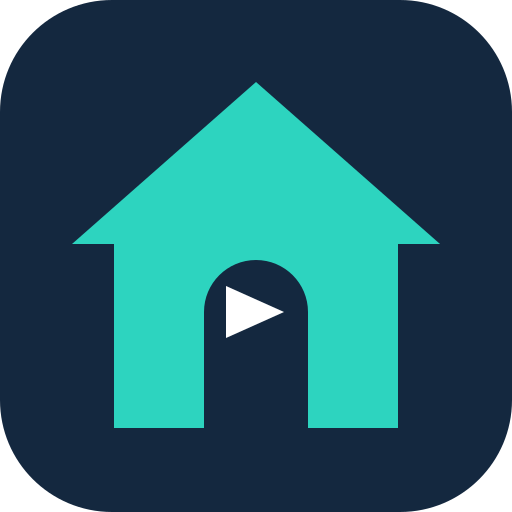
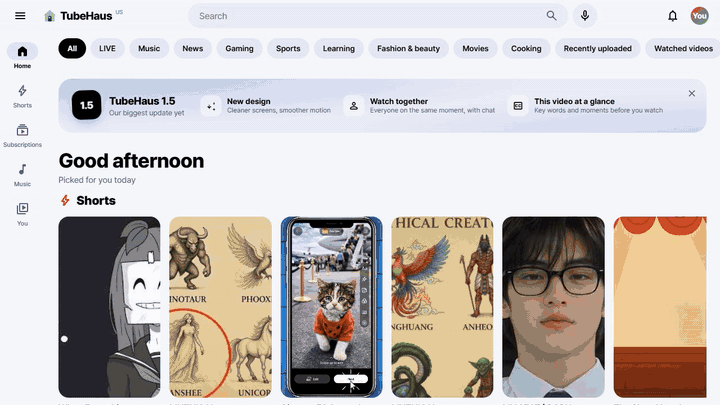

<div align="center">



# TubeHaus (튜브하우스)

### 늘 쓰던 그 유튜브, 구글의 눈길만 빼고.

TV, 폰, PC, 아이패드에서. 내 서버에 돌리거나, 그냥 앱을 깔거나. 한국인이 만들었어요!

[](https://github.com/biolend83/tubehaus/releases)
[](LICENSE)
[](https://github.com/biolend83/tubehaus/actions/workflows/check.yml)

[](https://selfh.st/weekly/2026-10-23/)

**[⬇ 앱 받기](#앱-받기)** &nbsp;·&nbsp; **[🖥️ 서버 설치](#빠른-설치-docker)** &nbsp;·&nbsp; **[📖 어떻게 재생하나](#어떻게-재생하나)** &nbsp;·&nbsp; **[❓ 자주 묻는 질문](#자주-묻는-질문)** &nbsp;·&nbsp; [English](README.md) · **한국어**


<a href="https://www.producthunt.com/products/tubehaus?embed=true&amp;utm_source=badge-featured&amp;utm_medium=badge&amp;utm_campaign=badge-tubehaus" target="_blank" rel="noopener noreferrer"></a>
<a href="https://fazier.com" target="_blank"></a>

<sub>독립 오픈소스 소프트웨어이며 YouTube·Google과 관계없어요. [면책 조항](#면책-조항)을 꼭 읽어 주세요.</sub>

</div>

## 한눈에

<table>
<tr>
<td width="33%" valign="top">

### 🎬 생김새가 *그냥* 유튜브
같은 홈 화면, 같은 플레이어, 같은 단축키. 집에서 아무도 새로 배울 게 없고, TV에는 리모컨용 화면이 따로 있어요.

</td>
<td width="33%" valign="top">

### 🔒 구글에 주는 건 없음
구글 계정도, 광고도, 추적 스크립트도 없어요. 구독, 기록, 재생목록은 내 기기나 내 서버에 있고, 어떤 형식으로든 내보낼 수 있어요.

</td>
<td width="33%" valign="top">

### 🏠 온 집이 보관함 하나
TV에서 멈추고 폰에서 이어 봐요. 집의 모든 기기와 브라우저가 보관함 하나를 같이 쓰거나, 사람마다 따로 써요.

</td>
</tr>
<tr>
<td colspan="3" valign="top">

### 🛡️ 유튜브가 막아도 계속 재생
다른 길이 막히면 youtube.com이 직접 쓰는 **SABR**로 넘어가요. BotGuard 토큰도 직접 만들고 계정은 필요 없어요. 서버에서는 막힌 주소를 스스로 새 주소로 바꿔요. [어떻게 돌아가나요](#어떻게-재생하나)

</td>
</tr>
</table>

## 어떤 TubeHaus를 쓸까요

두 가지 방식이 있어요. 이름도 생김새도 같고, 일하는 *곳*만 달라요.

| | 📱 **앱** | 🖥️ **서버판** (이 브랜치) |
|---|---|---|
| **이럴 때** | 폰, TV, PC 한 대에서, 오늘 바로, 설정 없이 | 온 가족이 같이 쓰기, 아이폰/아이패드에서 설치 없이, 유튜브가 내 기기 주소를 모르게 |
| **돌아가는 곳** | 안드로이드, 안드로이드 TV / 구글 TV, Windows, macOS, 리눅스, 아이패드/아이폰 | Docker가 되는 아무 서버: 클라우드, 집 PC, 라즈베리파이. 보는 건 아무 브라우저 |
| **유튜브와 통신하는 쪽** | 기기가 직접, 앱 안의 자체 엔진으로 | 내 서버가 자체 엔진으로, Cloudflare WARP를 거쳐서. 기기는 내 서버하고만 통신해요 |
| **유튜브가 보는 주소** | 내 기기 주소. 다른 유튜브 앱과 같아요 | Cloudflare WARP 주소. 우리 집 주소가 아니에요 |
| **보관함** | 그 기기에, 또는 내 TubeHaus 서버와 같이 | 서버에. 모든 기기와 사람이 같이 써요 |
| **여기에만 있는 것** | 오프라인 저장, 백그라운드 재생과 PIP, PC의 mpv 플레이어, 기기 안에서 배우는 추천 | 라이브 실시간 자막(whisper.cpp), TV로 보내기, 원본 화질 저장, 아무 TV 브라우저에서 TV 모드 |
| **시작하기** | **[내려받기](#앱-받기)** | **[docker compose up](#빠른-설치-docker)** |

**둘 다?** 앱을 내 서버에 연결할 수 있어요(설정 → *TubeHaus 서버*). 보관함은 어디서나 하나로 쓰고, 영상은 각 앱이 직접 재생해요.

### 앱 받기

| 플랫폼 | 내려받기 | 참고 |
|---|---|---|
| 🤖 **안드로이드·TV** | [APK](https://github.com/biolend83/tubehaus/releases/download/app-v1.7.2/TubeHaus-1.7.2.apk) | 안드로이드 8 이상. 안드로이드 TV는 Downloader 코드 **3155410**. 자동 업데이트는 [Obtainium](https://apps.obtainium.imranr.dev/redirect?r=obtainium://app/%7B%22id%22%3A%20%22io.github.biolend83.tubehaus%22%2C%20%22url%22%3A%20%22https%3A%2F%2Fgithub.com%2Fbiolend83%2Ftubehaus%22%2C%20%22author%22%3A%20%22biolend83%22%2C%20%22name%22%3A%20%22TubeHaus%22%2C%20%22additionalSettings%22%3A%20%22%7B%5C%22filterReleaseTitlesByRegEx%5C%22%3A%20%5C%22%5ETubeHaus%20%5C%22%2C%20%5C%22fallbackToOlderReleases%5C%22%3A%20true%2C%20%5C%22includePrereleases%5C%22%3A%20false%2C%20%5C%22apkFilterRegEx%5C%22%3A%20%5C%22TubeHaus-%5C%5C%5C%5Cd%5C%22%7D%22%7D)으로 |
| 🪟 **Windows** | [MSI](https://github.com/biolend83/tubehaus/releases/download/app-v1.7.2/TubeHaus-1.7.2.msi) | 또는 `scoop bucket add tubehaus https://github.com/biolend83/tubehaus` 다음 `scoop install tubehaus` |
| 🍏 **macOS** | [M칩](https://github.com/biolend83/tubehaus/releases/download/app-v1.7.2/TubeHaus-1.7.2-mac-arm64.dmg) · [인텔](https://github.com/biolend83/tubehaus/releases/download/app-v1.7.2/TubeHaus-1.7.2-mac-x64.dmg) | 또는 `brew tap biolend83/tubehaus https://github.com/biolend83/tubehaus && brew trust biolend83/tubehaus && brew install --cask tubehaus` (mpv가 앱 안에 들어 있어요) |
| 🐧 **리눅스** | [.deb](https://github.com/biolend83/tubehaus/releases/download/app-v1.7.2/TubeHaus-1.7.2-linux-amd64.deb) · [.rpm](https://github.com/biolend83/tubehaus/releases/download/app-v1.7.2/TubeHaus-1.7.2-linux-x86_64.rpm) | ARM64와 tar.gz는 [전체 파일](https://github.com/biolend83/tubehaus/releases/latest)에, Arch는 [`packaging/aur`](packaging/aur) |
| 📱 **아이패드 / 아이폰** | [.ipa](https://github.com/biolend83/tubehaus/releases/download/app-v1.7.2/TubeHaus-1.7.2-ipad.ipa) (베타) | iOS 16 이상, [Sideloadly](https://sideloadly.io/)와 내 Apple ID로 설치(무료 ID는 7일마다 다시 서명). 애플 플레이어로 4K까지, 백그라운드 재생, PIP, 오프라인 저장. 설치가 싫다면 사파리에서 서버판을 쓰세요 |

전체 파일, Windows portable, ARM 빌드: **[최신 릴리스](https://github.com/biolend83/tubehaus/releases/latest)**. 플랫폼별 설치 안내와 소스: [`android-app`](https://github.com/biolend83/tubehaus/tree/android-app) · [`windows-app`](https://github.com/biolend83/tubehaus/tree/windows-app) · [`mac-app`](https://github.com/biolend83/tubehaus/tree/mac-app) · [`linux-app`](https://github.com/biolend83/tubehaus/tree/linux-app) · [`ios-app`](https://github.com/biolend83/tubehaus/tree/ios-app). 이 README의 나머지는 서버판 이야기예요.
## 어떻게 재생하나

유튜브가 다른 플레이어에게 뭘 하는지, TubeHaus는 거기에 어떻게 대응하는지, 첫 요청부터 마지막 바이트까지. 요약하면 유튜브 공식 앱처럼 묻고, 막히면 다음 방법으로 차례로 내려가고, 마지막엔 **SABR**(youtube.com이 직접 쓰는 방식, BotGuard 토큰도 직접 만들고 계정 없음)로 받고, 서버에서는 막힌 주소를 스스로 새 주소로 바꿔요.

### 1. 문제: 유튜브는 웹사이트가 아니라 앱 API

youtube.com에서 영상을 열면 페이지 안에 영상이 있는 게 아니에요. 자바스크립트 플레이어가 있고, 이 플레이어가 비공개 API인 **InnerTube**에 *플레이어 응답*을 요청해요. 제목, 자막, 챕터, 그리고 제일 중요한 **스트리밍 데이터**가 담긴 JSON이에요. 스트리밍 데이터는 형식 목록이에요. 화면의 해상도·코덱별, 소리의 언어·음질별로 하나씩 있고, 각각 어디서 받는지가 적혀 있어요.

공식 유튜브 앱(안드로이드, iOS, TV, 키즈, VR)은 모두 같은 API에 자기가 누구인지 밝히고 물어요. 유튜브는 앱마다 다르게 답해요. 결국 핵심은 이거예요. 다른 플레이어는 받을 수 있는 답만큼만 좋고, 유튜브는 어떤 앱에 어떤 답을 줄지를 계속 바꿔요.

TubeHaus는 HTML을 긁어서 영상을 찾지 않고 계정도 쓰지 않아요. 공식 앱처럼 InnerTube에 묻고, 묻는 방법을 여러 개 갖고 있어요.

### 2. InnerTube, 그리고 클라이언트가 중요한 이유

InnerTube 요청은 `www.youtube.com/youtubei/v1/player`(또는 `/search`, `/browse`, `/next`)로 보내는 POST예요. 안에 `context.client`로 클라이언트 이름, 버전, 기기, OS, 언어, 국가를 적어요.

| 클라이언트 | 요즘 받는 것 |
|---|---|
| `WEB` | 목록(검색, 채널, 재생목록, 댓글)은 잘 받아요. 영상은 SABR로만 오고 PO 토큰이 필요해요(아래) |
| `VISIONOS` (애플 비전 프로) | **그냥 쓸 수 있는 영상 주소, PO 토큰 없이.** 가장 빠른 길이라 TubeHaus가 제일 먼저 써요 |
| `ANDROID_VR` (퀘스트) | 이것도 그냥 주소, 바로 다음 |
| `ANDROID_KIDS` | 다른 클라이언트가 거절하는 *어린이용* 영상 |
| `TVHTML5` (스마트 TV) | 거의 다 되지만 주소가 **잠겨** 있고 광고 뒤에 묶여 있어요 |

TubeHaus는 이 클라이언트들을 작은 표로 갖고 있어요(앱은 `clients.json`, 서버는 `ENG_*`). 정확한 버전과 user agent까지 적어 둬요. 2026년 11월에 알려진 클라이언트를 모두 실제 유튜브에 시험해 봤는데, 대부분 죽었거나 반쯤만 됐고 깨끗하게 되는 건 VISIONOS 하나뿐이었어요. 그 결과가 이 표예요.

요청마다 **방문자 ID**가 같이 가요. 브라우저의 익명 쿠키 같은 거예요. 유튜브가 그 ID를 막으면("봇이 아님을 확인하려면 로그인하세요") 더 무거운 방법으로 넘어가기 전에 새 ID로 다시 물어요.

### 3. 차례로 내려가는 길

모든 영상을 재생하는 클라이언트는 없어서, 영상 하나가 될 때까지 순서대로 내려가요.

```
visionOS ──거절──► (새 방문자 ID) ──► YouTube Kids ──► SABR ──► TV 클라이언트
  ~0.2초                               ~1초          2-3초      3-8초
```

- *"볼 수 없음"* 거절은 바로 다음 방법으로 가요.
- *"로그인하세요"* 거절은 방문자 ID나 주소가 막혔다는 뜻이라, 그것부터 바꿔요.
- 연령 제한 영상은 일찍 멈춰요. 계정 없이는 어떤 클라이언트도 나이 확인을 못 넘어요.
- 라이브는 SABR을 건너뛰어요. 자체 HLS 목록이 있어서예요.

서버에서는 `HT_SABR`로 순서를 바꿀 수 있어요(`first`는 SABR을 맨 앞에, `only`는 라이브·연령 제한 빼고 모두 SABR). 앱에서는 플레이어 설정의 **재생 방식**으로 한 가지를 고정할 수 있어요. 한 방법으로만 나오는 영상에 쓸모 있어요.


| `HT_SABR` | 영상을 여는 방식 | 열리는 시간 |
|---|---|---|
| `1` (기본) | visionOS 클라이언트, 거절되면 키즈 → SABR → TV 클라이언트 | 약 0.7초, SABR 약 3초 |
| `first` | SABR 먼저, 그다음 나머지 | 약 3초 |
| `only` | 라이브와 연령 제한 영상만 빼고 모두 SABR | 약 3초 |
| `0` | SABR 안 씀 | – |

### 4. 어린이용 영상: YouTube Kids와 TV 클라이언트

*어린이용*으로 표시된 영상(베베버스, 코코멜론 등)은 VISIONOS와 ANDROID_VR에서 "볼 수 없는 영상"이 떠요. 유튜브는 키즈 앱에서 보라는 거예요. 그래서 TubeHaus는 키즈 앱인 척(`ANDROID_KIDS`) 물어요. 대개 이걸로 돼요.

안 되면 TV 클라이언트는 늘 돼요. 다만 주소가 잠겨 있고(다음 절) 광고가 붙어 와요.

### 5. 잠긴 주소: 서명과 n 값

TV 클라이언트는 `url` 대신 `signatureCipher`를 줘요. 뒤섞인 서명이라, 유튜브 현재 플레이어 자바스크립트(`base.js`) 안에 숨은 함수로 풀어야 해요. 주소마다 `n` 값도 붙어 있는데, 이건 또 다른 숨은 함수로 바꿔야 해요. 안 바꾸면 유튜브가 아주 느리게 주거나 거절해요.

예전 프로젝트들은 정규식으로 이 함수를 찾았는데, 지금 플레이어에서는 더 이상 안 돼요. TubeHaus는 **yt-dlp의 EJS 풀이기**(Unlicense)를 써요. 플레이어 스크립트를 제대로 해석해서 함수를 실행해요.

- **서버:** deno나 node에서 `server/ejs/solve.js`. 전처리한 플레이어를 디스크에 보관해서, 새 플레이어 버전은 한 번만 해석해요.
- **안드로이드:** 같은 풀이기를 숨은 WebView에서(`WebSolver.kt`).
- **iPad:** 엔진 스크립트 안에 넣어서 JavaScriptCore에서.

그 플레이어 버전의 *서명 타임스탬프*를 TV 요청에 넣어요(`playbackContext.contentPlaybackContext.signatureTimestamp`). 그래야 유튜브가 TubeHaus가 풀 수 있는 플레이어 기준으로 주소를 섞어 줘요.

### 6. 주소를 붙잡고 있는 광고

TV 클라이언트의 답에는 `adPlacements`가 있어요. 보통 건너뛰기 시간이 있는 시작 광고예요. 그 시간의 80%쯤이 지나기 전까지 googlevideo는 영상 주소에 **403**을 줘요. 진짜 TV라면 그동안 광고를 보여 주고 있을 테니까요.

처음에는 그 시간을 그냥 다 기다렸어요(최대 8초). 지금은 0.5초마다 화면과 소리 주소에 1바이트씩(`&range=0-0`) 물어보고, 둘 다 열리는 순간 플레이어에 넘겨요. 평균 4초쯤, 최대 8초 대신이에요.

나중에 그래도 403이 오면(와이파이에서 데이터로 바뀐 폰 등), 안드로이드 앱은 새 주소를 **한 번** 받아 보고 그래도 안 되면 오류를 보여 줘요. 1.7.0은 끝없이 다시 받아서, 영상이 재생과 정지를 오가는 것처럼 보였어요([#101](https://github.com/biolend83/tubehaus/issues/101)).

### 7. SABR: youtube.com이 직접 쓰는 스트리밍 방식

위의 클라이언트들은 뒷문이고, 유튜브는 하나씩 닫아요. 정문은 youtube.com이 거의 모든 영상에 쓰는 **SABR**(*Server-side Adaptive Bit Rate*)이에요. 이걸 닫으면 유튜브 자기 웹사이트가 망가져요.

SABR에서는 형식마다 주소가 따로 없어요. `serverAbrStreamingUrl` **하나**를 받고, 거기와 대화를 해요.

```
플레이어 ── POST (protobuf VideoPlaybackAbrRequest) ──────────────────► googlevideo
            "지금 1:23.4, 1080p + Opus 40초 받아 둠,
             속도는 25 Mbit/s쯤, 내 PO 토큰은 이거"

플레이어 ◄── UMP 스트림 ────────────────────────────────────────────── googlevideo
            MEDIA_HEADER (형식, 파일 속 바이트 위치, 시간 범위)
            MEDIA (바이트)  MEDIA_END
            NEXT_REQUEST_POLICY ("2초 기다려"), SABR_REDIRECT ("이 서버로"),
            FORMAT_INITIALIZATION_METADATA, STREAM_PROTECTION_STATUS, ...
```

**UMP**(*Universal Media Protocol*)는 단순한 틀이에요. varint 종류, varint 크기, 내용이 이어 붙어 있어요. TubeHaus는 [googlevideo](https://github.com/LuanRT/googlevideo)(MIT)의 protobuf 정의와 UMP 읽기를 쓰고, 요청에 필요한 재생 상태(재생 시간, 받아 둔 구간, 고른 형식, 유튜브가 돌려주는 쿠키 같은 `playbackCookie`)를 진짜 플레이어처럼 관리해요.

SABR용 플레이어 응답은 **영상 페이지** 자체(`ytInitialPlayerResponse`)에서 가져와요. WEB 클라이언트 답은 현재 웹 플레이어 버전과 맞아야 해서예요. 그 `serverAbrStreamingUrl`에도 `n` 값이 있어서 같은 EJS 풀이기로 풀어요.

### 8. 계정 없이 만드는 PO 토큰과 BotGuard

SABR은 진짜 브라우저임을 증명하는 플레이어에게만 끝까지 보내 줘요. 그 증명이 **PO 토큰**(*proof of origin*)이에요. 없으면 1분쯤에서 멈춰요.

PO 토큰은 구글의 난독화된 봇 방지 VM인 **BotGuard**에서 나와요.

1. BotGuard *문제*를 받아요. TubeHaus는 유튜브 홈 페이지의 자체 부트스트랩(`ytAtN(...)`)에서 가져와요. youtube.com이 가져오는 바로 그곳이에요.
2. 문제의 해석기 스크립트를 실행해서 *스냅샷*을 떠요. BotGuard가 주변 환경을 살펴보고 알 수 없는 덩어리를 만들어요.
3. 그 덩어리를 유튜브의 **GenerateIT**(youtube.com 자체 `/api/jnn/v1` 경유)로 보내면 *무결성 토큰*이 와요.
4. 무결성 토큰으로 **영상 ID**에 묶인 PO 토큰을 **찍어 내요**.

묶는 대상이 중요해요. 방문자 ID나 세션에 묶은 토큰은 처음엔 받아 주다가 1분쯤 뒤에 거절돼요. 영상 ID에 묶은 토큰은 끝까지 가요. 유튜브는 판정을 스트림 안에 `STREAM_PROTECTION_STATUS`로 알려 주고, TubeHaus는 이걸 지켜봐요.

- **서버**에서는 BotGuard가 deno + jsdom에서 돌아요. 만든 발급기의 절반쯤은 불량이라, 첫 상태가 1(정상)이면 그 발급기를 계속 쓰고 2(불량)면 바로 바꿔요.
- **진짜 브라우저**에서는 정상 토큰도 첫 상태가 2라서, 3(*검증 실패*)이 세 번 연속일 때만 불량으로 봐요.

쿠키도, 구글 계정도, 서버의 헤드리스 브라우저도 없어요.

### 9. SABR 조각을 다시 파일로

ExoPlayer, mpv, AVPlayer 같은 플레이어는 바이트 범위로 읽을 수 있는 파일을 기대해요. SABR은 *조각*으로 와요. 그래서 TubeHaus가 파일을 다시 만들어요.

- `MEDIA_HEADER`마다 그 바이트가 유튜브 원본 파일의 어디에 들어가는지(`segmentByteRangeStart`)와 어느 시간 구간인지가 적혀 있어요.
- 바이트를 **그 위치에** **성긴 파일(sparse file)**로 써요. 받은 조각만 디스크를 차지해서, 2시간짜리 4K 영상도 보기 전까지는 공간이 안 들어요.
- 형식마다 이미 디스크에 있는 구간의 정렬된 목록과, 지금까지 본 `(바이트, 밀리초)` 지점을 기억해요.
- `127.0.0.1`의 작은 HTTP 서버가 플레이어의 `Range:` 요청에 그 파일로 답해요.
- 요청한 바이트가 아직 없으면, 아는 지점들로 그 바이트의 시간을 어림해서 **그 시간부터 새 SABR 대화를 시작**해요. 70%로 넘기면 앞부분을 다 받는 게 아니라 70%부터 받아요(시험에서 0.77초).
- 플레이어가 요청한 곳보다 최대 24MB 앞까지만 받고 멈추고, 20분 동안 안 쓰면 파일을 지워요.

플레이어에게는 평범한 파일이에요. 넘기기, 화질 바꾸기, 음성 트랙, 자막이 모두 그대로 돼요. 서버는 같은 파일을 웹 앱에 `/companion/sabr?v=&itag=`로 주고, 다른 영상과 같은 DASH 목록 뒤에 둬요.

### 10. 앱에서의 SABR: 숨은 브라우저 페이지

앱은 deno를 못 돌려요. 그래서 **주소가 `https://www.youtube.com`인 숨은 브라우저 페이지**에서 SABR을 돌려요. 그래야 BotGuard가 기대하는 환경이 돼요.

| | 숨은 페이지 | 로컬 파일 서버 |
|---|---|---|
| **안드로이드** | WebView, `loadDataWithBaseURL("https://www.youtube.com/tubehaus-sabr", …)`, 데스크톱 크롬 user agent | Kotlin, `common/jvm/Sabr.kt` |
| **데스크톱** | Edge나 Chrome을 헤드리스로, DevTools 프로토콜로 조종, `Fetch.fulfillRequest`로 youtube.com 주소에 페이지 제공 | 같은 Kotlin |
| **iPad / iPhone** | 1포인트짜리 WKWebView, `loadHTMLString(…, baseURL: youtube.com)` | POSIX 소켓 위 Kotlin/Native, 형식마다 색인으로 만든 **HLS** 제공(AVPlayer는 HLS만 재생) |

페이지(`sabr-page.js`, esbuild로 묶은 약 180KB)가 BotGuard와 SABR을 처리하고, 조각마다 (형식, 위치, 바이트)를 네이티브 쪽에 넘겨요. 네이티브 쪽은 성긴 파일을 관리하고 플레이어에 줘요.

하나 찾는 데 하루씩 걸린 것들:

- EJS 풀이기는 **Web Worker**에서 돌려야 해요. 페이지 안에서 돌리면 플레이어 스크립트가 페이지를 다른 곳으로 옮겨 버려요.
- BotGuard 해석기는 `<script src>`로 불러야 해요. `fetch`는 CORS로 막혀요.
- `window.yt.config_`에 홈 페이지의 `ytcfg`가 있어야 해요. 없으면 토큰이 전부 거절돼요.
- SABR 요청 본문은 `text/plain`으로 보내요. 그래야 금지된 헤더가 필요 없어요.
- `--remote-debugging-port=0`(무작위 포트)이면 유튜브가 토큰을 전부 거절해요. TubeHaus가 빈 포트를 직접 골라요.
- 안드로이드에서 `InetAddress.getLoopbackAddress()`는 `::1`이라, 서버를 `127.0.0.1`에 직접 묶어요.
- 새 Edge는 시작할 때 다른 프로세스로 넘겨서, 프로세스 대신 DevTools 포트를 기다려요.

데스크톱은 YouTube Kids에 묻는 동안 숨은 브라우저를 미리 데워 둬서, SABR이 필요하면 바로 준비돼 있어요. 그래서 처음 12.8초 걸리던 게 5.8초, 다음 영상은 1.6초가 됐어요.

### 11. WARP: 유튜브가 상대해 주는 주소

클라우드 서버 주소는 유튜브가 "봇이 아님을 확인하려면 로그인하세요"를 제일 먼저 띄우는 곳이에요. 서버는 **Cloudflare WARP 프록시 모드**로 나가요. `warp-cli`가 `127.0.0.1:40000`에서 기다리고, 유튜브로 가는 것만 그리로 가요. 서버의 나머지 길은 그대로예요.

유튜브가 주소를 막으면(InnerTube의 "로그인하세요" 벽, 또는 SABR이 읽는 영상 페이지의 구글 **sorry** 페이지) 서버가 주소를 바꿔요.

1. `warp-cli disconnect` 후 `connect`, 다시 통할 때까지 기다리기.
2. 나가는 주소가 안 바뀌었으면(자주 그래요) 등록을 지우고 **새로 등록**해서 새 주소를 받아요. 그다음 프록시 모드와 포트를 다시 설정해요.
3. 요청을 다시 보내기.

바꾸는 도중에 온 요청은 실패하거나 또 바꾸려 하지 않고, 바꾸기 잠금이 풀리기를 **기다렸다가** 다시 시도해요. 바꾸는 횟수에도 제한이 있어서(최소 간격, 30분당 최대 횟수), 유튜브 전체 장애 때 등록만 계속 갈아 치우지 않아요. 한 번 바꾸는 데 2초쯤 걸려요.

### 12. 빠르게 만들기

Invidious를 거칠 때 영상 페이지가 1.3초 걸렸어요. 지금은 영상이 **0.16초**에 시작돼요.

- **빠른 답 먼저.** 플레이어는 스트림만 있으면 돼요. 제목, 설명, 관련 영상은 두 번째 호출로 받아서 잠깐 뒤에 채워져요.
- **같은 요청은 한 번만.** 동시에 들어온 같은 요청은 유튜브에 한 번만 물어요(`api_busy`). 번역 자막도 마찬가지예요.
- **오래된 답 주면서 새로 고치기.** 종류마다 보관 시간이 있고(검색 15분, 채널 10분, 검색어 제안 1시간 등), 최대 6시간까지는 오래된 답을 바로 주면서 뒤에서 새로 고쳐요.
- **미리 받기.** 영상에 마우스를 올리거나 검색 결과가 뜨면 처음 몇 개의 플레이어 응답을 미리 받아요. 클릭하면 대개 이미 받아 둔 걸 열어요. `HT_SABR=only`에서는 영상 페이지를 읽어야 해서 다음 영상 하나만 미리 받아요.
- **연결 열어 두기.** 스트림 조각은 googlevideo와의 연결을 재사용해요(새 TLS 연결은 0.17초). InnerTube 호출은 압축해요.
- **댓글 미리.** 영상을 열 때 댓글을 받아 둬서, 내리면 바로 있어요(0.002초).

### 13. 자막: 몇 초 만에 번역, 라이브는 실시간으로

**번역 자막.** 유튜브 자체 기계 번역(`&tlang=`)은 긴 영상에서 자주 비어 있거나 429가 와요. 그래서 서버가 자막을 조각으로 나눠 **여섯 개씩 동시에** 번역해요. 플레이어는 `?part=1`로 물어서 지금까지 된 걸 받아요. 처음엔 원문 줄이 나오고, 조각이 번역될 때마다 바뀌어요. 다 끝나면 `X-Sub-Done` 헤더가 알려 줘요. 1시간짜리 영상이 93초에서 10초쯤으로 줄었고, 첫 줄은 0.3초에 나와요.

**라이브 자막.** 대부분의 라이브에는 유튜브 자막이 없어요. 서버가 시청자보다 몇 초 앞서 라이브 소리를 받아 **whisper.cpp**(`ggml-base-q5_1`, CPU 코어 하나)로 받아쓰고, 화면과 시간을 맞춘 WebVTT 트랙으로 줘요.

### 14. 플레이어들

| 어디서 | 플레이어 | 메모 |
|---|---|---|
| 웹 앱 | 서버가 만든 DASH 목록 위의 [Shaka Player](https://github.com/shaka-project/shaka-player) | 미리보기 이미지, 챕터, "가장 많이 다시 본 구간" 그래프 |
| 안드로이드, 안드로이드 TV | ExoPlayer (Media3) | 하드웨어 코덱 우선(기기가 하드웨어로 푸는 순서대로 AV1 → VP9 → H.264), 60fps 우선, 8K 크기 버퍼 |
| 윈도우, macOS, 리눅스 | **mpv**(libmpv), GPU 디코딩 | 같은 DASH 목록이라 화질 바꿀 때 끊김 없음 |
| iPad, iPhone, 애플 TV | AVPlayer | 형식마다 `sidx` 색인으로 만든 HLS, 최대 4K |

변환(트랜스코딩)은 절대 안 해요. 기기가 풀 수 있는 형식을 골라서, 유튜브가 보낸 걸 기기가 그대로 풀어요.

### 15. ffmpeg 없이 두 스트림을 한 파일로

720p를 넘으면 유튜브는 화면과 소리를 따로 보내요. 데스크톱 앱의 **한 파일로 저장**은 ffmpeg 없이 둘을 합쳐요(`Mux.kt`). 두 컨테이너의 박스(조각난 MP4)나 요소(WebM/Matroska)를 읽고, 두 트랙이 들어간 컨테이너 하나를 쓰고, 샘플은 그대로 복사해요. 다시 인코딩하지 않아서 몇 초면 끝나요.

### 16. 구글 SDK 없이 캐스트

앱은 구글이나 애플 SDK 없이 크롬캐스트·구글 TV로 캐스트하고 애플 TV로 AirPlay해요.

- **구글 캐스트:** mDNS로 찾고, Cast v2 프로토콜(8009 포트의 TLS 위 protobuf `CastMessage` 틀)로 기본 미디어 수신기를 띄워서 스트림을 넣어요.
- **AirPlay:** mDNS로 찾고 AirPlay HTTP API로 재생해요.

이 코드는 따로 떼어 [Castwire](https://github.com/biolend83/castwire) 라이브러리가 됐어요.

### 17. 기기 밖으로 나가지 않는 추천

앱의 홈 피드(서버에서는 Shorts)는 기기 안에서 배워요. 영상을 볼 때마다 채널별, 그리고 제목·키워드의 *단어*별 점수가 쌓여요. 얼마나 봤는지, 반복했는지, 좋아요·싫어요·숨기기·건너뛰기를 했는지, 몇 시인지에 따라 가중치가 달라요. Shorts는 네 개 중 하나를 새로운 걸로 섞어서 피드가 한쪽으로 좁아지지 않게 해요. 점수는 기기나 내 서버의 작은 파일이에요. 어디로도 안 보내고, 배우기를 끄거나 초기화할 수 있어요.

### 18. 고장 나면 바로 알기

유튜브는 예고 없이 바꿔요. 그래서 매일 [GitHub Actions 점검](.github/workflows/engine-check.yml)이 새 WARP 주소로 엔진의 모든 호출을 실제 유튜브에 돌려 보고, 하나라도 깨지면 이슈를 열어요. 알려진 클라이언트와 버전(앱, yt-dlp, YouTube.js에서 모은 것)을 시험해서 고친 `clients.json`을 제안하는 수리 도구도 같이 돌아서, 대부분의 사람이 알아채기 전에 고친 게 나가요.

내 서버에서는 `--doctor`가 같은 점검을 한 줄씩 보여 줘요. WARP, 유튜브, 검색, 실제 영상과 그 스트림 몇 바이트.

## 빠름, 자체 유튜브 엔진으로

1.6부터 서버판은 Invidious 위에서 돌지 않아요. 유튜브에 직접 물어봐서 **컨테이너가 세 개 줄었어요**(Invidious, companion, PostgreSQL 없음). 속도도 빨라요. 영상은 스트림만 받으면 바로 재생되고 제목·설명·관련 영상은 잠깐 뒤에 채워져요. 받은 답은 보관해 두고 뒤에서 새로 고치고, 유튜브 영상 서버와의 연결은 열어 둔 채 다시 쓰고, 댓글은 영상을 열 때 같이 받아 둬요.

| | TubeHaus 1.6.3 | Invidious |
|---|---|---|
| **영상 재생 시작** | **0.16초** `▇▇` | 1.29초 `▇▇▇▇▇▇▇▇▇▇▇▇▇` |
| 영상 화면 전체 (제목, 설명, 관련 영상) | **0.59초** `▇▇▇▇▇▇` | 1.29초 `▇▇▇▇▇▇▇▇▇▇▇▇▇` |
| 채널 | **0.38초** `▇▇▇▇` | 0.66초 `▇▇▇▇▇▇▇` |
| 채널의 영상 목록 | **0.28초** `▇▇▇` | 0.61초 `▇▇▇▇▇▇` |
| 검색 | **0.56초** `▇▇▇▇▇▇` | 0.56초 `▇▇▇▇▇▇` |
| 댓글 (영상을 연 뒤) | **0.002초** `▏` | 0.16초 `▇▇` |
| **다시 여는 것 전부** | **0.002초** `▏` | – |
| 스트림 조각 하나 | **0.07초** `▇` | – |

각각 처음 여는 10~12번의 중앙값이에요. 같은 서버, 같은 WARP 주소에서 쟀어요(TubeHaus는 2026-11-17, Invidious는 서버에서 내리기 전 1.6.0 비교 때). 검색이나 채널은 대부분 유튜브가 답하는 시간이라 더 줄이기 어려워요. 대신 TubeHaus는 화면이 다 차기 전에 영상부터 틀고, 다음에 누를 것을 보는 동안 미리 받고, 같은 것을 두 번 받지 않아요. 스트림 조각은 열린 연결을 다시 써요(새 연결은 0.17초).

영상에 마우스를 올리거나 검색 결과가 뜨면 앞의 몇 개를 미리 받아 둬서, 누르면 대개 이미 준비된 화면이 열려요. 답은 여전히 [Invidious](https://invidious.io) API 모양이라 웹 화면, 앱의 서버 모드, 그 API를 쓰는 다른 도구가 그대로 돌아가요. 1.5까지는 Invidious와 [invidious-companion](https://github.com/iv-org/invidious-companion) 위에서 동작했고, 유튜브에 대해 아는 많은 것을 두 프로젝트에서 배웠어요. Invidious 팀에 감사드려요. 1.5에서 업데이트한다면 [아래](#빠른-설치-docker)를 보세요.

<div align="center">

</div>

## 서버판이 좋은 점

<table>
<tr>
<td width="50%" valign="top">

**⚡ 누르자마자, 늘 최고 화질로**<br>
영상 정보를 서버에 받아 두고 뒤에서 새로 고치고, 다음에 누를 만한 영상도 미리 받아 둬요. 화질을 알아서 낮추지 않아요. 60프레임과 기기가 하드웨어로 푸는 코덱을 먼저 고르고, 8K도 버퍼에 맞춰요.

</td>
<td width="50%" valign="top">

**🔒 기기가 구글과 통신하지 않아요**<br>
영상, 썸네일, 페이지가 전부 내 서버를 거쳐요. 구글 쿠키도 유튜브 스크립트도 브라우저에 들어오지 않아요. 유튜브는 Cloudflare WARP 주소만 보고, 우리 집 주소는 몰라요.

</td>
</tr>
<tr>
<td valign="top">

**🎙️ 라이브 실시간 자막**<br>
유튜브는 라이브에 자막을 안 줘요. TubeHaus는 [whisper.cpp](https://github.com/ggml-org/whisper.cpp)로 받아써서 재생보다 몇 초 앞서 자막을 만들어요. CPU 코어 하나면 돼요. 라이브도 조각을 미리 받아 정확히 이어 붙여서 끊기지 않아요.

</td>
<td valign="top">

**📺 TV에도 맞춰서**<br>
리모컨의 방향키, 확인, 뒤로만으로 움직이는 TV 모드, 그리고 **TV로 보내기**: 폰에서 고르면 TV에서 재생돼요(크롬캐스트 필요 없음). **같이 보기**는 방 안의 모두를 같은 초에 맞춰요.

</td>
</tr>
<tr>
<td valign="top">

**🌿 차분 모드**<br>
스위치 하나로 유튜브를 다시 "도구"로: 홈에는 구독 채널의 새 영상만, 쇼츠·인기·추천은 사라지고, 다음 영상 자동 재생도 없고, 댓글은 눌러야 펼쳐져요. 검색은 그대로예요.

</td>
<td valign="top">

**🧠 내 서버에서 배우는 쇼츠**<br>
몇 초 봤는지, 반복했는지, 좋아요를 눌렀는지, 넘겼는지가 채널·주제별 점수가 되어 내 서버의 작은 파일에 저장돼요. 네 번째 칸마다 새로운 것을 섞어요. 서버 밖으로 나가는 건 없고, 언제든 초기화할 수 있어요.

</td>
</tr>
<tr>
<td valign="top">

**🚫 낚시 제목·광고 읽기 끝**<br>
[DeArrow](https://dearrow.ajay.app)로 올린 사람 대신 사람들이 고른 제목과 썸네일, [SponsorBlock](https://sponsor.ajay.app)으로 광고 구간 건너뛰기와 "하이라이트로 이동", Return YouTube Dislike로 싫어요 수.

</td>
<td valign="top">

**💾 원본 화질로 저장**<br>
1080p와 4K는 영상과 소리가 따로 와요. 서버가 둘 다 받아서 ffmpeg로 합쳐 줘요. 내 언어 자막이 없는 영상은 번역 자막으로 봐요.

</td>
</tr>
<tr>
<td valign="top">

**☁️ 값싼 클라우드 서버에서도**<br>
클라우드 주소는 "봇이 아닌지 확인하려면 로그인하세요"가 자주 떠요. TubeHaus는 **Cloudflare WARP(프록시 모드)**로 나가고, 막히면 방문자 정보를 새로 받고, 그래도 막히면 WARP 주소를 바꿔요.

</td>
<td valign="top">

**🌍 15개 언어**<br>
한국어 · English · 日本語 · 简体中文 · Español · Português · Français · Deutsch · Русский · हिन्दी · Bahasa Indonesia · Türkçe · বাংলা · Tiếng Việt · Polski. 조회수와 날짜도 언어마다 그 나라 방식으로 보여요.

</td>
</tr>
</table>

<details>
<summary><b>그 밖의 기능</b></summary>

- 유튜브와 같은 화면: 홈, 검색, 채널, 재생목록, 구독, 기록, 보관함, 인기 급상승, 그리고 유튜브의 주제 페이지(음악, 실시간, 뉴스, 게임, 스포츠, 학습, 패션·뷰티)를 선반 그대로
- [Shaka Player](https://github.com/shaka-project/shaka-player) 기반 플레이어: 챕터, 탐색 미리보기, 재생바 위 **"가장 많이 다시 본 장면"** 물결, 재생 속도, 수면 타이머, 통계, 미니 플레이어, 영화관 모드, 앰비언트 모드, 잠금 화면과 블루투스 버튼 조작
- 모든 기기가 같은 보관함: 구독(RSS 기반 피드), 시청 기록, 이어보기, 나중에 볼 동영상, 좋아요, 재생목록
- 댓글, 스크립트, 마우스를 올리면 정확한 업로드 시각
- 구글 Takeout, Invidious, NewPipe, FreeTube, OPML, TubeHaus 백업에서 가져오기, 그리고 그 모든 형식으로 내보내기

브라우저가 직접 하는 선택 기능: SponsorBlock과 DeArrow(둘 다 영상 ID 대신 해시 앞부분만 보내요), Return YouTube Dislike. DeArrow 썸네일은 서버를 거쳐 받아서, DeArrow에는 보는 사람 대신 서버가 보여요.

</details>

## FreeTube, NewPipe와 뭐가 다른가요?

FreeTube와 NewPipe는 오래되고 훌륭한 프로젝트이고, TubeHaus도 많은 걸 배웠어요. 차이는 주로 어디서 돌아가는지와 생김새예요.

| | **TubeHaus** | **FreeTube** | **NewPipe** |
|---|---|---|---|
| **돌아가는 곳** | 안드로이드 폰과 안드로이드 TV / 구글 TV, 윈도우, macOS, 리눅스, 아이패드/아이폰(사이드로드), 서버판으로는 모든 브라우저 | 윈도우, macOS, 리눅스 | 안드로이드 폰과 태블릿 |
| **생김새** | 유튜브와 같음: 같은 배치, 같은 단축키 | 자체 디자인 | 자체 디자인 |
| **구글 계정** | 필요 없음 | 필요 없음 | 필요 없음 |
| **첫 화면** | 본 것·좋아요·건너뛴 것·숨긴 것으로 기기 안에서 배운 추천, 밖으로 나가는 건 없음 | 구독, 인기 | 구독 피드, 인기 |
| **여러 기기에서 하나의 보관함** | 선택: 앱들을 내 TubeHaus 서버에 연결 | 파일로 내보내기/가져오기 | 파일로 내보내기/가져오기 |
| **SponsorBlock, DeArrow** | 둘 다 기본 포함 | 둘 다 기본 포함 | 공식 앱에는 없음(포크인 Tubular에 SponsorBlock) |
| **TV에서** | 리모컨용: 방향키로 움직이는 TV 화면 | TV판 없음 | 되긴 하지만 폰용 화면 |
| **역사** | 새 프로젝트(2026), 베타, 관리자 1명 | 2018년부터, 큰 커뮤니티 | 2015년부터, 큰 커뮤니티, F-Droid에 있음 |

**다른 걸 고르면 좋을 때:** 컴퓨터용 앱 하나만 필요하고 가장 검증된 걸 원하면 FreeTube가 아주 좋아요. 안드로이드 폰만 쓰고 오랜 역사와 F-Droid를 원하면 NewPipe가 아주 좋아요. TubeHaus는 TV, 폰, PC, 아이패드에서 유튜브처럼 생긴 같은 앱을 쓰고, 원하면 보관함까지 하나로 묶고 싶을 때를 위한 거예요.

## 빠른 설치 (Docker)

| 필요한 것 | |
|---|---|
| **서버** | Docker와 docker compose가 있는 리눅스, x86-64 또는 ARM64(오라클 클라우드 무료 ARM 서버로 충분해요) |
| **CPU / 메모리** | 2코어 이상, 메모리 약 4GB. 라이브 자막을 켜고 라이브를 볼 때만 코어 하나를 더 써요 |
| **디스크** | 약 10~20GB, 대부분 이미지예요. 영상은 저장하지 않고 흘려보내요 |
| **주소** | HTTPS용 도메인, 또는 sslip.io 같은 무료 와일드카드 이름. 집 안에서만 쓰면 HTTP도 돼요 |

```sh
git clone https://github.com/biolend83/tubehaus && cd tubehaus
cp .env.example .env        # 도메인을 넣어요
docker compose pull         # 미리 빌드된 이미지 (amd64, arm64)
docker compose up -d
```

끝이에요. Caddy, 자체 유튜브 엔진과 Cloudflare WARP가 들어 있는 TubeHaus 서버, 라이브용 PO 토큰 제공기, 라이브 자막용 whisper.cpp가 한 번에 올라와요. 도메인을 열면 돼요.

> [!NOTE]
> **TrueNAS를 쓰나요?** TubeHaus가 TrueNAS 앱 목록에 있어요. **Apps → Discover Apps**에서 **TubeHaus**를 검색하세요(community 트레인). 클론할 필요가 없어요.

> [!IMPORTANT]
> **공개 도메인에 올릴 거라면 `.env`에 로그인부터 넣으세요:** `TUBEHAUS_AUTH=basic`, `TUBEHAUS_USER`, `TUBEHAUS_PASSWORD_HASH` (해시는 `docker compose run --rm caddy caddy hash-password`로 만들고, `$`는 모두 `$$`로 써요). 이게 없으면 주소를 여는 사람 모두가 같은 보관함을 써요. 다른 방법: [외부에 열기 전에 로그인 붙이기](#외부에-열기-전에-로그인-붙이기).

> [!TIP]
> **1.5 이하에서 업데이트하나요?** 이제 Invidious, companion, PostgreSQL은 필요 없어요. `git pull` 다음에 `docker compose pull && docker compose up -d --remove-orphans`로 내리면 돼요. `.env`의 그쪽 비밀값은 지워도 돼요. 보관함은 `tubehaus-data` 볼륨에 그대로 있어요. 자세히: [업데이트와 백업](docs/UPGRADING.md)(영어).

<details>
<summary><b>도메인이 없거나, 이미 쓰는 리버스 프록시 뒤에 둘 때</b></summary>

Caddy가 아무 포트에서나 HTTP로 열 수 있어요. 설정 예시와 nginx·Traefik 전체 예시는 [영어 README](README.md#quick-start-docker)와 [docs/reverse-proxy.md](docs/reverse-proxy.md)(영어)에 있어요.

</details>

<details>
<summary><b>docker compose 대신 Flisk로</b></summary>

같은 컨테이너 세 개가 [Flisk](https://flisk.sh)용으로도 적혀 있고 같은 `.env`를 읽어요. 선택 사항이고, 기본은 계속 docker compose예요.

```sh
npm install -g @flisk-sh/flisk   # Flisk 1.4.26 이상
git clone https://github.com/biolend83/tubehaus && cd tubehaus
cp .env.example .env
flisk up                          # flisk status / flisk logs --service tubehaus / flisk down
```

한 서버에서는 둘 중 하나만 쓰세요. 포트, 볼륨, 업데이트, 기존 설치 옮기기는 [docs/FLISK.md](docs/FLISK.md)에 있어요. Flisk 구성은 @odykyi 님이 만들어 주셨어요 (#40, #42).

</details>

### 외부에 열기 전에 로그인 붙이기

기본으로는 계정이 없어서, 로그인을 안 붙이면 주소를 아는 사람 모두가 같은 보관함을 봐요.

- **내장 비밀번호:** `.env`에 `TUBEHAUS_AUTH=basic`, `TUBEHAUS_USER`, `TUBEHAUS_PASSWORD_HASH` (해시는 `docker compose run --rm caddy caddy hash-password`, `$`는 모두 `$$`로)
- **사람마다 계정:** `TUBEHAUS_AUTH=accounts`면 로그인 화면이 생기고 보관함이 사람마다 따로예요
- **통합 로그인(SSO):** 계정을 켠 상태에서 `TUBEHAUS_OIDC_ISSUER`, `TUBEHAUS_OIDC_CLIENT_ID`, `TUBEHAUS_OIDC_CLIENT_SECRET`을 넣으면 OpenID Connect 제공자(Authentik, Authelia, Keycloak, Pocket ID 등)로 "…(으)로 계속하기" 버튼이 생겨요. 리디렉션 주소는 `<TUBEHAUS_URL>/api/p/auth/oidc/callback`, `TUBEHAUS_OIDC_ONLY=1`이면 비밀번호 로그인은 꺼져요
- **내 문지기:** Authelia, Authentik, 패스키 게이트를 `forward_auth`로 앞에
- **아예 안 열기:** 집 네트워크에서만, 또는 Tailscale·WireGuard로 어디서든

차례로 적어 둔 안내: [가족에게 TubeHaus 열어 주기](docs/SELF-HOSTING.md)(영어).

### 잘 돌아가는지 점검

```sh
docker compose exec tubehaus python3 /app/server/tubehaus_server.py --doctor
```

WARP, 유튜브 연결, 검색, 실제 영상 조회(스트림 몇 바이트까지), 선택 기능(yt-dlp, ffmpeg, whisper)을 한 줄씩 점검해요. 문제가 있으면 [문제 해결](docs/TROUBLESHOOTING.md)(영어)을 보세요. 직접 설치(Docker 없이)와 설정 항목 전체는 [영어 README](README.md#manual-setup)에 있어요.

### 이미지 두 개: tubehaus와 tubehaus-web

둘 중에 고르는 판(에디션)이 아니라, 하나는 서버고 하나는 웹 화면이에요. 어떤 설치든 서버 하나에 웹 화면을 보여 주는 쪽이 하나 붙어요.

| 이미지 | 하는 일 | 포트 |
|---|---|---|
| `ghcr.io/biolend83/tubehaus` | **서버.** 유튜브와 통신하고, 보관함, 라이브 자막, 오프라인 저장, 같이 보기 방. 화면은 없어요 | 3010 (안쪽) |
| `ghcr.io/biolend83/tubehaus-web` | **웹 화면과 출입구.** 화면과, 나머지 요청을 서버로 보내는 Caddy. 밖으로 여는 포트는 이것 하나 | 8080 |

- **이 저장소에서 `docker compose up`** 하면 `tubehaus`만 써요. 화면은 받아 둔 저장소의 `web/` 폴더를 일반 `caddy` 이미지가 보여 줘요
- **앱 스토어**(Umbrel, CasaOS, TrueNAS)는 둘 다 써요. 앱은 하나로 보이고 포트는 8796 하나만 열려요
- **Unraid**는 **TubeHaus**, **TubeHaus-Web** 템플릿 두 개로 보여요. 또는 Docker Compose Manager 플러그인과 [`deploy/docker-compose.home.yml`](deploy/docker-compose.home.yml)로 한 번에
- **저장소 없이 집 서버에 바로:** [`deploy/docker-compose.home.yml`](deploy/docker-compose.home.yml)이 스토어와 같은 구성이에요(포트 하나, WARP 없음, 추가 권한 없음)

두 이미지는 서버 릴리스마다 같은 버전 번호로 함께 나와요. 버전을 맞춰 쓰세요.

## 어떻게 이어져 있나요

```
브라우저 ──► Caddy ─┬─ /y/*, 페이지 이동 ──► web/ (화면)
                    └─ 나머지 전부 ───────► TubeHaus 서버
                                              │  보관함, 라이브, 자막, 저장,
                                              │  그리고 자체 유튜브 엔진 (/api/v1/*,
                                              │  영상 스트림, 자막, 썸네일)
                                              ▼
                                  Cloudflare WARP (프록시 모드)
                                              │
                                           YouTube
```

엔진은 유튜브 공식 앱들과 같은 방식으로 물어봐요. 목록(검색, 채널, 재생목록, 댓글)은 웹 클라이언트로, 영상 스트림은 visionOS 클라이언트로(PO 토큰 없는 그냥 주소), 그게 거절되면 SABR로, 정확한 업로드 시각과 분류는 웹 플레이어로, 열어 둔 채 압축한 연결로요. 답은 Invidious API 모양(`/api/v1/videos`, `/api/v1/search` 등, `?local=true` 포함)이라 그 API를 쓰는 도구도 붙일 수 있어요. 자세히: [docs/ARCHITECTURE.md](docs/ARCHITECTURE.md)(영어).

## 공개 서버로 열기

<details>
<summary><b>설치 없이 써 보게 해 주기: <code>TUBEHAUS_PUBLIC=1</code></b></summary>

- **방문자 기록은 각자의 브라우저에 저장돼요.** 구독, 시청 기록, 이어보기, 재생목록이 서버에 남지 않아서, 모르는 사람끼리 서로의 기록을 볼 수 없어요
- **서버는 저장 없는 일만 해요:** 피드 받아오기, 가져오기 파일 읽기, 내보내기 변환, 영상 재생
- **꺼지는 기능:** TV로 보내기, 서버 다운로드(낯선 사람끼리 공유되기 때문), 쇼츠 추천 학습
- **사람이 몰려도 버티게:** `.env`에서 동시 시청자 수(`TUBEHAUS_MAX_VIEWERS`), 최고 화질(`TUBEHAUS_MAX_HEIGHT`, 예: 1080), 한 사람당 분당 요청 수(`TUBEHAUS_RATE_PER_MIN`, 공개 서버 기본 120)를 정할 수 있어요. 자리가 차면 새로 온 사람에게 "바빠요, 잠시 뒤에"라고 알려주고, 이미 보는 사람은 끊기지 않아요. 같은 영상이나 같은 채널을 여러 명이 동시에 열면 유튜브에는 한 번만 물어보고, 라이브는 몇 명이 보든 한 번만 받아와요
- **바로 쓰는 공개 서버 구성:** `deploy/docker-compose.public.yml`에 다 들어 있어요. 들어오면 먼저 봇 확인 화면(Anubis, 몇 초 계산)이 뜨고, 그다음 계정 만들기(사용자 이름과 비밀번호만, 이메일 없음)를 해야 볼 수 있어요. 비밀번호는 60만 번 해싱해서 저장하고, 가입과 로그인은 네트워크마다 횟수를 제한해요
- **열기 전에:** 영상이 서버를 거쳐서 데이터 사용량이 커요. 사람이 많으면 유튜브에 더 빨리 막힐 수 있어요. 내장 비밀번호는 끄고 두세요

</details>

## 자주 묻는 질문

<details>
<summary><b>유튜브가 막으면 어떻게 되나요?</b></summary>

세 겹으로 막아요. 영상이 거절되면 다음 방법으로 넘어가요(visionOS 클라이언트 → 유튜브 키즈 → SABR → TV 클라이언트). 그래서 문 하나가 닫혀도 재생이 멈추지 않아요. 유튜브가 주소를 의심하면("봇이 아님을 확인", 구글 "sorry" 페이지) 서버가 스스로 새 WARP 주소로 바꾸고 요청을 다시 보내요. 그리고 매일 [검사](.github/workflows/engine-check.yml)가 엔진의 모든 기능을 실제 유튜브에 돌려 보고, 하나라도 깨지면 바로 이슈를 열어요. 그래서 대부분 알아채기 전에 고쳐져요.

</details>

<details>
<summary><b>SABR이 뭐고, 따로 켜야 하나요?</b></summary>

youtube.com이 직접 쓰는 방식이에요. 주소 하나로, 플레이어가 지금 위치와 원하는 걸 작은 요청으로 알려요([자세히](#어떻게-재생하나)). 기본으로 예비 방법으로 켜져 있어서 설정할 건 없어요. 서버에서 `HT_SABR=only`로 하면 SABR이 주 방법이 돼요. 대신 새 영상마다 1초 안이 아니라 3초쯤 걸려요.

</details>

<details>
<summary><b>아직 Invidious가 필요한가요? 쓰던 건 그대로 둬도 되나요?</b></summary>

아니요, 1.6부터는 서버가 유튜브에 직접 물어봐요. 답은 Invidious API와 같은 모양이라, Invidious 인스턴스의 API를 쓰는 앱(Yattee, FreeTube의 API 모드 등)도 붙을 수 있어요. 다만 Invidious 계정이 필요한 부분(그쪽 구독, 로그인)은 없어요. 쓰던 Invidious는 그대로 둬도 서로 방해하지 않아요. TubeHaus가 더 이상 쓰지 않을 뿐이에요.

</details>

<details>
<summary><b>영상은 어디서 오나요? 서버에 저장되나요?</b></summary>

전부 유튜브에서 와요. 보관함(구독, 기록, 재생목록)과, 저장할 때 잠깐 쓰는 임시 파일 말고는 아무것도 저장하지 않아요.

</details>

<details>
<summary><b>추천 알고리즘이 있나요?</b></summary>

쇼츠에는 있어요. 전부 내 서버에서 돌아가요(위의 "내 서버에서 배우는 쇼츠"). 일반 영상은 구독 피드, 인기와 분야별 탭, 영상마다 유튜브가 주는 관련 영상 목록을 보여줘요. 구글 계정이 없으니 구글이 내 시청을 학습하는 일은 없어요.

</details>

<details>
<summary><b>연령 제한 영상은요?</b></summary>

대부분 재생되지 않아요. 나이 확인을 통과할 로그인 계정이 없기 때문이에요.

</details>

<details>
<summary><b>구독을 가져오거나, 내 데이터를 빼낼 수 있나요?</b></summary>

네. 설정 → 내 데이터(또는 구독 관리 화면)의 **파일에서 가져오기**로 구글 Takeout(구독 CSV, `watch-history.json` 시청 기록), Invidious, NewPipe, FreeTube 내보내기 파일, OPML, TubeHaus 백업을 가져올 수 있어요. **내보내기**로는 TubeHaus 전체 백업(구독, 시청 기록, 이어보기, 재생목록, 좋아요), Invidious 형식, Takeout과 같은 CSV, RSS 리더용 OPML을 받을 수 있어요. 내 데이터가 TubeHaus에 갇히는 일은 없어요.

</details>

<details>
<summary><b>밖으로 정보를 보내나요?</b></summary>

아니요. 계정도 원격 수집도 없어요. 밖으로 나가는 요청은 유튜브(서버에서, WARP를 거쳐서), DeArrow 썸네일 서버(서버에서, DeArrow 썸네일을 켰을 때), 그리고 브라우저의 선택 기능(SponsorBlock, DeArrow, Return YouTube Dislike)뿐이에요.

</details>

<details>
<summary><b>폰과 TV에서는 어떻게 접속하나요?</b></summary>

웹앱이에요. 브라우저에서 내 주소를 열거나, "홈 화면에 추가"로 앱처럼 설치하면 돼요. TV 브라우저에서는 리모컨으로 조작하는 TV 모드가 켜져요. 또는 [TubeHaus 앱](#앱-받기)을 따로, 또는 내 서버에 연결해서 쓰세요.

</details>


<details>
<summary><b>서버가 변환(트랜스코딩)하나요? 제 NAS는 AV1을 못 풀어요.</b></summary>

변환은 전혀 안 해요. 서버는 유튜브에서 받은 영상을 그대로 넘기기만 해서, 작은 NAS나 라즈베리 파이도 거의 일을 안 해요. 영상을 푸는 건 보는 기기이고, 플레이어가 그 기기가 하드웨어로 풀 수 있는 형식(AV1, VP9, H.264 모두 유튜브가 줘요)을 골라요. AV1을 못 푸는 예전 폰은 그냥 VP9이나 H.264를 받아요. 예외는 1080p·4K 내려받기 하나로, 이때 ffmpeg가 화면과 소리를 다시 인코딩 없이 합쳐요.

</details>

<details>
<summary><b>집 밖에서는 어떻게 보나요?</b></summary>

가장 쉬운 건 사설망이에요. [Tailscale](https://tailscale.com)이나 WireGuard를 켜고 집에서와 같은 주소로, 브라우저나 앱에서 보면 돼요. 인터넷에 직접 열려면 도메인을 붙이고(HTTPS 인증서는 Caddy가 알아서 받아요) 먼저 [로그인을 붙이세요](#외부에-열기-전에-로그인-붙이기).

</details>

<details>
<summary><b>영상이 안 나와요. 뭘 해 볼 수 있나요?</b></summary>

먼저 몇 초 기다려 보세요. 평소 방법이 막히면 다음 방법을 알아서 시도해요(SABR은 2~3초). 앱에서는 플레이어 설정 → **재생 방식**에서 한 가지를 고정할 수 있어요. 다른 방법으로 안 되는 영상은 대부분 *SABR*이나 *TV*로, 어린이용 영상은 대부분 *YouTube Kids*로 나와요. 서버라면 위의 `--doctor`로 유튜브가 응답하는지 볼 수 있어요. 그래도 안 되면 영상 링크와 함께 [이슈를 남겨 주세요](https://github.com/biolend83/tubehaus/issues).

</details>

## 함께하기

- **질문과 설치 도움:** [Discussions](https://github.com/biolend83/tubehaus/discussions) (`--doctor` 결과를 같이 붙여 주세요)
- **버그와 기능 제안:** [Issues](https://github.com/biolend83/tubehaus/issues/new/choose)
- **기여:** [CONTRIBUTING.md](CONTRIBUTING.md)(영어). 번역 고치기가 첫 기여로 좋아요
- **보안 문제:** 공개 이슈 말고 [비공개로 알려 주세요](SECURITY.md)
- **바뀐 것:** [CHANGELOG.md](CHANGELOG.md)와 [릴리스](https://github.com/biolend83/tubehaus/releases)

## 고마운 사람들

코드, 번역, 테스트, 아이디어로 TubeHaus를 더 좋게 만들어 준 분들이에요.

**코드와 디자인**
-  [@onedge](https://github.com/onedge): 댓글 번역 링크(아이폰·아이패드·Mac 기기 안에서 번역), 제어 센터·잠금 화면과 미디어 키에 지금 재생 표시(아이패드, macOS), 음악 플레이어의 "음악으로 돌아가기" (#49~#52, #68, #69, #73~#75)
-  [@Aaqibhafeezkhan](https://github.com/Aaqibhafeezkhan): 집과 재생 버튼 아이콘, 재생 속도 기억, nginx 예시, 스페인어 다듬기 (#28, #29, #30, #31)
-  [@bh-official](https://github.com/bh-official): 마우스를 올리면 정확한 업로드 날짜, 업로드 시각 테스트 (#26, #27)
-  [@eran3d](https://github.com/eran3d): 아이폰·아이패드에서 더빙이 아니라 원래 음성으로 시작 (#80)
-  [@Neatly9509](https://github.com/Neatly9509): 아이폰에서 Safari 자체 플레이어로 재생과 위쪽 안전 영역, 멈췄다 다시 나와도 줄이 빠지지 않는 서버 자막, 자막 설정 (#41, #53, #54)
-  [@odykyi](https://github.com/odykyi): Flisk로 전체 스택 실행 (#40, #42), 유튜브 커뮤니티 글에서 TubeHaus 추천 (#43)
-  [@adebayomoses](https://github.com/adebayomoses): sidx 파서 단위 테스트 (#48)
-  [@onyks-os](https://github.com/onyks-os): 첫 기여, 설치 안내 수정 (#1)

**번역**
-  [@SakarPaisen](https://github.com/SakarPaisen): 터키어 (#8)
-  [@rahul05ranjan](https://github.com/rahul05ranjan): 벵골어, 원어민의 힌디어 다듬기 (#16, #17)

**아이디어와 버그 제보**
-  [@JamesMowery](https://github.com/JamesMowery): 파일 가져오기와 데이터 내보내기 제안(v0.4.0), 새 영상의 업로드 시각 오류 제보, 볼륨 슬라이더를 더 크게 (#14, #15, #20, #32)
-  [@DEDSECex0dus](https://github.com/DEDSECex0dus): 매일 쓰면서 보낸 제보와 아이디어 15개. 리눅스 초기화·충돌·메모리 사용부터 PiP, 끌어서 옮기는 재생 대기열, 직접 고르는 테마까지 (#63~#67, #70~#72, #77~#79, #82, #84, #85, #87)
-  [@DarekRobert](https://github.com/DarekRobert): 구독 피드에서 오래된 영상이 "방금 전", 조회수 0으로 보이는 문제 (#33)
-  [@attiamohammed](https://github.com/attiamohammed): 자체 서버용 APK (#34)
-  [@JonnyWalker115](https://github.com/JonnyWalker115): 검색 기록 (#35)
-  [@krrishroy](https://github.com/krrishroy): 앱 충돌과 멈춤 (#44)
-  [@dachronos](https://github.com/dachronos): mpv를 못 찾는 문제, 오디오 장치 선택 (#45, #46)
-  [@iamprabhuantony](https://github.com/iamprabhuantony): "mpv is missing" (#61)
-  [@teruis](https://github.com/teruis): AppImage 패키지와 자막 번역 (#62)
-  [@MrCableYolo](https://github.com/MrCableYolo): "This video is not available" (#76)
-  [@hilloIsTheBest](https://github.com/hilloIsTheBest): OIDC 로그인 (#81)
-  [@karimabousleiman](https://github.com/karimabousleiman): 끝난 라이브 다시보기가 웹 플레이어에서 안 나오는 문제 (#86)
-  [@arcastro](https://github.com/arcastro): 유튜브 링크를 TubeHaus로 열기 (#88)

**Reddit에서 테스트와 의견** (주로 [r/DigitalEscapeTools](https://www.reddit.com/r/DigitalEscapeTools/))
- [u/Proper_Witness9173](https://www.reddit.com/user/Proper_Witness9173/): 밝기·볼륨 제스처, 태블릿 화면, 영상 옆 댓글, PiP 등 0.3.8의 대부분
- [u/DryYam2258](https://www.reddit.com/user/DryYam2258/): 첫 Mac 테스터. 글자 크기, 구독 지우기, 채널 사진 요청과 구독 그룹 제안
- [u/Gloomy_Acadia_445](https://www.reddit.com/user/Gloomy_Acadia_445/): 리눅스 요청으로 .deb, .rpm, tar.gz가 생겼어요
- [u/Victor_Orbis35](https://www.reddit.com/user/Victor_Orbis35/): Windows "mpv is missing" 제보. 원인은 빠진 Vulkan 런타임이었어요 (0.3.5에서 수정)
- [u/ValerieAnne84](https://www.reddit.com/user/ValerieAnne84/): 안드로이드 TV(onn 4K Pro)에서 충돌과 리모컨 방향키 문제 제보
- [u/Low-Term5893](https://www.reddit.com/user/Low-Term5893/): 안드로이드 스마트 TV에서 테스트
- [u/Training_Constant_84](https://www.reddit.com/user/Training_Constant_84/): Docker 서버와 Authentik 뒤 쿠버네티스에서 실행해 보고, 내려받은 영상의 음성 언어가 다른 문제 제보
- [u/human-rights-4-all](https://www.reddit.com/user/human-rights-4-all/): Invidious 출처를 앞에 밝히자고 제안 (지금은 그렇게 돼 있어요)

유용한 이슈를 열었거나, PR을 보냈거나, 앱을 테스트해 주셨나요? 여기에 함께 올려 드릴게요.

## 면책 조항

> [!CAUTION]
> **TubeHaus는 개인이 만든 무료 오픈소스 소프트웨어예요. 유튜브나 구글과 제휴하거나 승인·후원을 받은 프로젝트가 아니에요.** "YouTube"는 Google LLC의 상표예요.
>
> - TubeHaus는 영상을 저장하거나 올리거나 배포하지 않아요. 영상은 유튜브에서 내 기기(앱)나 내가 직접 운영하는 서버(서버판)로 바로 와요.
> - **내려받은 영상은 본인이 개인적으로 보는 용도로만 쓰세요.** 영상의 저작권은 원래 주인에게 있어요. 공유하거나 다시 올리거나 팔거나 그 밖의 방법으로 퍼뜨리는 건 전적으로 그렇게 한 사람의 책임이고, 만든 사람은 책임지지 않아요.
> - 라이선스에 적힌 대로 "있는 그대로" 제공되며 어떤 보증도 하지 않아요. 만든 사람과 기여자는 사용 방법이나 사용으로 생기는 일에 책임지지 않아요.
> - 사는 곳의 법과 연결하는 서비스의 약관에 맞게 쓰는 건 사용하는 사람의 책임이에요.
> - 만든 사람은 공개 서버나 그 밖의 서비스를 운영하지 않아요.
> - **권리자분들께:** 이 저장소의 내용이 권리를 침해한다고 생각되면 [이슈](https://github.com/biolend83/tubehaus/issues/new)로 자세한 내용을 알려 주세요(비공개 연락이 필요하면 거기서 말씀해 주세요). 확인해서 타당하면 바로 내릴게요.

## 라이선스

AGPL-3.0, Invidious와 같아요. 위의 [면책 조항](#면책-조항)도 함께 봐 주세요.
