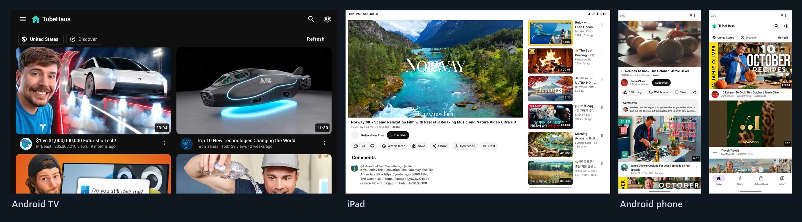

<div align="center">


# TubeHaus (튜브하우스)

### 늘 쓰던 그 유튜브, 구글의 눈길만 빼고.

TV, 폰, PC, 아이패드에서. 내 서버에 돌리거나, 그냥 앱을 깔거나. 한국인이 만들었어요!

[](https://github.com/biolend83/tubehaus/releases)
[](LICENSE)
[](https://github.com/biolend83/tubehaus/actions/workflows/check.yml)

[](https://selfh.st/weekly/2026-10-23/)

**[⬇ 앱 받기](#앱-받기)** &nbsp;·&nbsp; **[🖥️ 서버 설치](#빠른-설치-docker)** &nbsp;·&nbsp; **[📖 어떻게 재생하나](#어떻게-재생하나)** &nbsp;·&nbsp; **[❓ 자주 묻는 질문](#자주-묻는-질문)** &nbsp;·&nbsp; [English](README.md) · **한국어**



<a href="https://www.producthunt.com/products/tubehaus?embed=true&amp;utm_source=badge-featured&amp;utm_medium=badge&amp;utm_campaign=badge-tubehaus" target="_blank" rel="noopener noreferrer"></a>
<a href="https://fazier.com" target="_blank"></a>

<sub>독립 오픈소스 소프트웨어이며 YouTube·Google과 관계없어요. [면책 조항](#면책-조항)을 꼭 읽어 주세요.</sub>

</div>

## 한눈에

<table>
<tr>
<td width="33%" valign="top">

### 🎬 생김새가 *그냥* 유튜브
같은 홈 화면, 같은 플레이어, 같은 단축키. 집에서 아무도 새로 배울 게 없고, TV에는 리모컨용 화면이 따로 있어요.

</td>
<td width="33%" valign="top">

### 🔒 구글에 주는 건 없음
구글 계정도, 광고도, 추적 스크립트도 없어요. 구독, 기록, 재생목록은 내 기기나 내 서버에 있고, 어떤 형식으로든 내보낼 수 있어요.

</td>
<td width="33%" valign="top">

### 🏠 온 집이 보관함 하나
TV에서 멈추고 폰에서 이어 봐요. 집의 모든 기기와 브라우저가 보관함 하나를 같이 쓰거나, 사람마다 따로 써요.

</td>
</tr>
<tr>
<td colspan="3" valign="top">

### 🛡️ 유튜브가 막아도 계속 재생
다른 길이 막히면 youtube.com이 직접 쓰는 **SABR**로 넘어가요. BotGuard 토큰도 직접 만들고 계정은 필요 없어요. 서버에서는 막힌 주소를 스스로 새 주소로 바꿔요. [어떻게 돌아가나요](#어떻게-재생하나)

</td>
</tr>
</table>

## 어떤 TubeHaus를 쓸까요

두 가지 방식이 있어요. 이름도 생김새도 같고, 일하는 *곳*만 달라요.

| | 📱 **앱** | 🖥️ **서버판** (이 브랜치) |
|---|---|---|
| **이럴 때** | 폰, TV, PC 한 대에서, 오늘 바로, 설정 없이 | 온 가족이 같이 쓰기, 아이폰/아이패드에서 설치 없이, 유튜브가 내 기기 주소를 모르게 |
| **돌아가는 곳** | 안드로이드, 안드로이드 TV / 구글 TV, Windows, macOS, 리눅스, 아이패드/아이폰 | Docker가 되는 아무 서버: 클라우드, 집 PC, 라즈베리파이. 보는 건 아무 브라우저 |
| **유튜브와 통신하는 쪽** | 기기가 직접, 앱 안의 자체 엔진으로 | 내 서버가 자체 엔진으로, Cloudflare WARP를 거쳐서. 기기는 내 서버하고만 통신해요 |
| **유튜브가 보는 주소** | 내 기기 주소. 다른 유튜브 앱과 같아요 | Cloudflare WARP 주소. 우리 집 주소가 아니에요 |
| **보관함** | 그 기기에, 또는 내 TubeHaus 서버와 같이 | 서버에. 모든 기기와 사람이 같이 써요 |
| **여기에만 있는 것** | 오프라인 저장, 백그라운드 재생과 PIP, PC의 mpv 플레이어, 기기 안에서 배우는 추천 | 라이브 실시간 자막(whisper.cpp), TV로 보내기, 원본 화질 저장, 아무 TV 브라우저에서 TV 모드 |
| **시작하기** | **[내려받기](#앱-받기)** | **[docker compose up](#빠른-설치-docker)** |

**둘 다?** 앱을 내 서버에 연결할 수 있어요(설정 → *TubeHaus 서버*). 보관함은 어디서나 하나로 쓰고, 영상은 각 앱이 직접 재생해요.

### 앱 받기

| 플랫폼 | 내려받기 | 참고 |
|---|---|---|
| 🤖 **안드로이드·TV** | [APK](https://github.com/biolend83/tubehaus/releases/download/app-v2.0.0/TubeHaus-2.0.0.apk) | 안드로이드 8 이상. 안드로이드 TV는 Downloader 코드 **3155410**. 자동 업데이트는 [Obtainium](https://apps.obtainium.imranr.dev/redirect?r=obtainium://app/%7B%22id%22%3A%20%22io.github.biolend83.tubehaus%22%2C%20%22url%22%3A%20%22https%3A%2F%2Fgithub.com%2Fbiolend83%2Ftubehaus%22%2C%20%22author%22%3A%20%22biolend83%22%2C%20%22name%22%3A%20%22TubeHaus%22%2C%20%22additionalSettings%22%3A%20%22%7B%5C%22filterReleaseTitlesByRegEx%5C%22%3A%20%5C%22%5ETubeHaus%20%5C%22%2C%20%5C%22fallbackToOlderReleases%5C%22%3A%20true%2C%20%5C%22includePrereleases%5C%22%3A%20false%2C%20%5C%22apkFilterRegEx%5C%22%3A%20%5C%22TubeHaus-%5C%5C%5C%5Cd%5C%22%7D%22%7D)으로 |
| 🪟 **Windows** | [MSI](https://github.com/biolend83/tubehaus/releases/download/app-v2.0.0/TubeHaus-2.0.0.msi) | 또는 `scoop bucket add tubehaus https://github.com/biolend83/tubehaus` 다음 `scoop install tubehaus` |
| 🍏 **macOS** | [M칩](https://github.com/biolend83/tubehaus/releases/download/app-v2.0.0/TubeHaus-2.0.0-mac-arm64.dmg) · [인텔](https://github.com/biolend83/tubehaus/releases/download/app-v2.0.0/TubeHaus-2.0.0-mac-x64.dmg) | 또는 `brew tap biolend83/tubehaus https://github.com/biolend83/tubehaus && brew trust biolend83/tubehaus && brew install --cask tubehaus` (mpv가 앱 안에 들어 있어요) |
| 🐧 **리눅스** | [.deb](https://github.com/biolend83/tubehaus/releases/download/app-v2.0.0/TubeHaus-2.0.0-linux-amd64.deb) · [.rpm](https://github.com/biolend83/tubehaus/releases/download/app-v2.0.0/TubeHaus-2.0.0-linux-x86_64.rpm) | ARM64와 tar.gz는 [전체 파일](https://github.com/biolend83/tubehaus/releases/latest)에, Arch는 [`packaging/aur`](packaging/aur) |
| 📱 **아이패드 / 아이폰** | [.ipa](https://github.com/biolend83/tubehaus/releases/download/app-v2.0.0/TubeHaus-2.0.0-ipad.ipa) (베타) | iOS 16 이상, [Sideloadly](https://sideloadly.io/)와 내 Apple ID로 설치(무료 ID는 7일마다 다시 서명). 애플 플레이어로 4K까지, 백그라운드 재생, PIP, 오프라인 저장. 설치가 싫다면 사파리에서 서버판을 쓰세요 |

전체 파일, Windows portable, ARM 빌드: **[최신 릴리스](https://github.com/biolend83/tubehaus/releases/latest)**. 플랫폼별 설치 안내와 소스: [`android-app`](https://github.com/biolend83/tubehaus/tree/android-app) · [`windows-app`](https://github.com/biolend83/tubehaus/tree/windows-app) · [`mac-app`](https://github.com/biolend83/tubehaus/tree/mac-app) · [`linux-app`](https://github.com/biolend83/tubehaus/tree/linux-app) · [`ios-app`](https://github.com/biolend83/tubehaus/tree/ios-app). 이 README의 나머지는 서버판 이야기예요.
## 빠름, 자체 유튜브 엔진으로

1.6부터 서버판은 Invidious 위에서 돌지 않아요. 유튜브에 직접 물어봐서 **컨테이너가 세 개 줄었어요**(Invidious, companion, PostgreSQL 없음). 속도도 빨라요. 영상은 스트림만 받으면 바로 재생되고 제목·설명·관련 영상은 잠깐 뒤에 채워져요. 받은 답은 보관해 두고 뒤에서 새로 고치고, 유튜브 영상 서버와의 연결은 열어 둔 채 다시 쓰고, 댓글은 영상을 열 때 같이 받아 둬요.

| | TubeHaus 1.6.3 | Invidious |
|---|---|---|
| **영상 재생 시작** | **0.16초** `▇▇` | 1.29초 `▇▇▇▇▇▇▇▇▇▇▇▇▇` |
| 영상 화면 전체 (제목, 설명, 관련 영상) | **0.59초** `▇▇▇▇▇▇` | 1.29초 `▇▇▇▇▇▇▇▇▇▇▇▇▇` |
| 채널 | **0.38초** `▇▇▇▇` | 0.66초 `▇▇▇▇▇▇▇` |
| 채널의 영상 목록 | **0.28초** `▇▇▇` | 0.61초 `▇▇▇▇▇▇` |
| 검색 | **0.56초** `▇▇▇▇▇▇` | 0.56초 `▇▇▇▇▇▇` |
| 댓글 (영상을 연 뒤) | **0.002초** `▏` | 0.16초 `▇▇` |
| **다시 여는 것 전부** | **0.002초** `▏` | – |
| 스트림 조각 하나 | **0.07초** `▇` | – |

각각 처음 여는 10~12번의 중앙값이에요. 같은 서버, 같은 WARP 주소에서 쟀어요(TubeHaus는 2026-11-17, Invidious는 서버에서 내리기 전 1.6.0 비교 때). 검색이나 채널은 대부분 유튜브가 답하는 시간이라 더 줄이기 어려워요. 대신 TubeHaus는 화면이 다 차기 전에 영상부터 틀고, 다음에 누를 것을 보는 동안 미리 받고, 같은 것을 두 번 받지 않아요. 스트림 조각은 열린 연결을 다시 써요(새 연결은 0.17초).

영상에 마우스를 올리거나 검색 결과가 뜨면 앞의 몇 개를 미리 받아 둬서, 누르면 대개 이미 준비된 화면이 열려요. 답은 여전히 [Invidious](https://invidious.io) API 모양이라 웹 화면, 앱의 서버 모드, 그 API를 쓰는 다른 도구가 그대로 돌아가요. 1.5까지는 Invidious와 [invidious-companion](https://github.com/iv-org/invidious-companion) 위에서 동작했고, 유튜브에 대해 아는 많은 것을 두 프로젝트에서 배웠어요. Invidious 팀에 감사드려요. 1.5에서 업데이트한다면 [아래](#빠른-설치-docker)를 보세요.

<div align="center">

</div>

## 서버판이 좋은 점

<table>
<tr>
<td width="50%" valign="top">

**⚡ 누르자마자, 늘 최고 화질로**<br>
영상 정보를 서버에 받아 두고 뒤에서 새로 고치고, 다음에 누를 만한 영상도 미리 받아 둬요. 화질을 알아서 낮추지 않아요. 60프레임과 기기가 하드웨어로 푸는 코덱을 먼저 고르고, 8K도 버퍼에 맞춰요.

</td>
<td width="50%" valign="top">

**🔒 기기가 구글과 통신하지 않아요**<br>
영상, 썸네일, 페이지가 전부 내 서버를 거쳐요. 구글 쿠키도 유튜브 스크립트도 브라우저에 들어오지 않아요. 유튜브는 Cloudflare WARP 주소만 보고, 우리 집 주소는 몰라요.

</td>
</tr>
<tr>
<td valign="top">

**🎙️ 라이브 실시간 자막**<br>
유튜브는 라이브에 자막을 안 줘요. TubeHaus는 [whisper.cpp](https://github.com/ggml-org/whisper.cpp)로 받아써서 재생보다 몇 초 앞서 자막을 만들어요. CPU 코어 하나면 돼요. 라이브도 조각을 미리 받아 정확히 이어 붙여서 끊기지 않아요.

</td>
<td valign="top">

**📺 TV에도 맞춰서**<br>
리모컨의 방향키, 확인, 뒤로만으로 움직이는 TV 모드, 그리고 **TV로 보내기**: 폰에서 고르면 TV에서 재생돼요(크롬캐스트 필요 없음). **같이 보기**는 방 안의 모두를 같은 초에 맞춰요.

</td>
</tr>
<tr>
<td valign="top">

**🌿 차분 모드**<br>
스위치 하나로 유튜브를 다시 "도구"로: 홈에는 구독 채널의 새 영상만, 쇼츠·인기·추천은 사라지고, 다음 영상 자동 재생도 없고, 댓글은 눌러야 펼쳐져요. 검색은 그대로예요.

</td>
<td valign="top">

**🧠 내 서버에서 배우는 쇼츠**<br>
몇 초 봤는지, 반복했는지, 좋아요를 눌렀는지, 넘겼는지가 채널·주제별 점수가 되어 내 서버의 작은 파일에 저장돼요. 네 번째 칸마다 새로운 것을 섞어요. 서버 밖으로 나가는 건 없고, 언제든 초기화할 수 있어요.

</td>
</tr>
<tr>
<td valign="top">

**🚫 낚시 제목·광고 읽기 끝**<br>
[DeArrow](https://dearrow.ajay.app)로 올린 사람 대신 사람들이 고른 제목과 썸네일, [SponsorBlock](https://sponsor.ajay.app)으로 광고 구간 건너뛰기와 "하이라이트로 이동", Return YouTube Dislike로 싫어요 수.

</td>
<td valign="top">

**💾 원본 화질로 저장**<br>
1080p와 4K는 영상과 소리가 따로 와요. 서버가 둘 다 받아서 ffmpeg로 합쳐 줘요. 내 언어 자막이 없는 영상은 번역 자막으로 봐요.

</td>
</tr>
<tr>
<td valign="top">

**☁️ 값싼 클라우드 서버에서도**<br>
클라우드 주소는 "봇이 아닌지 확인하려면 로그인하세요"가 자주 떠요. TubeHaus는 **Cloudflare WARP(프록시 모드)**로 나가고, 막히면 방문자 정보를 새로 받고, 그래도 막히면 WARP 주소를 바꿔요.

</td>
<td valign="top">

**🌍 15개 언어**<br>
한국어 · English · 日本語 · 简体中文 · Español · Português · Français · Deutsch · Русский · हिन्दी · Bahasa Indonesia · Türkçe · বাংলা · Tiếng Việt · Polski. 조회수와 날짜도 언어마다 그 나라 방식으로 보여요.

</td>
</tr>
</table>

<details>
<summary><b>그 밖의 기능</b></summary>

- 유튜브와 같은 화면: 홈, 검색, 채널, 재생목록, 구독, 기록, 보관함, 인기 급상승, 그리고 유튜브의 주제 페이지(음악, 실시간, 뉴스, 게임, 스포츠, 학습, 패션·뷰티)를 선반 그대로
- [Shaka Player](https://github.com/shaka-project/shaka-player) 기반 플레이어: 챕터, 탐색 미리보기, 재생바 위 **"가장 많이 다시 본 장면"** 물결, 재생 속도, 수면 타이머, 통계, 미니 플레이어, 영화관 모드, 앰비언트 모드, 잠금 화면과 블루투스 버튼 조작
- 모든 기기가 같은 보관함: 구독(RSS 기반 피드), 시청 기록, 이어보기, 나중에 볼 동영상, 좋아요, 재생목록
- 댓글, 스크립트, 마우스를 올리면 정확한 업로드 시각
- 구글 Takeout, Invidious, NewPipe, FreeTube, OPML, TubeHaus 백업에서 가져오기, 그리고 그 모든 형식으로 내보내기

브라우저가 직접 하는 선택 기능: SponsorBlock과 DeArrow(둘 다 영상 ID 대신 해시 앞부분만 보내요), Return YouTube Dislike. DeArrow 썸네일은 서버를 거쳐 받아서, DeArrow에는 보는 사람 대신 서버가 보여요.

</details>

## FreeTube, NewPipe와 뭐가 다른가요?

FreeTube와 NewPipe는 오래되고 훌륭한 프로젝트이고, TubeHaus도 많은 걸 배웠어요. 차이는 주로 어디서 돌아가는지와 생김새예요.

| | **TubeHaus** | **FreeTube** | **NewPipe** |
|---|---|---|---|
| **돌아가는 곳** | 안드로이드 폰과 안드로이드 TV / 구글 TV, 윈도우, macOS, 리눅스, 아이패드/아이폰(사이드로드), 서버판으로는 모든 브라우저 | 윈도우, macOS, 리눅스 | 안드로이드 폰과 태블릿 |
| **생김새** | 유튜브와 같음: 같은 배치, 같은 단축키 | 자체 디자인 | 자체 디자인 |
| **구글 계정** | 필요 없음 | 필요 없음 | 필요 없음 |
| **첫 화면** | 본 것·좋아요·건너뛴 것·숨긴 것으로 기기 안에서 배운 추천, 밖으로 나가는 건 없음 | 구독, 인기 | 구독 피드, 인기 |
| **여러 기기에서 하나의 보관함** | 선택: 앱들을 내 TubeHaus 서버에 연결 | 파일로 내보내기/가져오기 | 파일로 내보내기/가져오기 |
| **SponsorBlock, DeArrow** | 둘 다 기본 포함 | 둘 다 기본 포함 | 공식 앱에는 없음(포크인 Tubular에 SponsorBlock) |
| **TV에서** | 리모컨용: 방향키로 움직이는 TV 화면 | TV판 없음 | 되긴 하지만 폰용 화면 |
| **역사** | 새 프로젝트(2026), 베타, 관리자 1명 | 2018년부터, 큰 커뮤니티 | 2015년부터, 큰 커뮤니티, F-Droid에 있음 |

**다른 걸 고르면 좋을 때:** 컴퓨터용 앱 하나만 필요하고 가장 검증된 걸 원하면 FreeTube가 아주 좋아요. 안드로이드 폰만 쓰고 오랜 역사와 F-Droid를 원하면 NewPipe가 아주 좋아요. TubeHaus는 TV, 폰, PC, 아이패드에서 유튜브처럼 생긴 같은 앱을 쓰고, 원하면 보관함까지 하나로 묶고 싶을 때를 위한 거예요.

## 빠른 설치 (Docker)

| 필요한 것 | |
|---|---|
| **서버** | Docker와 docker compose가 있는 리눅스, x86-64 또는 ARM64(오라클 클라우드 무료 ARM 서버로 충분해요) |
| **CPU / 메모리** | 2코어 이상, 메모리 약 4GB. 라이브 자막을 켜고 라이브를 볼 때만 코어 하나를 더 써요 |
| **디스크** | 약 10~20GB, 대부분 이미지예요. 영상은 저장하지 않고 흘려보내요 |
| **주소** | HTTPS용 도메인, 또는 sslip.io 같은 무료 와일드카드 이름. 집 안에서만 쓰면 HTTP도 돼요 |

```sh
git clone https://github.com/biolend83/tubehaus && cd tubehaus
cp .env.example .env        # 도메인을 넣어요
docker compose pull         # 미리 빌드된 이미지 (amd64, arm64)
docker compose up -d
```

끝이에요. Caddy, 자체 유튜브 엔진과 Cloudflare WARP가 들어 있는 TubeHaus 서버, 라이브용 PO 토큰 제공기, 라이브 자막용 whisper.cpp가 한 번에 올라와요. 도메인을 열면 돼요.

> [!NOTE]
> **TrueNAS를 쓰나요?** TubeHaus가 TrueNAS 앱 목록에 있어요. **Apps → Discover Apps**에서 **TubeHaus**를 검색하세요(community 트레인). 클론할 필요가 없어요.

> [!IMPORTANT]
> **공개 도메인에 올릴 거라면 `.env`에 로그인부터 넣으세요:** `TUBEHAUS_AUTH=basic`, `TUBEHAUS_USER`, `TUBEHAUS_PASSWORD_HASH` (해시는 `docker compose run --rm caddy caddy hash-password`로 만들고, `$`는 모두 `$$`로 써요). 이게 없으면 주소를 여는 사람 모두가 같은 보관함을 써요. 다른 방법: [외부에 열기 전에 로그인 붙이기](#외부에-열기-전에-로그인-붙이기).

> [!TIP]
> **1.5 이하에서 업데이트하나요?** 이제 Invidious, companion, PostgreSQL은 필요 없어요. `git pull` 다음에 `docker compose pull && docker compose up -d --remove-orphans`로 내리면 돼요. `.env`의 그쪽 비밀값은 지워도 돼요. 보관함은 `tubehaus-data` 볼륨에 그대로 있어요. 자세히: [업데이트와 백업](README.md#updating-and-backups)(영어).

<details>
<summary><b>도메인이 없거나, 이미 쓰는 리버스 프록시 뒤에 둘 때</b></summary>

Caddy가 아무 포트에서나 HTTP로 열 수 있어요. 설정 예시와 nginx·Traefik 전체 예시는 [영어 README](README.md#quick-start-docker)와 [Running behind your own reverse proxy](README.md#running-tubehaus-behind-your-own-reverse-proxy)(영어)에 있어요.

</details>

<details>
<summary><b>docker compose 대신 Flisk로</b></summary>

같은 컨테이너 세 개가 [Flisk](https://flisk.sh)용으로도 적혀 있고 같은 `.env`를 읽어요. 선택 사항이고, 기본은 계속 docker compose예요.

```sh
npm install -g @flisk-sh/flisk   # Flisk 1.4.26 이상
git clone https://github.com/biolend83/tubehaus && cd tubehaus
cp .env.example .env
flisk up                          # flisk status / flisk logs --service tubehaus / flisk down
```

한 서버에서는 둘 중 하나만 쓰세요. 포트, 볼륨, 업데이트, 기존 설치 옮기기는 [Running with Flisk](README.md#running-tubehaus-with-flisk-optional)에 있어요. Flisk 구성은 @odykyi 님이 만들어 주셨어요 (#40, #42).

</details>

### 외부에 열기 전에 로그인 붙이기

기본으로는 계정이 없어서, 로그인을 안 붙이면 주소를 아는 사람 모두가 같은 보관함을 봐요.

- **내장 비밀번호:** `.env`에 `TUBEHAUS_AUTH=basic`, `TUBEHAUS_USER`, `TUBEHAUS_PASSWORD_HASH` (해시는 `docker compose run --rm caddy caddy hash-password`, `$`는 모두 `$$`로)
- **사람마다 계정:** `TUBEHAUS_AUTH=accounts`면 로그인 화면이 생기고 보관함이 사람마다 따로예요
- **통합 로그인(SSO):** 계정을 켠 상태에서 `TUBEHAUS_OIDC_ISSUER`, `TUBEHAUS_OIDC_CLIENT_ID`, `TUBEHAUS_OIDC_CLIENT_SECRET`을 넣으면 OpenID Connect 제공자(Authentik, Authelia, Keycloak, Pocket ID 등)로 "…(으)로 계속하기" 버튼이 생겨요. 리디렉션 주소는 `<TUBEHAUS_URL>/api/p/auth/oidc/callback`, `TUBEHAUS_OIDC_ONLY=1`이면 비밀번호 로그인은 꺼져요
- **내 문지기:** Authelia, Authentik, 패스키 게이트를 `forward_auth`로 앞에
- **아예 안 열기:** 집 네트워크에서만, 또는 Tailscale·WireGuard로 어디서든

차례로 적어 둔 안내: [가족에게 TubeHaus 열어 주기](README.md#opening-tubehaus-to-your-household)(영어).

### 잘 돌아가는지 점검

```sh
docker compose exec tubehaus python3 /app/server/tubehaus_server.py --doctor
```

WARP, 유튜브 연결, 검색, 실제 영상 조회(스트림 몇 바이트까지), 선택 기능(yt-dlp, ffmpeg, whisper)을 한 줄씩 점검해요. 문제가 있으면 [문제 해결](README.md#troubleshooting)(영어)을 보세요. 직접 설치(Docker 없이)와 설정 항목 전체는 [영어 README](README.md#manual-setup)에 있어요.

### 이미지 두 개: tubehaus와 tubehaus-web

둘 중에 고르는 판(에디션)이 아니라, 하나는 서버고 하나는 웹 화면이에요. 어떤 설치든 서버 하나에 웹 화면을 보여 주는 쪽이 하나 붙어요.

| 이미지 | 하는 일 | 포트 |
|---|---|---|
| `ghcr.io/biolend83/tubehaus` | **서버.** 유튜브와 통신하고, 보관함, 라이브 자막, 오프라인 저장, 같이 보기 방. 화면은 없어요 | 3010 (안쪽) |
| `ghcr.io/biolend83/tubehaus-web` | **웹 화면과 출입구.** 화면과, 나머지 요청을 서버로 보내는 Caddy. 밖으로 여는 포트는 이것 하나 | 8080 |

- **이 저장소에서 `docker compose up`** 하면 `tubehaus`만 써요. 화면은 받아 둔 저장소의 `web/` 폴더를 일반 `caddy` 이미지가 보여 줘요
- **앱 스토어**(Umbrel, CasaOS, TrueNAS)는 둘 다 써요. 앱은 하나로 보이고 포트는 8796 하나만 열려요
- **Unraid**는 **TubeHaus**, **TubeHaus-Web** 템플릿 두 개로 보여요. 또는 Docker Compose Manager 플러그인과 [`deploy/docker-compose.home.yml`](deploy/docker-compose.home.yml)로 한 번에
- **저장소 없이 집 서버에 바로:** [`deploy/docker-compose.home.yml`](deploy/docker-compose.home.yml)이 스토어와 같은 구성이에요(포트 하나, WARP 없음, 추가 권한 없음)

두 이미지는 서버 릴리스마다 같은 버전 번호로 함께 나와요. 버전을 맞춰 쓰세요.

## 어떻게 이어져 있나요

```
브라우저 ──► Caddy ─┬─ /y/*, 페이지 이동 ──► web/ (화면)
                    └─ 나머지 전부 ───────► TubeHaus 서버
                                              │  보관함, 라이브, 자막, 저장,
                                              │  그리고 자체 유튜브 엔진 (/api/v1/*,
                                              │  영상 스트림, 자막, 썸네일)
                                              ▼
                                  Cloudflare WARP (프록시 모드)
                                              │
                                           YouTube
```

엔진은 유튜브 공식 앱들과 같은 방식으로 물어봐요. 목록(검색, 채널, 재생목록, 댓글)은 웹 클라이언트로, 영상 스트림은 visionOS 클라이언트로(PO 토큰 없는 그냥 주소), 그게 거절되면 SABR로, 정확한 업로드 시각과 분류는 웹 플레이어로, 열어 둔 채 압축한 연결로요. 답은 Invidious API 모양(`/api/v1/videos`, `/api/v1/search` 등, `?local=true` 포함)이라 그 API를 쓰는 도구도 붙일 수 있어요. 자세히: [How TubeHaus is put together](README.md#how-tubehaus-is-put-together)(영어).

## 공개 서버로 열기

<details>
<summary><b>설치 없이 써 보게 해 주기: <code>TUBEHAUS_PUBLIC=1</code></b></summary>

- **방문자 기록은 각자의 브라우저에 저장돼요.** 구독, 시청 기록, 이어보기, 재생목록이 서버에 남지 않아서, 모르는 사람끼리 서로의 기록을 볼 수 없어요
- **서버는 저장 없는 일만 해요:** 피드 받아오기, 가져오기 파일 읽기, 내보내기 변환, 영상 재생
- **꺼지는 기능:** TV로 보내기, 서버 다운로드(낯선 사람끼리 공유되기 때문), 쇼츠 추천 학습
- **사람이 몰려도 버티게:** `.env`에서 동시 시청자 수(`TUBEHAUS_MAX_VIEWERS`), 최고 화질(`TUBEHAUS_MAX_HEIGHT`, 예: 1080), 한 사람당 분당 요청 수(`TUBEHAUS_RATE_PER_MIN`, 공개 서버 기본 120)를 정할 수 있어요. 자리가 차면 새로 온 사람에게 "바빠요, 잠시 뒤에"라고 알려주고, 이미 보는 사람은 끊기지 않아요. 같은 영상이나 같은 채널을 여러 명이 동시에 열면 유튜브에는 한 번만 물어보고, 라이브는 몇 명이 보든 한 번만 받아와요
- **바로 쓰는 공개 서버 구성:** `deploy/docker-compose.public.yml`에 다 들어 있어요. 들어오면 먼저 봇 확인 화면(Anubis, 몇 초 계산)이 뜨고, 그다음 계정 만들기(사용자 이름과 비밀번호만, 이메일 없음)를 해야 볼 수 있어요. 비밀번호는 60만 번 해싱해서 저장하고, 가입과 로그인은 네트워크마다 횟수를 제한해요
- **열기 전에:** 영상이 서버를 거쳐서 데이터 사용량이 커요. 사람이 많으면 유튜브에 더 빨리 막힐 수 있어요. 내장 비밀번호는 끄고 두세요

</details>

## 자주 묻는 질문

<details>
<summary><b>유튜브가 막으면 어떻게 되나요?</b></summary>

세 겹으로 막아요. 영상이 거절되면 다음 방법으로 넘어가요(visionOS 클라이언트 → 유튜브 키즈 → SABR → TV 클라이언트). 그래서 문 하나가 닫혀도 재생이 멈추지 않아요. 유튜브가 주소를 의심하면("봇이 아님을 확인", 구글 "sorry" 페이지) 서버가 스스로 새 WARP 주소로 바꾸고 요청을 다시 보내요. 그리고 매일 [검사](.github/workflows/engine-check.yml)가 엔진의 모든 기능을 실제 유튜브에 돌려 보고, 하나라도 깨지면 바로 이슈를 열어요. 그래서 대부분 알아채기 전에 고쳐져요.

</details>

<details>
<summary><b>SABR이 뭐고, 따로 켜야 하나요?</b></summary>

youtube.com이 직접 쓰는 방식이에요. 주소 하나로, 플레이어가 지금 위치와 원하는 걸 작은 요청으로 알려요([자세히](#어떻게-재생하나)). 기본으로 예비 방법으로 켜져 있어서 설정할 건 없어요. 서버에서 `HT_SABR=only`로 하면 SABR이 주 방법이 돼요. 대신 새 영상마다 1초 안이 아니라 3초쯤 걸려요.

</details>

<details>
<summary><b>아직 Invidious가 필요한가요? 쓰던 건 그대로 둬도 되나요?</b></summary>

아니요, 1.6부터는 서버가 유튜브에 직접 물어봐요. 답은 Invidious API와 같은 모양이라, Invidious 인스턴스의 API를 쓰는 앱(Yattee, FreeTube의 API 모드 등)도 붙을 수 있어요. 다만 Invidious 계정이 필요한 부분(그쪽 구독, 로그인)은 없어요. 쓰던 Invidious는 그대로 둬도 서로 방해하지 않아요. TubeHaus가 더 이상 쓰지 않을 뿐이에요.

</details>

<details>
<summary><b>영상은 어디서 오나요? 서버에 저장되나요?</b></summary>

전부 유튜브에서 와요. 보관함(구독, 기록, 재생목록)과, 저장할 때 잠깐 쓰는 임시 파일 말고는 아무것도 저장하지 않아요.

</details>

<details>
<summary><b>추천 알고리즘이 있나요?</b></summary>

쇼츠에는 있어요. 전부 내 서버에서 돌아가요(위의 "내 서버에서 배우는 쇼츠"). 일반 영상은 구독 피드, 인기와 분야별 탭, 영상마다 유튜브가 주는 관련 영상 목록을 보여줘요. 구글 계정이 없으니 구글이 내 시청을 학습하는 일은 없어요.

</details>

<details>
<summary><b>연령 제한 영상은요?</b></summary>

대부분 재생되지 않아요. 나이 확인을 통과할 로그인 계정이 없기 때문이에요.

</details>

<details>
<summary><b>구독을 가져오거나, 내 데이터를 빼낼 수 있나요?</b></summary>

네. 설정 → 내 데이터(또는 구독 관리 화면)의 **파일에서 가져오기**로 구글 Takeout(구독 CSV, `watch-history.json` 시청 기록), Invidious, NewPipe, FreeTube 내보내기 파일, OPML, TubeHaus 백업을 가져올 수 있어요. **내보내기**로는 TubeHaus 전체 백업(구독, 시청 기록, 이어보기, 재생목록, 좋아요), Invidious 형식, Takeout과 같은 CSV, RSS 리더용 OPML을 받을 수 있어요. 내 데이터가 TubeHaus에 갇히는 일은 없어요.

</details>

<details>
<summary><b>밖으로 정보를 보내나요?</b></summary>

아니요. 계정도 원격 수집도 없어요. 밖으로 나가는 요청은 유튜브(서버에서, WARP를 거쳐서), DeArrow 썸네일 서버(서버에서, DeArrow 썸네일을 켰을 때), 그리고 브라우저의 선택 기능(SponsorBlock, DeArrow, Return YouTube Dislike)뿐이에요.

</details>

<details>
<summary><b>폰과 TV에서는 어떻게 접속하나요?</b></summary>

웹앱이에요. 브라우저에서 내 주소를 열거나, "홈 화면에 추가"로 앱처럼 설치하면 돼요. TV 브라우저에서는 리모컨으로 조작하는 TV 모드가 켜져요. 또는 [TubeHaus 앱](#앱-받기)을 따로, 또는 내 서버에 연결해서 쓰세요.

</details>


<details>
<summary><b>서버가 변환(트랜스코딩)하나요? 제 NAS는 AV1을 못 풀어요.</b></summary>

변환은 전혀 안 해요. 서버는 유튜브에서 받은 영상을 그대로 넘기기만 해서, 작은 NAS나 라즈베리 파이도 거의 일을 안 해요. 영상을 푸는 건 보는 기기이고, 플레이어가 그 기기가 하드웨어로 풀 수 있는 형식(AV1, VP9, H.264 모두 유튜브가 줘요)을 골라요. AV1을 못 푸는 예전 폰은 그냥 VP9이나 H.264를 받아요. 예외는 1080p·4K 내려받기 하나로, 이때 ffmpeg가 화면과 소리를 다시 인코딩 없이 합쳐요.

</details>

<details>
<summary><b>집 밖에서는 어떻게 보나요?</b></summary>

가장 쉬운 건 사설망이에요. [Tailscale](https://tailscale.com)이나 WireGuard를 켜고 집에서와 같은 주소로, 브라우저나 앱에서 보면 돼요. 인터넷에 직접 열려면 도메인을 붙이고(HTTPS 인증서는 Caddy가 알아서 받아요) 먼저 [로그인을 붙이세요](#외부에-열기-전에-로그인-붙이기).

</details>

<details>
<summary><b>영상이 안 나와요. 뭘 해 볼 수 있나요?</b></summary>

먼저 몇 초 기다려 보세요. 평소 방법이 막히면 다음 방법을 알아서 시도해요(SABR은 2~3초). 앱에서는 플레이어 설정 → **재생 방식**에서 한 가지를 고정할 수 있어요. 다른 방법으로 안 되는 영상은 대부분 *SABR*이나 *TV*로, 어린이용 영상은 대부분 *YouTube Kids*로 나와요. 서버라면 위의 `--doctor`로 유튜브가 응답하는지 볼 수 있어요. 그래도 안 되면 영상 링크와 함께 [이슈를 남겨 주세요](https://github.com/biolend83/tubehaus/issues).

</details>

## 어떻게 재생하나

긴 버전이에요. 유튜브가 자기 것이 아닌 플레이어에게 뭘 하는지, TubeHaus는 거기에 어떻게 대응하는지, 첫 요청부터 화면에 뜨는 마지막 바이트까지. 궁금한 사람을 위한 글이라 TubeHaus를 쓰는 데는 몰라도 돼요. 다만 다른 유튜브 앱들이 왜 몇 달마다 망가지는지, 이건 왜 계속 되는지 궁금했다면 여기에 답이 있어요.

**짧은 버전:** TubeHaus는 유튜브 공식 앱처럼 유튜브에 물어요. 한 방법이 막히면 다음 방법으로 차례로 내려가고, 마지막에는 youtube.com이 직접 쓰는 **SABR**로 받아요. 이때 필요한 BotGuard 토큰도 계정 없이 직접 만들어요. 서버에서는 유튜브가 막은 주소를 스스로 새 주소로 바꾸고, 매일 자동 점검이 엔진 전체를 실제 유튜브에 돌려 봐요.

<details open>
<summary><b>목차</b></summary>

1. [유튜브는 웹사이트가 아니라 앱 API](#1-유튜브는-웹사이트가-아니라-앱-api)
2. [InnerTube, 그리고 클라이언트가 중요한 이유](#2-innertube-그리고-클라이언트가-중요한-이유)
3. [방문자 ID와 벽](#3-방문자-id와-벽)
4. [차례로 내려가는 길](#4-차례로-내려가는-길)
5. [어린이용 영상](#5-어린이용-영상)
6. [잠긴 주소: 서명과 n 값](#6-잠긴-주소-서명과-n-값)
7. [주소를 붙잡고 있는 광고](#7-주소를-붙잡고-있는-광고)
8. [SABR: youtube.com이 직접 쓰는 스트리밍 방식](#8-sabr-youtubecom이-직접-쓰는-스트리밍-방식)
9. [UMP: 답 읽기](#9-ump-답-읽기)
10. [계정 없이 만드는 PO 토큰과 BotGuard](#10-계정-없이-만드는-po-토큰과-botguard)
11. [SABR 조각을 다시 파일로](#11-sabr-조각을-다시-파일로)
12. [앱에서의 SABR: 숨은 브라우저 페이지](#12-앱에서의-sabr-숨은-브라우저-페이지)
13. [WARP: 유튜브가 상대해 주는 주소](#13-warp-유튜브가-상대해-주는-주소)
14. [빠르게 만들기](#14-빠르게-만들기)
15. [자막: 몇 초 만에 번역, 라이브는 실시간으로](#15-자막-몇-초-만에-번역-라이브는-실시간으로)
16. [라이브](#16-라이브)
17. [플레이어들, 그리고 변환을 안 하는 이유](#17-플레이어들-그리고-변환을-안-하는-이유)
18. [ffmpeg 없이 두 스트림을 한 파일로](#18-ffmpeg-없이-두-스트림을-한-파일로)
19. [구글 SDK 없이 캐스트](#19-구글-sdk-없이-캐스트)
20. [기기 밖으로 나가지 않는 추천](#20-기기-밖으로-나가지-않는-추천)
21. [고장 나면 바로 알기](#21-고장-나면-바로-알기)
22. [솔직히, 안 되는 것](#22-솔직히-안-되는-것)

</details>

### 1. 유튜브는 웹사이트가 아니라 앱 API

youtube.com에서 영상을 열고 뭐가 오는지 보면, 페이지 안에 영상은 없어요. 커다란 자바스크립트 플레이어(`base.js`, 몇 MB, 배포할 때마다 이름이 바뀌어요)가 있고, 이 플레이어가 비공개 API에 **플레이어 응답**을 요청해요. 영상 하나를 설명하는 JSON 문서예요.

플레이어 응답에서 중요한 부분은 이 정도예요.

| 부분 | 들어 있는 것 |
|---|---|
| `playabilityStatus` | `OK`, 아니면 이유: `UNPLAYABLE`, `LOGIN_REQUIRED`("봇이 아님을 확인하려면 로그인", 또는 나이 확인), `ERROR`("볼 수 없는 영상") |
| `streamingData.adaptiveFormats` | 영상의 모든 형식. 화면은 해상도·코덱(H.264, VP9, AV1)별, 소리는 음질·언어(AAC, Opus)별로, 각각 크기·비트레이트와 함께 `url`이나 잠긴 `signatureCipher`가 있어요 |
| `streamingData.hlsManifestUrl` | 라이브(와 애플 클라이언트)용 HLS 목록 |
| `streamingData.serverAbrStreamingUrl` | SABR 주소(8절) |
| `captions` | 자막 트랙과 기계 번역 가능한 언어 |
| `videoDetails`, `microformat` | 제목, 채널, 길이, 키워드, 올린 날 |
| `storyboards` | 넘기기 미리보기 이미지 |
| `adPlacements` | 광고 위치. 생각보다 중요해요(7절) |

공식 유튜브 앱(안드로이드, iOS, 스마트 TV, YouTube Kids, VR)은 모두 **같은** API에 같은 문서를 요청하고, 자기가 누구인지 밝혀요. 유튜브는 앱마다 다르게 답해요. 형식도, 제한도, 보호 방식도 달라요. 결국 핵심은 이거예요. 다른 플레이어는 받을 수 있는 답만큼만 좋고, 유튜브는 어떤 앱에 어떤 답을 줄지를 몇 주마다 예고 없이 바꿔요.

TubeHaus는 HTML에서 영상 주소를 긁지 않고, 구글 계정을 쓰지 않고, 유튜브 플레이어를 돌리지 않아요. 공식 앱처럼 API에 묻고, 묻는 방법을 여러 개 갖고 있어요.

### 2. InnerTube, 그리고 클라이언트가 중요한 이유

이 비공개 API의 이름이 **InnerTube**예요. 요청은 `https://www.youtube.com/youtubei/v1/<endpoint>`(`player`, `next`, `browse`, `search` 등)로 보내는 평범한 HTTPS POST이고, 본문은 JSON이에요. 중요한 건 `context.client`예요.

```json
{
  "context": {
    "client": {
      "clientName": "VISIONOS",
      "clientVersion": "0.1",
      "deviceMake": "Apple",
      "deviceModel": "RealityDevice14,1",
      "osName": "visionOS",
      "osVersion": "26.0",
      "hl": "en",
      "gl": "US",
      "visitorData": "Cgt..."
    }
  },
  "videoId": "dQw4w9WgXcQ",
  "contentCheckOk": true,
  "racyCheckOk": true
}
```

헤더도 맞춰 보내요. `X-YouTube-Client-Name`(클라이언트마다 번호), `X-YouTube-Client-Version`, 거기에 맞는 `User-Agent`, `Origin: https://www.youtube.com`. 유튜브는 이것들이 서로 맞는지 봐요. TV라고 하면서 폰 user agent를 쓰면 더 나쁜 답을 받아요.

2026년 11월 기준으로 클라이언트마다 받는 건 이래요. 찾을 수 있는 클라이언트 이름과 버전(공식 앱, yt-dlp, YouTube.js에서)을 모두 실제 유튜브에, 클라우드 주소와 집 주소에서 시험해 봤어요. 대부분 죽었거나 반쯤만 됐어요.

| 클라이언트 | 목록(검색, 채널, 댓글) | 영상 | 단점 |
|---|---|---|---|
| `WEB` | ✅ 가장 좋음 | SABR로만 | PO 토큰 필요(10절) |
| `VISIONOS` (애플 비전 프로) | – | ✅ **그냥 쓸 수 있는 주소** | 어린이용과 일부 음반사 영상 거절 |
| `ANDROID_VR` (메타 퀘스트) | – | ✅ 그냥 주소 | visionOS와 같은 거절 |
| `ANDROID_KIDS` | – | ✅ *어린이용* 영상 | 그것만 |
| `TVHTML5` (삼성 스마트 TV) | – | ✅ 거의 전부 | 잠긴 주소(6절)와 광고 대기(7절) |
| `ANDROID`, `IOS`, `MWEB` 등 | – | ❌ 또는 ⚠️ | PO 토큰을 원하거나 1분 뒤 끊김 |

그래서 TubeHaus는 영상이 아닌 모든 것(검색, 채널, 재생목록, 댓글, 홈의 선반들, 인기)에 `WEB`을 쓰고, 영상에는 **VISIONOS**를 제일 먼저 써요. 영상 ID에서 재생 가능한 주소까지 가장 빠른 길이에요. 요청 한 번, 0.2초쯤, 토큰도 퍼즐도 없어요.

정확한 버전, 기기 이름, user agent는 표 하나에 모여 있어요(앱은 `clients.json`, 서버는 `ENG_*` 상수). 유튜브가 바뀌면 대개 버전 번호 하나를 같이 옮겨야 해서예요.

### 3. 방문자 ID와 벽

요청마다 **방문자 ID**(`visitorData`)가 같이 가요. 브라우저 익명 쿠키의 API판이에요. 유튜브는 첫 요청에 하나를 주고, 다음에도 보기를 기대해요. 다시 온 시청자와, 새 요청을 마구 보내는 봇을 구별하는 방법이에요.

유튜브가 마음에 안 들면 `LOGIN_REQUIRED`와 *"봇이 아님을 확인하려면 로그인하세요"*가 와요. 이게 **벽**이고, 두 가지 중 하나에 걸려 있어요.

- **방문자 ID.** 요청을 너무 많이 받았거나 수상한 곳에서 생겼어요. 새 ID면 대개 통과해요. TubeHaus는 새 방문자 ID를 받아서(서버 `eng_reroll`, 앱 `InnerTube.reroll()`) 다시 물어요.
- **주소.** 그 IP의 모든 방문자 ID가 벽에 막혀요. 새 주소만이 답이에요. 서버에서는 WARP가 해요(13절). 폰에서는 대개 문제가 안 돼요. 집이나 모바일 주소는 거의 안 막혀요.

TubeHaus는 싼 방법부터 해 보는 걸로 둘을 구별해요. 새 방문자 ID로도 막히면 주소가 막힌 거예요.

### 4. 차례로 내려가는 길

모든 영상을 재생하는 클라이언트는 없어서, 영상 하나가 될 때까지 순서대로 내려가요.

```
 VISIONOS ──► ANDROID_VR ──► (다 막힘? 새 방문자 ID로 한 번 더) ──► ANDROID_KIDS ──► SABR ──► TVHTML5
  ~0.2초       ~0.2초                                                  ~1초          2-3초      3-8초
```

단계마다 거절 이유를 읽고 넘어가요.

| 거절 | 뜻 | 하는 일 |
|---|---|---|
| `ERROR`, "볼 수 없는 영상" | 이 클라이언트에는 이 영상이 안 됨(어린이용, 일부 음반사) | 바로 다음 클라이언트 |
| `LOGIN_REQUIRED`, "봇이 아님" | 벽 | 새 방문자 ID, 서버에서는 그래도 안 되면 새 주소 |
| `LOGIN_REQUIRED`, 나이 확인 | 로그인한 성인 필요 | 멈춤: 여기 어떤 클라이언트도 못 넘어요 |
| `UNPLAYABLE`, 비공개·삭제·멤버 전용 | 영상 자체 문제 | 멈추고 유튜브의 이유를 보여 줘요 |
| 네트워크 오류 | 기기가 오프라인 | 멈춤, 다시 할 게 없어요 |

라이브는 다른 길로 가요. 보통은 HLS 목록으로 오고, 그게 거절되면 서버가 라이브도 SABR로 받아요(16절).

순서는 속도와 범위 사이의 타협이에요. VISIONOS는 즉시 되지만 거절이 많아요. SABR은 거의 다 되지만 페이지 하나와 토큰 하나가 들어서 2~3초예요. TV 클라이언트는 거의 다 되지만 광고 뒤에서 기다려요. 그래서 싼 것부터 해요.

**순서는 바꿀 수 있어요.** 서버에서는 `HT_SABR`:

| `HT_SABR` | 영상을 여는 방식 | 열리는 시간 |
|---|---|---|
| `1` (기본) | visionOS 클라이언트, 거절되면 키즈 → SABR → TV 클라이언트 | 약 0.7초, SABR 약 3초 |
| `first` | SABR 먼저, 그다음 나머지 | 약 3초 |
| `only` | 라이브와 연령 제한 영상만 빼고 모두 SABR | 약 3초 |
| `0` | SABR 안 씀 | – |

**앱에서는** 플레이어 설정에 **재생 방식**이 있어요. *자동*이면 위 순서대로, 아니면 한 가지(visionOS, Android VR, YouTube Kids, SABR, TV)를 고정해요. 고정하면 그 방법에만 바로 물어보고 다른 건 안 해 봐서, 안 되는 영상은 조용히 넘어가지 않고 안 된다고 알려 줘요. 고른 건 다음 영상에도 유지돼서, 한 방법이 늘 막히는 네트워크에서 쓸모 있어요.

### 5. 어린이용 영상

2020년부터 *어린이용*으로 표시된 영상(동요, 베베버스, 코코멜론, 장난감 채널 다수)은 다르게 다뤄져요. 댓글이 꺼지고, 맞춤 광고가 꺼지고, 많은 클라이언트에서 그냥 *"볼 수 없는 영상"*이 돼요. 유튜브는 YouTube Kids에서 보길 원해요.

그래서 TubeHaus는 YouTube Kids인 척 물어요. `ANDROID_KIDS`, 키즈 앱의 버전과 user agent로요. 대부분의 어린이 영상은 이걸로 첫 거절 뒤 1초쯤이면 돼요.

그래도 거절되는 게 있어요. 음반사의 어린이 콘텐츠가 많아요. 그럴 땐 SABR, 그다음 TV 클라이언트로 가는데, TV는 거의 다 돼요. 데스크톱 앱은 YouTube Kids에 묻는 *동안* SABR 브라우저(12절)를 미리 켜 둬서, 키즈가 거절하면 바로 준비돼 있어요. 그래서 어린이 영상 하나가 처음 12.8초에서 5.8초, 다음엔 1.6초가 됐어요.

### 6. 잠긴 주소: 서명과 n 값

TV 클라이언트의 형식에는 `url`이 없어요. 대신 `signatureCipher`가 와요.

```
s=AOq0QJ8wRgIhAP...&sp=sig&url=https://rr3---sn-....googlevideo.com/videoplayback?...
```

`s`는 **뒤섞인 서명**이에요. 유튜브 플레이어는 `base.js`에 숨은 함수(뒤집기, 바꾸기, 자르기 몇 번, 플레이어 버전마다 달라요)로 풀어서 `sig=`로 붙여요. 이와 별도로 googlevideo 주소마다 `n` 값이 있는데, 이건 *또 다른*, 훨씬 큰 숨은 함수를 거쳐야 해요. `n`을 건너뛰면 유튜브가 대놓고 거절하진 않지만, 아주 느리게 줘요. 1080p 영상이 재생 속도를 못 따라가요.

오랫동안 다른 플레이어들은 `base.js`에 정규식을 돌려 이 함수들을 찾았어요. 지금은 안 돼요. 요즘 플레이어는 어떤 정규식으로도 못 따라가게 함수를 만들어요. TubeHaus는 대신 **yt-dlp의 EJS 풀이기**(Unlicense)를 써요. 플레이어 스크립트를 구문 트리로 해석해서, 이름이 아니라 구조로 두 함수를 찾고, 자바스크립트 엔진에서 실행해요.

| 어디서 | 풀이기 실행 방법 |
|---|---|
| 서버 | deno(또는 node)에서 `server/ejs/solve.js`. 전처리한 플레이어를 버전별로 디스크에 보관해서, 새 `base.js`는 영상마다가 아니라 한 번만 해석해요 |
| 안드로이드 | 같은 풀이기를 숨은 WebView에서(`WebSolver.kt`), 플레이어 스크립트는 버전마다 한 번 |
| iPad / iPhone | 엔진 스크립트 안에 넣어 JavaScriptCore에서 |
| 데스크톱 | 필요할 때 SABR 브라우저 페이지에서 |

하나 더 있어요. TV 요청에는 어떤 플레이어 버전으로 풀 건지 적어야 해요. 그게 플레이어의 **서명 타임스탬프**(`sts`, `base.js` 안의 숫자)이고, `playbackContext.contentPlaybackContext.signatureTimestamp`로 보내요. 그러면 유튜브가 그 버전 기준으로 주소를 섞어 줘요. 틀리면 서명이 전부 엉터리로 나와요.

### 7. 주소를 붙잡고 있는 광고

풀린 TV 주소도 처음엔 재생이 안 돼요. TV 클라이언트의 플레이어 응답에는 `adPlacements`가 있고, 보통 `skipOffsetMilliseconds`가 있는 시작 광고예요. 답이 온 뒤로 그 시간의 **80%쯤**이 지나기 전까지 googlevideo는 영상 주소에 **403 Forbidden**을 줘요. 진짜 TV라면 그동안 광고를 보여 주고 있을 테니까요. 유튜브는 광고를 봤을 시간이 지나야 영상을 줘요.

TubeHaus는 광고를 틀지 않아요. 처음 버전은 그 시간을 다 기다렸다가(최대 8초) 플레이어에 넘겼어요. 그런데 주소가 그보다 훨씬 일찍 열릴 때가 많다는 걸 알게 됐어요. 그래서 지금은 이래요.

```
답 도착 (t = 0)
0.5초마다: GET <화면 주소>&range=0-0   그리고   GET <소리 주소>&range=0-0
  둘 다 200/206? → 지금 플레이어에 넘기기
  마감(건너뛰기 시간의 0.8배, 최대 8초)? → 그래도 넘기기
```

평균 **3.9초쯤**, 최대 8초 대신이에요. 화면과 소리를 둘 다 확인해요. 하나가 열렸다고 다른 하나도 열린 건 아니라서요.

그래도 나중에 403이 오면(예를 들어 와이파이에서 데이터로 바뀐 폰, 주소가 예전 IP에 묶여 있을 때) 안드로이드 앱은 새 주소를 **영상마다 몇 분에 한 번만** 받아 보고, 그래도 안 되면 오류를 보여 줘요. 1.7.0은 매번 다시 받아서, 영상이 재생과 정지를 계속 오가는 것처럼 보였어요([#101](https://github.com/biolend83/tubehaus/issues/101)).

### 8. SABR: youtube.com이 직접 쓰는 스트리밍 방식

위의 것들은 모두 **뒷문**이에요. 유튜브가 어떤 목적(VR 헤드셋, 어린이, TV)으로 허락한 앱을 다른 플레이어가 빌려 쓰는 거예요. 유튜브는 뒷문을 하나씩 닫고, 닫을 때마다 몇몇 앱이 몇 주씩 망가져요. 하지만 자기 웹사이트를 망가뜨리지 않고는 닫을 수 없는 정문이 있어요. **SABR**, *Server-side Adaptive Bit Rate*, 지금 youtube.com이 거의 모든 영상에 쓰는 방식이에요.

예전 방식(DASH, HLS, 유튜브의 옛 방식)은 형식마다 주소를 하나씩 주고, 플레이어가 바이트 범위나 조각을 받아 화질을 스스로 정해요. SABR은 반대예요. 플레이어는 주소 **하나**, `serverAbrStreamingUrl`을 받고 거기와 대화를 해요. 요청마다 protobuf 본문 `VideoPlaybackAbrRequest`를 POST해요. 간단히 하면 이런 내용이에요.

```
client_abr_state {
  player_time_ms: 83400                  # "지금 1:23.4"
  bandwidth_estimate: 25000000           # "속도는 25 Mbit/s쯤"
  enabled_track_types: VIDEO_AND_AUDIO
  sticky_resolution: 1080
}
selected_format_ids: [ itag 299 (1080p60 H.264), itag 251 (Opus) ]
buffered_ranges: [ itag 299: 0-42초, itag 251: 0-45초 ]
playback_cookie: <지난번에 서버가 준 것>
streamer_context {
  client { WEB, 2.2026xxxx }
  po_token: <출처 증명>                   # 10절
}
```

서버는 플레이어에게 다음으로 필요하다고 판단한 걸 줘요. 고른 형식의 영상 조각, 어쩌면 다른 서버로 옮기라는 말, 어쩌면 기다리라는 말. 즉 **화질 결정이 유튜브 쪽으로 넘어가고**, 유튜브는 플레이어가 정확히 어디쯤인지 봐요. 그래서 SABR은 흉내 내기 어려워요. 재생 시간은 안 움직이면서 영상 하나를 3초 만에 다 받는 "플레이어"는 사람이 보는 것과 전혀 달라 보여요.

TubeHaus는 이 대화의 플레이어 쪽을 구현해요. 진짜 플레이어가 갖는 상태(재생에 따라 흐르는 시간, 형식별 받아 둔 구간, 고른 형식, 유튜브가 매번 돌려주는 `playbackCookie`)를 관리하고, 서버 이동을 따르고, 기다리라면 기다리고, 버퍼가 줄 때만 더 달라고 해요. protobuf 메시지와 UMP 읽기는 이걸 역분석한 [googlevideo](https://github.com/LuanRT/googlevideo)(MIT)에서 가져왔고, 대화를 넘길 수 있는 파일로 바꾸는 부분(11절)은 TubeHaus가 직접 만들었어요.

SABR용 플레이어 응답은 InnerTube `player` 호출이 아니라 **영상 페이지**(`https://www.youtube.com/watch?v=…`의 `ytInitialPlayerResponse`)에서 가져와요. WEB 클라이언트 답은 현재 웹 플레이어 버전과 정확히 맞아야만 돼서예요. 버전이 낡으면 1분쯤 뒤 "페이지를 새로고침해야 합니다"가 떠요. `serverAbrStreamingUrl`에도 `n` 값이 있어서 TV 주소와 같은 EJS 풀이기로 풀어요.

### 9. UMP: 답 읽기

SABR 요청에 대한 답은 JSON도 protobuf도 아니에요. **UMP**, *Universal Media Protocol*이라는 틀이에요. 조각이 이어 붙은 흐름이고, 각 조각은 **종류** 번호, **크기**, 그 크기만큼의 내용이에요.

```
[MEDIA_HEADER][크기][protobuf: header_id=3, itag=299, start_ms=42000, duration_ms=5000,
                     start_range=8_400_000, content_length=1_250_000, ...]
[MEDIA][크기][header_id=3][H.264 1 250 000바이트]
[MEDIA_END][크기][header_id=3]
[NEXT_REQUEST_POLICY][크기][protobuf: backoff_time_ms=2000, playback_cookie=...]
[SABR_REDIRECT][크기][protobuf: url=https://rr5---...]
[STREAM_PROTECTION_STATUS][크기][protobuf: status=1]
```

크기 숫자는 protobuf가 아니라 UMP 자체 방식(첫 바이트의 위쪽 비트가 몇 바이트가 더 오는지 알려 줘요)이에요. 중요한 조각은 이래요.

| 조각 | TubeHaus가 하는 일 |
|---|---|
| `FORMAT_INITIALIZATION_METADATA` | 형식의 전체 길이와 재생 시간, 색인 위치: 파일 크기를 정해요(11절) |
| `MEDIA_HEADER` | 이 조각이 파일의 어디(바이트 범위), 시간의 어디(밀리초)에 들어가는지 |
| `MEDIA`, `MEDIA_END` | 바이트. 한 조각이 여러 MEDIA로 나뉘어 올 수 있어요 |
| `NEXT_REQUEST_POLICY` | 다시 묻기 전에 기다릴 시간, 새 playback cookie |
| `SABR_REDIRECT` | 다른 서버에서 계속 |
| `STREAM_PROTECTION_STATUS` | PO 토큰에 대한 유튜브의 판정(10절) |
| `SABR_ERROR`, `RELOAD_PLAYER_RESPONSE` | 새 플레이어 응답으로 처음부터 |

### 10. 계정 없이 만드는 PO 토큰과 BotGuard

SABR은 youtube.com의 진짜 브라우저임을 증명하는 플레이어에게만 계속 보내 줘요. 그 증명이 **PO 토큰**(*proof of origin*, 출처 증명)이에요. 없으면 1분쯤, 네이티브 클라이언트로는 1.7MB쯤 받고 끝나요.

PO 토큰은 구글의 봇 방지 시스템 **BotGuard**에서 나와요. 자바스크립트로 배포되는 난독화된 가상 머신인데, 자기가 도는 환경(DOM, canvas, 시간, 브라우저 API 수십 개)을 살펴서 구글 서버가 검사할 수 있는 알 수 없는 덩어리를 만들어요. 토큰은 이렇게 만들어요.

1. **문제 받기.** youtube.com 홈 페이지가 BotGuard를 직접 띄워요. 그 안에 `ytAtN({...})` 호출이 있고, 해석기 스크립트 주소와 돌릴 프로그램이 담긴 `bgChallenge`가 있어요. TubeHaus는 브라우저가 가져오는 바로 그 페이지에서 읽어요.
2. **실행하기.** 해석기를 불러 프로그램을 돌리고 **스냅샷**을 떠요. BotGuard가 주변을 살피고 덩어리를 돌려줘요(나중에 쓸 함수 묶음 `webPoSignalOutput`도 같이 와요).
3. **무결성 토큰 받기.** 그 덩어리를 youtube.com과 같은 방식으로, `www.youtube.com/api/jnn/v1/GenerateIT`를 거쳐 구글의 **GenerateIT**로 보내요. 몇 시간 유효한 *무결성 토큰*이 와요.
4. **찍어 내기.** 무결성 토큰과 2단계의 함수로 **어떤 식별자에 묶인** PO 토큰을 찍어 내요. 찍기는 기기 안에서 몇 밀리초면 돼요.

4단계의 식별자에서 일주일이 갔어요. 방문자 ID나 세션의 data-sync ID에 묶은 토큰은 처음엔 받아 줘요. 잘 보내 주다가 1분쯤 뒤 상태 3(*검증 실패*)을 알리고 멈춰요. **영상 ID**에 묶은 토큰은, 이런 세션에서 유튜브 플레이어가 하듯이, 끝까지 가요. 그래서 TubeHaus는 영상마다 새 토큰을 찍어요.

유튜브는 판정을 스트림 안에 `STREAM_PROTECTION_STATUS`로 알려 주고, TubeHaus는 이걸 들어요.

| 어디서 | 환경 | 불량 토큰 알아보기 |
|---|---|---|
| 서버 | **deno + jsdom**(자바스크립트로 만든 DOM, canvas는 흉내만)의 BotGuard, 브라우저 없음 | jsdom이 만든 발급기의 절반쯤은 불량: 첫 상태가 **1**이면 그 발급기를 계속 쓰고, **2**면 바로 바꿔요 |
| 앱 | 진짜 브라우저 엔진의 BotGuard(12절) | 정상 토큰도 첫 상태가 2라서, **3이 세 번 연속**일 때만 불량 |

다시 밟지 않도록 적어 두는 막다른 길 세 개: `jnn-pa.googleapis.com`의 *WAA Create* 문제로 만든 토큰은 진짜 헤드리스 Edge에서도 1분 뒤 죽어요. 토큰 없이 SABR을 쓰는 네이티브 클라이언트(안드로이드, iOS, VR)는 1.7MB쯤에서 멈춰요. 낡은 웹 클라이언트 버전은 "페이지를 새로고침해야 합니다"가 떠요.

쿠키도, 구글 계정도 없고, 서버에는 브라우저도 없어요. 라이브러리는 파일 하나(`server/sabr/vendor.mjs`)로 묶여 있어서 deno가 실행 중에 아무것도 내려받지 않아요.

### 11. SABR 조각을 다시 파일로

플레이어(ExoPlayer, mpv, AVPlayer, 브라우저의 Media Source Extensions)는 **바이트 범위**로 읽을 수 있는 걸 원해요. "1080p 파일의 8,400,000~9,650,000바이트 줘." SABR은 **시간 순서대로, 자기가 정할 때** 조각을 줘요. 둘을 잇는 게 TubeHaus SABR 지원의 핵심이에요.

```
 SABR 조각 ──► 바이트 위치에 쓰기 ──► 형식마다 성긴 파일 ──► 127.0.0.1 서버 ──► 플레이어
              (MEDIA_HEADER.start_range)  + 가진 구간 목록       Range: 요청에
                                          + 본 (바이트, ms) 지점  파일로 답함
```

- `MEDIA_HEADER`마다 그 바이트가 유튜브 원본 파일의 정확히 어디인지 적혀 있어요. **그 위치에** **성긴 파일(sparse file)**로 써요. 운영체제는 실제로 쓴 부분만 공간을 잡아서, 2시간짜리 4K 형식도 처음부터 전체 크기로 "있지만" 보기 전까지는 공간이 안 들어요.
- 형식마다 디스크에 있는 바이트 구간의 정렬·병합된 목록과, 헤더가 알려 준 `(바이트 위치, 밀리초)` 짝을 모두 기억해요.
- `127.0.0.1`의 작은 HTTP 서버가 플레이어의 `Range:` 요청에 답해요. 디스크에 있으면 바로 주고, 없으면 플레이어 연결을 붙잡은 채 **기다리면서** SABR이 그걸 받고 있는지 확인해요.
- **넘기기.** 플레이어가 없는 바이트를 원하고 SABR이 곧 거기 닿지도 않으면, 가까운 지점들로 그 바이트의 *시간*을 어림해서 **그 시간부터 새 SABR 대화를 시작**해요. 70%로 넘기면 앞을 다 받지 않고 70%부터 받아요. 시험에서 0.77초였어요. 첫 조각이 원하는 바이트보다 뒤에 떨어지면 조금 앞에서 다시 시작해요.
- **너무 앞서지 않기.** 플레이어가 요청한 곳보다 최대 24MB 앞까지만 받고 대화를 멈춰요. 1분 보고 닫을 영상에 대역폭을 낭비하지 않아요.
- **정리.** 20분 동안 안 쓴 형식은 닫고 파일을 지워요. 모든 형식을 합쳐 2GB가 한도예요.

플레이어에게는 빠른 서버의 평범한 파일이에요. 넘기기, 화질 바꾸기, 음성 트랙 바꾸기, 자막(이것도 `127.0.0.1`에서, 자기 토큰으로)이 SABR을 전혀 모르는 채로 다 돼요.

서버에서는 같은 파일을 웹 앱에 `/companion/sabr?v=&itag=`로 주고, 다른 영상과 같은 DASH 목록 뒤에 둬요. 웹 플레이어도 몰라요.

### 12. 앱에서의 SABR: 숨은 브라우저 페이지

앱은 deno와 jsdom을 못 돌려요. 대신 모든 플랫폼에 진짜 브라우저 엔진이 있고, BotGuard는 그쪽을 더 믿어요. 그래서 앱마다 **주소가 `https://www.youtube.com`인 숨은 브라우저 페이지**에서 SABR을 돌려요. BotGuard와 유튜브 서버에게는 있는 그대로 보여요. youtube.com 위의 브라우저.

| | 숨은 페이지 | 파일 서버(11절) |
|---|---|---|
| **안드로이드** | WebView, `loadDataWithBaseURL("https://www.youtube.com/tubehaus-sabr", page)`, 데스크톱 크롬 user agent | Kotlin, `common/jvm/Sabr.kt` |
| **윈도우, macOS, 리눅스** | Edge나 Chrome을 자체 프로필로 헤드리스 실행, **DevTools 프로토콜**로 조종, `Fetch.fulfillRequest`로 youtube.com 주소에 페이지를 답함 | 같은 Kotlin |
| **iPad, iPhone** | 창 안의 1×1포인트 WKWebView, `loadHTMLString(page, baseURL: youtube.com)` | POSIX 소켓 위 Kotlin/Native, 형식마다 `sidx` 색인으로 만든 **HLS** 제공(AVPlayer는 HLS만 재생) |

페이지는 googlevideo, BgUtils, TubeHaus 연결 코드를 esbuild로 묶은 약 180KB짜리 `sabr-page.js`예요. BotGuard와 SABR을 처리하고, 조각마다 (형식, 위치, 바이트)를 메시지 다리로 네이티브 쪽에 넘겨요. 네이티브 쪽은 성긴 파일을 관리하고 플레이어에 줘요.

하나 찾는 데 하루씩 걸린 것들:

- EJS 풀이기는 **Web Worker**에서 돌려야 해요. 페이지 안에서 돌리면 유튜브 플레이어 스크립트가 불리자마자 페이지를 영상 주소로 옮기려 해요.
- BotGuard 해석기는 `<script src>` 태그로 불러야 해요. `fetch`는 CORS로 막혀요.
- `window.yt.config_`에 **홈 페이지의 `ytcfg`**(클라이언트 버전, API 키, 방문자 데이터)가 있어야 해요. 덜 넣으면 토큰이 전부 거절돼요.
- SABR 요청 본문은 `text/plain`으로 보내요. 그러면 브라우저가 사전 요청을 안 보내고, 금지된 헤더도 필요 없어요.
- `--remote-debugging-port=0`(무작위 DevTools 포트)이면 **유튜브가 토큰을 전부 거절**해요. 앱이 빈 포트를 직접 골라요.
- 안드로이드에서 `InetAddress.getLoopbackAddress()`는 `::1`인데 ExoPlayer는 `127.0.0.1`에 물어요. 서버를 `127.0.0.1`에 직접 묶어요.
- 새 Edge는 시작할 때 다른 프로세스로 넘겨서 꺼진 것처럼 보였어요. 이제 앱은 프로세스 대신 DevTools 포트가 답하길 기다리고, 충돌 뒤 남아서 프로필을 잡고 있던 브라우저를 치워요.
- 데스크톱은 숨은 브라우저를 영상 사이에도 살려 두고(두 번째 영상 1.6초), 앱이 꺼질 때 같이 닫아요.

### 13. WARP: 유튜브가 상대해 주는 주소

데이터센터 서버의 주소는 유튜브가 데이터센터인 걸 알아요. "봇이 아님을 확인하려면 로그인하세요"를 제일 먼저 받는 주소고, 일부는 아예 막혀 있어요. 집 회선은 잘 안 막히지만, 집에 둔 서버는 온 가족이 보는 모든 걸 집 주소로 유튜브에 드러내요.

서버는 유튜브로 가는 걸 **Cloudflare WARP 프록시 모드**로 보내요. 공식 `warp-cli`가 `127.0.0.1:40000`에 로컬 프록시를 띄우고, 서버의 유튜브 요청(InnerTube, 영상 페이지, googlevideo 스트림, 자막, 사진)만 그리로 가요. 서버의 나머지 길은 그대로예요. 이게 중요해요. WARP 기본 모드는 SSH를 포함한 기계 전체의 연결을 옮겨 버려요.

WARP 주소는 수백만 명의 Cloudflare 사용자와 같이 써서 유튜브가 통째로 막을 수는 없지만, 하나하나는 표시해요. 서버는 두 가지 신호를 봐요.

- 새 방문자 ID로도 InnerTube 답에 **"봇이 아님" 벽**이 올 때
- 영상 페이지 대신 구글의 **"sorry" 페이지**(`google.com/sorry/...`, 비정상 트래픽 확인)가 올 때. 한 주소로 영상 페이지를 너무 많이 읽으면 SABR이 받는 거예요.

둘 중 하나면 **주소 바꾸기**를 해요.

```
1. warp-cli disconnect, warp-cli connect         → 다시 통할 때까지 기다림(최대 40초, 보통 1~2초)
2. 나가는 주소가 그대로? (자주 그래요)
     warp-cli registration delete
     warp-cli registration new                   → 새 기기, 새 주소
     warp-cli mode proxy, warp-cli proxy port 40000
     warp-cli connect                            → 다시 기다림
3. 벽에 막혔던 요청 다시 보내기
```

다시 연결만 하면 대개 같은 주소라서, 실제로 새 주소를 받는 건 **재등록**이에요. 한 번에 2초쯤 걸려요.

바꾸는 도중에 온 요청은 실패하거나 각자 또 바꾸려 하지 않고, 바꾸기 잠금이 풀리기를 **기다렸다가** 새 주소로 가요. 시험에서 바꾸는 도중 보낸 요청 네 개가 모두 성공했어요. 바꾸는 횟수에도 최소 간격과 30분당 한도가 있어서, 유튜브 전체 장애가 서버의 WARP 기기 수백 개 등록으로 번지지 않아요.

### 14. 빠르게 만들기

TubeHaus가 Invidious 위에서 돌 때 영상 페이지가 1.3초 걸렸어요. 지금은 영상이 **0.16초**에 시작돼요. 비결 하나가 아니라 작은 것들이 쌓였어요.

- **스트림 먼저.** 플레이어 응답에는 스트림이 있고, 제목·설명·챕터·관련 영상은 따로 `next` 호출로 와요. TubeHaus는 스트림만으로 플레이어에 답하고 나머지는 잠깐 뒤에 채워요. 그때 영상은 이미 재생 중이에요.
- **몇 명이 물어도 유튜브엔 한 번.** 열 명이(또는 한 사람의 미리 받기와 클릭이) 같은 걸 동시에 물으면 유튜브엔 한 번만 묻고 나머지는 기다려요(`api_busy`). 번역 자막도 마찬가지예요.
- **오래된 답 주면서 새로 고치기.** 답은 종류에 맞는 시간만큼 보관해요. 검색 15분, 채널 10분, 재생목록 15분, 인기 30분, 검색어 제안 1시간. 그 뒤로도 최대 6시간까지는 바로 주면서 뒤에서 새 걸 받아요. 본 적 있는 페이지는 2ms에 열려요.
- **미리 받기.** 영상에 잠깐 마우스를 올리거나 검색 결과가 뜨면 처음 몇 개의 플레이어 응답을 받아 둬요. 대부분의 클릭은 이미 받아 둔 걸 열어요. `HT_SABR=only`에서는 SABR 미리 받기마다 영상 페이지가 들어서 다음 영상 하나만 받아요.
- **연결 열어 두기.** googlevideo와 새 TLS 연결은 0.17초가 들어요. 스트림 조각은 열어 둔 연결들로 가서 조각당 0.07초쯤이에요. InnerTube 호출은 압축된 답을 요청해요.
- **댓글 미리.** 영상을 열 때 댓글을 받아 둬서 내리면 이미 있어요. 160ms 대신 2ms.

한 서버, 같은 WARP 주소에서 처음 방문 10~12번의 중앙값:

| | TubeHaus | Invidious |
|---|---|---|
| 영상 재생 시작 | **0.16초** | 1.29초 |
| 영상 페이지 전체 | **0.59초** | 1.29초 |
| 채널 | **0.38초** | 0.66초 |
| 검색 | 0.56초 | 0.56초 |
| 다시 연 모든 것 | **0.002초** | – |

검색은 대부분 유튜브 자체 시간이라 더 줄이기 어려워요. TubeHaus가 더하는 건, 페이지가 다 차기 전에 영상이 재생되고, 보는 동안 다음 클릭을 미리 받고, 같은 걸 두 번 받지 않는 거예요.

### 15. 자막: 몇 초 만에 번역, 라이브는 실시간으로

**번역 자막.** 유튜브는 자막을 기계 번역할 수 있지만(자막 주소에 `&tlang=ko`), 긴 영상에서는 빈 답이나 429(*요청 과다*)가 자주 와요. 서버는 다르게 해요.

1. 원본 트랙을 한 번 받아요.
2. 줄 묶음으로 나눠서 **여섯 묶음씩 동시에** 번역해요.
3. 된 만큼 바로 플레이어에 줘요. 플레이어가 `?part=1`로 물으면 완전한 WebVTT 파일이 와요. 된 줄은 번역, 아직인 줄은 원문, 그리고 `X-Sub-Done: 0` 헤더. 플레이어는 `X-Sub-Done: 1`이 될 때까지 1.5초마다 다시 물어요.
4. 같은 번역을 원하는 여러 시청자는 작업 하나를 같이 써요.

1시간짜리 영상이 **93초에서 10초쯤**으로 줄었고, 첫 줄은 **0.3초**에 원문으로 먼저 나왔다가 번역으로 바뀌어요.

**라이브 자막.** 대부분의 라이브에는 자막이 아예 없어요. 서버가 직접 써요. 시청자가 보는 것보다 몇 초 앞서 라이브 소리를 받아 **whisper.cpp**(`ggml-base-q5_1`, 양자화, CPU 코어 하나)로 받아쓰고, 화면과 시간이 맞는 WebVTT 트랙으로 줘요. 누군가 그 라이브를 자막 켜고 볼 때만 돌아요.

### 16. 라이브

라이브는 몇 초마다 바뀌는 HLS 목록으로 오고, 조각 주소는 시간이 지나면 죽어요. 어려운 점 두 가지:

- **죽는 주소.** 라이브 조각 주소는 얼마 뒤 안 되고, 오래 가려면 PO 토큰이 필요해요. 서버는 라이브마다 새 목록을 유지하고(누가 보는 동안 뒤에서 새로 고침), PO 토큰 제공 컨테이너가 라이브 주소를 살려 둬요.
- **멈춤.** 플레이어는 필요할 때 조각을 받는데, 받는 게 느리면 멈춰요. 서버가 시청자보다 **앞서** 조각을 받아 화질마다 1분쯤(1080p에서 약 40MB) 들고 있다가, 정확한 시간에 맞춰 메모리에서 줘요. 한 라이브의 모든 시청자가 받기 하나를 같이 써요.
- **HLS 목록이 거절되면** 서버가 **라이브 SABR**로 받아요. 이번엔 채울 파일이 없어요. 화질마다 SABR 대화 하나가 라이브 끝 근처에서 화면과 소리를 같이 받고(화면만 받는 라이브 대화에는 유튜브가 같은 소리 조각을 끝없이 다시 보내요), 서버는 최신 1분치 조각을 메모리에 두고 그걸로 **라이브 HLS 목록**을 직접 써요. init 부분은 `EXT-X-MAP`으로 한 번, 그다음 번호 붙은 조각들이고, 길이는 다음 조각의 시작 시간으로 계산해요(라이브 헤더에는 길이가 없어요). 어떤 HLS 플레이어든 그대로 틀어요. 라이브 끝에서는 라이브러리가 쉬지 않고 다시 물어서 요청을 1초에 하나로 띄우고, 1분 동안 아무도 안 찾은 화질은 멈춰요. `HT_SABR_LIVE=first`로 하면 평소 HLS보다 먼저 써요.

### 17. 플레이어들, 그리고 변환을 안 하는 이유

| 어디서 | 플레이어 | 재생 방법 |
|---|---|---|
| 웹 앱 | [Shaka Player](https://github.com/shaka-project/shaka-player) | 서버가 플레이어 응답으로 만든 DASH 목록: 모든 형식과 색인 범위가 있어서 Shaka가 영상 중간에 화질을 바꿀 수 있어요 |
| 안드로이드, 안드로이드 TV | ExoPlayer (Media3) | 같은 DASH 정보. 기기가 **하드웨어로** 푸는 코덱을 골라요(기기 디코더가 알려 주는 대로 AV1 → VP9 → H.264), 60fps 우선, 8K 크기 버퍼 |
| 윈도우, macOS, 리눅스 | **mpv**(libmpv), GPU 디코딩 | 같은 DASH 목록이라 화질 바꿀 때 끊김 없음. mpv는 앱 안에 들어 있어요 |
| iPad, iPhone, 애플 TV | AVPlayer | HLS: 형식마다 `sidx` 색인으로 만든 마스터·미디어 목록, 최대 4K |

**변환(트랜스코딩)은 절대 안 해요.** 서버에서도, 기기에서도요. 유튜브는 이미 모든 영상을 여러 코덱으로 줘요. H.264는 전부, VP9는 대부분, AV1은 많이. 플레이어가 기기가 하드웨어로 풀 수 있는 걸 보고 그걸 달라고 해요. AV1을 못 푸는 예전 폰은 VP9이나 H.264를 받고, AV1을 지원 안 하는 NAS는 아예 관여하지 않아요. 서버는 바이트를 넘기기만 하니까요. 그래서 라즈베리 파이 하나로 온 가족이 써요.

### 18. ffmpeg 없이 두 스트림을 한 파일로

720p를 넘으면 유튜브는 화면과 소리를 따로 보내요. 내려받으면 파일이 두 개고, 대부분의 영상 앱은 둘을 같이 못 틀어요. 보통은 커다란 네이티브 의존성인 ffmpeg로 합쳐요. 데스크톱 앱의 **한 파일로 저장**은 대신 Kotlin으로 해요(`Mux.kt`).

- **MP4 (H.264/AAC, AV1):** 두 파일의 박스(`ftyp`, `moov`, 조각 박스 `moof` + `mdat`)를 읽고, 두 트랙을 설명하는 `moov` 하나를 쓰고, 각 조각을 번호를 다시 매겨 조각난 MP4 하나로 복사해요.
- **WebM (VP9/Opus):** 두 파일의 EBML 요소를 읽고, 두 `Tracks`가 있는 `Segment` 하나를 쓰고, `Cluster`를 시간 순서로 섞어요.

샘플 자체는 바이트 그대로 복사해요. 풀거나 다시 인코딩하지 않아서, 1시간짜리 1080p 영상도 원래 화질 그대로 몇 초면 합쳐져요.

### 19. 구글 SDK 없이 캐스트

캐스트는 보통 구글 Cast SDK(안드로이드 전용, 비공개 코드, Play 서비스에 묶임)와 애플 AirPlay 프레임워크(애플 전용)를 써요. TubeHaus는 공통 Kotlin 코드로 프로토콜을 직접 말해서, 윈도우 PC, 리눅스 노트북, 구글 없는 폰에서도 똑같이 돼요.

- **구글 캐스트:** **mDNS**(`_googlecast._tcp`)로 기기를 찾고, 8009 포트에 TLS로 연결해서 **Cast v2**를 말해요. 이름 붙은 채널(연결, 심장박동, 수신기, 미디어) 위로 길이가 앞에 붙은 protobuf `CastMessage` 틀을 주고받아요. 기본 미디어 수신기를 띄우고, 스트림을 넣고, 진행 막대를 위해 상태를 따라가요.
- **AirPlay:** mDNS(`_airplay._tcp`)로 애플 TV를 찾고 AirPlay HTTP API로 재생해요.

캐스트 코드는 따로 떼어 [Castwire](https://github.com/biolend83/castwire) 라이브러리가 됐고, 실제 구글 TV에서 시험했어요.

### 20. 기기 밖으로 나가지 않는 추천

앱의 홈 피드와 서버의 Shorts는 **기기 안에서** 배워요. 클라우드 모델도 없고 어디로도 안 보내요.

- 영상을 볼 때마다 그 **채널**과, 제목·키워드의 의미 있는 **단어**마다 점수가 쌓여요(언어별로 나눠서 한국어, 일본어, 영어 제목이 다 돼요).
- 가중치는 한 일에 따라 달라요. 얼마나 봤는지, 반복했는지, 좋아요·싫어요·숨기기를 했는지, 2초 만에 넘겼는지. 시간대도 쳐서, 저녁에 보는 게 저녁 피드를 만들어요.
- 피드는 유튜브의 관련 영상과 구독 채널의 새 영상을 섞어서 이 점수로 순서를 매겨요. Shorts는 네 개 중 하나를 일부러 새로운 걸로 넣어서 피드가 좁아지지 않게 해요.
- 점수는 기기(Shorts는 내 서버)의 작은 파일이에요. 기록은 두고 배우기만 끄거나, 초기화할 수 있어요.

### 21. 고장 나면 바로 알기

유튜브는 예고 없이 바꾸고, 엔진이 망가지면 대개 사용자가 먼저 알아요. TubeHaus는 먼저 알려고 해요.

- **매일** [GitHub Actions 점검](.github/workflows/engine-check.yml)이 새 WARP 주소로 엔진의 모든 호출(검색, 채널, 재생목록, 댓글, 일반 영상, 어린이 영상, 자막, 실제 스트림 몇 바이트)을 실제 유튜브에 돌려요. 유튜브가 점검 기계를 막으면 실패로 치기 전에 새 주소로 다시 해요.
- 뭔가 망가지면 이슈를 열고, **수리 도구**를 돌려요. 알려진 클라이언트와 버전(앱, yt-dlp, YouTube.js에서 모은 것)을 시험해서 되는 조합을 찾고, 고친 `clients.json`을 브랜치에 제안해요.
- 내 서버에서는 `docker compose exec tubehaus python3 /app/server/tubehaus_server.py --doctor`가 같은 점검을 한 줄씩 보여 줘요. WARP, 유튜브, 검색, 실제 영상과 그 스트림 몇 바이트, 선택 도구들.

### 22. 솔직히, 안 되는 것

- **연령 제한 영상**은 로그인한 성인 계정이 필요한데, TubeHaus는 계정을 절대 안 써요. 재생 안 돼요.
- **멤버 전용, 유료 영상**도 같은 이유로 안 돼요.
- **SABR은 새 영상마다 영상 페이지 하나가 들어요.** 한 가족에겐 괜찮지만, 모르는 사람 여럿에게 여는 서버는 구글 "sorry" 페이지를 더 자주 만나요(WARP 주소 바꾸기가 한도 안에서 처리해요).
- **애플 TV 앱에는 SABR이 없어요.** tvOS에는 BotGuard를 돌릴 웹 엔진이 없어요. 다른 클라이언트가 주는 것만 틀거나, 내 서버를 거쳐요.
- **유튜브는 또 바뀌어요.** 위의 모든 건 2026년 11월 기준이에요. 매일 점검이 있는 건, 이 목록의 뭔가가 내년엔 낡았을 거라서예요.

TubeHaus는 다른 이들의 작업 위에 서 있어요. [yt-dlp](https://github.com/yt-dlp/yt-dlp)(EJS 풀이기, 그리고 유튜브에 대한 수년간의 공개 지식), [googlevideo](https://github.com/LuanRT/googlevideo), [BgUtils](https://github.com/LuanRT/BgUtils), [YouTube.js](https://github.com/LuanRT/YouTube.js)(SABR, UMP, BotGuard), [Invidious](https://invidious.io)와 invidious-companion(1.5까지 TubeHaus의 바탕), [whisper.cpp](https://github.com/ggml-org/whisper.cpp), Shaka Player, ExoPlayer, mpv. 고마워요.

## 함께하기

- **질문과 설치 도움:** [Discussions](https://github.com/biolend83/tubehaus/discussions) (`--doctor` 결과를 같이 붙여 주세요)
- **버그와 기능 제안:** [Issues](https://github.com/biolend83/tubehaus/issues/new/choose)
- **기여:** [Contributing](README.md#contributing)(영어). 번역 고치기가 첫 기여로 좋아요
- **보안 문제:** 공개 이슈 말고 [비공개로 알려 주세요](README.md#security)
- **바뀐 것:** [CHANGELOG.md](CHANGELOG.md)와 [릴리스](https://github.com/biolend83/tubehaus/releases)

## 고마운 사람들

코드, 번역, 테스트, 아이디어로 TubeHaus를 더 좋게 만들어 준 분들이에요.

**코드와 디자인**
-  [@onedge](https://github.com/onedge): 댓글 번역 링크(아이폰·아이패드·Mac 기기 안에서 번역), 제어 센터·잠금 화면과 미디어 키에 지금 재생 표시(아이패드, macOS), 음악 플레이어의 "음악으로 돌아가기" (#49~#52, #68, #69, #73~#75)
-  [@Aaqibhafeezkhan](https://github.com/Aaqibhafeezkhan): 집과 재생 버튼 아이콘, 재생 속도 기억, nginx 예시, 스페인어 다듬기 (#28, #29, #30, #31)
-  [@bh-official](https://github.com/bh-official): 마우스를 올리면 정확한 업로드 날짜, 업로드 시각 테스트 (#26, #27)
-  [@eran3d](https://github.com/eran3d): 아이폰·아이패드에서 더빙이 아니라 원래 음성으로 시작 (#80)
-  [@Neatly9509](https://github.com/Neatly9509): 아이폰에서 Safari 자체 플레이어로 재생과 위쪽 안전 영역, 멈췄다 다시 나와도 줄이 빠지지 않는 서버 자막, 자막 설정 (#41, #53, #54)
-  [@odykyi](https://github.com/odykyi): Flisk로 전체 스택 실행 (#40, #42), 유튜브 커뮤니티 글에서 TubeHaus 추천 (#43)
-  [@adebayomoses](https://github.com/adebayomoses): sidx 파서 단위 테스트 (#48)
-  [@onyks-os](https://github.com/onyks-os): 첫 기여, 설치 안내 수정 (#1)

**번역**
-  [@SakarPaisen](https://github.com/SakarPaisen): 터키어 (#8)
-  [@rahul05ranjan](https://github.com/rahul05ranjan): 벵골어, 원어민의 힌디어 다듬기 (#16, #17)

**아이디어와 버그 제보**
-  [@JamesMowery](https://github.com/JamesMowery): 파일 가져오기와 데이터 내보내기 제안(v0.4.0), 새 영상의 업로드 시각 오류 제보, 볼륨 슬라이더를 더 크게 (#14, #15, #20, #32)
-  [@DEDSECex0dus](https://github.com/DEDSECex0dus): 매일 쓰면서 보낸 제보와 아이디어 15개. 리눅스 초기화·충돌·메모리 사용부터 PiP, 끌어서 옮기는 재생 대기열, 직접 고르는 테마까지 (#63~#67, #70~#72, #77~#79, #82, #84, #85, #87)
-  [@DarekRobert](https://github.com/DarekRobert): 구독 피드에서 오래된 영상이 "방금 전", 조회수 0으로 보이는 문제 (#33)
-  [@attiamohammed](https://github.com/attiamohammed): 자체 서버용 APK (#34)
-  [@JonnyWalker115](https://github.com/JonnyWalker115): 검색 기록 (#35)
-  [@krrishroy](https://github.com/krrishroy): 앱 충돌과 멈춤 (#44)
-  [@dachronos](https://github.com/dachronos): mpv를 못 찾는 문제, 오디오 장치 선택 (#45, #46)
-  [@iamprabhuantony](https://github.com/iamprabhuantony): "mpv is missing" (#61)
-  [@teruis](https://github.com/teruis): AppImage 패키지와 자막 번역 (#62)
-  [@MrCableYolo](https://github.com/MrCableYolo): "This video is not available" (#76)
-  [@hilloIsTheBest](https://github.com/hilloIsTheBest): OIDC 로그인 (#81)
-  [@karimabousleiman](https://github.com/karimabousleiman): 끝난 라이브 다시보기가 웹 플레이어에서 안 나오는 문제 (#86)
-  [@arcastro](https://github.com/arcastro): 유튜브 링크를 TubeHaus로 열기 (#88)

**Reddit에서 테스트와 의견** (주로 [r/DigitalEscapeTools](https://www.reddit.com/r/DigitalEscapeTools/))
- [u/Proper_Witness9173](https://www.reddit.com/user/Proper_Witness9173/): 밝기·볼륨 제스처, 태블릿 화면, 영상 옆 댓글, PiP 등 0.3.8의 대부분
- [u/DryYam2258](https://www.reddit.com/user/DryYam2258/): 첫 Mac 테스터. 글자 크기, 구독 지우기, 채널 사진 요청과 구독 그룹 제안
- [u/Gloomy_Acadia_445](https://www.reddit.com/user/Gloomy_Acadia_445/): 리눅스 요청으로 .deb, .rpm, tar.gz가 생겼어요
- [u/Victor_Orbis35](https://www.reddit.com/user/Victor_Orbis35/): Windows "mpv is missing" 제보. 원인은 빠진 Vulkan 런타임이었어요 (0.3.5에서 수정)
- [u/ValerieAnne84](https://www.reddit.com/user/ValerieAnne84/): 안드로이드 TV(onn 4K Pro)에서 충돌과 리모컨 방향키 문제 제보
- [u/Low-Term5893](https://www.reddit.com/user/Low-Term5893/): 안드로이드 스마트 TV에서 테스트
- [u/Training_Constant_84](https://www.reddit.com/user/Training_Constant_84/): Docker 서버와 Authentik 뒤 쿠버네티스에서 실행해 보고, 내려받은 영상의 음성 언어가 다른 문제 제보
- [u/human-rights-4-all](https://www.reddit.com/user/human-rights-4-all/): Invidious 출처를 앞에 밝히자고 제안 (지금은 그렇게 돼 있어요)

유용한 이슈를 열었거나, PR을 보냈거나, 앱을 테스트해 주셨나요? 여기에 함께 올려 드릴게요.

## 면책 조항

> [!CAUTION]
> **TubeHaus는 개인이 만든 무료 오픈소스 소프트웨어예요. 유튜브나 구글과 제휴하거나 승인·후원을 받은 프로젝트가 아니에요.** "YouTube"는 Google LLC의 상표예요.
>
> - TubeHaus는 영상을 저장하거나 올리거나 배포하지 않아요. 영상은 유튜브에서 내 기기(앱)나 내가 직접 운영하는 서버(서버판)로 바로 와요.
> - **내려받은 영상은 본인이 개인적으로 보는 용도로만 쓰세요.** 영상의 저작권은 원래 주인에게 있어요. 공유하거나 다시 올리거나 팔거나 그 밖의 방법으로 퍼뜨리는 건 전적으로 그렇게 한 사람의 책임이고, 만든 사람은 책임지지 않아요.
> - 라이선스에 적힌 대로 "있는 그대로" 제공되며 어떤 보증도 하지 않아요. 만든 사람과 기여자는 사용 방법이나 사용으로 생기는 일에 책임지지 않아요.
> - 사는 곳의 법과 연결하는 서비스의 약관에 맞게 쓰는 건 사용하는 사람의 책임이에요.
> - 만든 사람은 공개 서버나 그 밖의 서비스를 운영하지 않아요.
> - **권리자분들께:** 이 저장소의 내용이 권리를 침해한다고 생각되면 [이슈](https://github.com/biolend83/tubehaus/issues/new)로 자세한 내용을 알려 주세요(비공개 연락이 필요하면 거기서 말씀해 주세요). 확인해서 타당하면 바로 내릴게요.

## 라이선스

AGPL-3.0, Invidious와 같아요. 위의 [면책 조항](#면책-조항)도 함께 봐 주세요.
