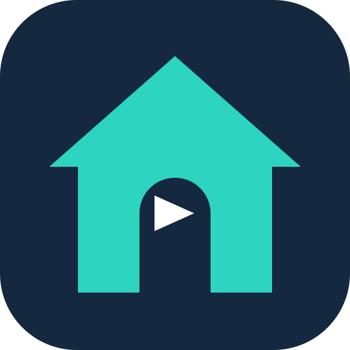
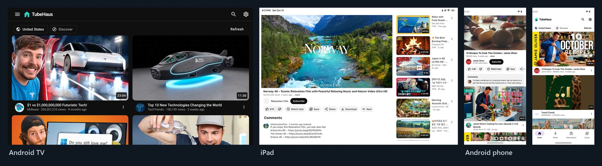
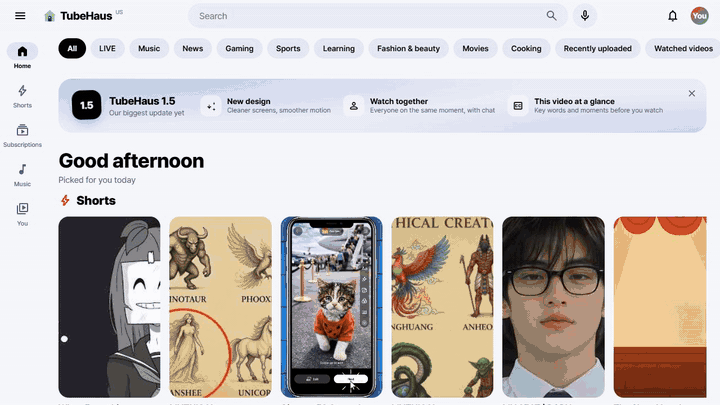

<div align="center">



# TubeHaus (튜브하우스)

### 늘 쓰던 그 유튜브, 구글의 눈길만 빼고.

TV, 폰, PC, 아이패드에서. 내 서버에 돌리거나, 그냥 앱을 깔거나. 한국인이 만들었어요!

[](https://github.com/biolend83/tubehaus/releases)
[](LICENSE)
[](https://github.com/biolend83/tubehaus/actions/workflows/check.yml)

[](https://selfh.st/weekly/2026-10-23/)

**[⬇ 앱 받기](#앱-받기)** &nbsp;·&nbsp; **[🖥️ 서버 설치](#빠른-설치-docker)** &nbsp;·&nbsp; **[✨ 1.6 새 기능](#16-새-기능-자체-유튜브-엔진)** &nbsp;·&nbsp; [English](README.md) · **한국어**



<a href="https://www.producthunt.com/products/tubehaus?embed=true&amp;utm_source=badge-featured&amp;utm_medium=badge&amp;utm_campaign=badge-tubehaus" target="_blank" rel="noopener noreferrer"></a>
<a href="https://fazier.com" target="_blank"></a>

<sub>독립 오픈소스 소프트웨어이며 YouTube·Google과 관계없어요. [면책 조항](#면책-조항)을 꼭 읽어 주세요.</sub>

</div>

## 한눈에

<table>
<tr>
<td width="33%" valign="top">

### 🎬 생김새가 *그냥* 유튜브
같은 홈 화면, 같은 플레이어, 같은 단축키. 집에서 아무도 새로 배울 게 없고, TV에는 리모컨용 화면이 따로 있어요.

</td>
<td width="33%" valign="top">

### 🔒 구글에 주는 건 없음
구글 계정도, 광고도, 추적 스크립트도 없어요. 구독, 기록, 재생목록은 내 기기나 내 서버에 있고, 어떤 형식으로든 내보낼 수 있어요.

</td>
<td width="33%" valign="top">

### 🏠 온 집이 보관함 하나
TV에서 멈추고 폰에서 이어 봐요. 집의 모든 기기와 브라우저가 보관함 하나를 같이 쓰거나, 사람마다 따로 써요.

</td>
</tr>
</table>

## 어떤 TubeHaus를 쓸까요

두 가지 방식이 있어요. 이름도 생김새도 같고, 일하는 *곳*만 달라요.

| | 📱 **앱** | 🖥️ **서버판** (이 브랜치) |
|---|---|---|
| **이럴 때** | 폰, TV, PC 한 대에서, 오늘 바로, 설정 없이 | 온 가족이 같이 쓰기, 아이폰/아이패드에서 설치 없이, 유튜브가 내 기기 주소를 모르게 |
| **돌아가는 곳** | 안드로이드, 안드로이드 TV / 구글 TV, Windows, macOS, 리눅스, 아이패드/아이폰 | Docker가 되는 아무 서버: 클라우드, 집 PC, 라즈베리파이. 보는 건 아무 브라우저 |
| **유튜브와 통신하는 쪽** | 기기가 직접, 앱 안의 자체 엔진으로 | 내 서버가 자체 엔진으로, Cloudflare WARP를 거쳐서. 기기는 내 서버하고만 통신해요 |
| **유튜브가 보는 주소** | 내 기기 주소. 다른 유튜브 앱과 같아요 | Cloudflare WARP 주소. 우리 집 주소가 아니에요 |
| **보관함** | 그 기기에, 또는 내 TubeHaus 서버와 같이 | 서버에. 모든 기기와 사람이 같이 써요 |
| **여기에만 있는 것** | 오프라인 저장, 백그라운드 재생과 PIP, PC의 mpv 플레이어, 기기 안에서 배우는 추천 | 라이브 실시간 자막(whisper.cpp), TV로 보내기, 원본 화질 저장, 아무 TV 브라우저에서 TV 모드 |
| **시작하기** | **[내려받기](#앱-받기)** | **[docker compose up](#빠른-설치-docker)** |

**둘 다?** 앱을 내 서버에 연결할 수 있어요(설정 → *TubeHaus 서버*). 보관함은 어디서나 하나로 쓰고, 영상은 각 앱이 직접 재생해요.

### 앱 받기

| 플랫폼 | 내려받기 | 참고 |
|---|---|---|
| 🤖 **안드로이드·TV** | [APK](https://github.com/biolend83/tubehaus/releases/download/app-v1.6.0/TubeHaus-1.6.0.apk) | 안드로이드 8 이상. 안드로이드 TV는 Downloader 코드 **3155410**. 자동 업데이트는 [Obtainium](https://apps.obtainium.imranr.dev/redirect?r=obtainium://app/%7B%22id%22%3A%20%22io.github.biolend83.tubehaus%22%2C%20%22url%22%3A%20%22https%3A%2F%2Fgithub.com%2Fbiolend83%2Ftubehaus%22%2C%20%22author%22%3A%20%22biolend83%22%2C%20%22name%22%3A%20%22TubeHaus%22%2C%20%22additionalSettings%22%3A%20%22%7B%5C%22filterReleaseTitlesByRegEx%5C%22%3A%20%5C%22%5ETubeHaus%20%5C%22%2C%20%5C%22fallbackToOlderReleases%5C%22%3A%20true%2C%20%5C%22includePrereleases%5C%22%3A%20false%2C%20%5C%22apkFilterRegEx%5C%22%3A%20%5C%22TubeHaus-%5C%5C%5C%5Cd%5C%22%7D%22%7D)으로 |
| 🪟 **Windows** | [MSI](https://github.com/biolend83/tubehaus/releases/download/app-v1.6.0/TubeHaus-1.6.0.msi) | 또는 `scoop bucket add tubehaus https://github.com/biolend83/tubehaus` 다음 `scoop install tubehaus` |
| 🍏 **macOS** | [M칩](https://github.com/biolend83/tubehaus/releases/download/app-v1.6.0/TubeHaus-1.6.0-mac-arm64.dmg) · [인텔](https://github.com/biolend83/tubehaus/releases/download/app-v1.6.0/TubeHaus-1.6.0-mac-x64.dmg) | 또는 `brew tap biolend83/tubehaus https://github.com/biolend83/tubehaus && brew trust biolend83/tubehaus && brew install --cask tubehaus` (mpv가 앱 안에 들어 있어요) |
| 🐧 **리눅스** | [.deb](https://github.com/biolend83/tubehaus/releases/download/app-v1.6.0/TubeHaus-1.6.0-linux-amd64.deb) · [.rpm](https://github.com/biolend83/tubehaus/releases/download/app-v1.6.0/TubeHaus-1.6.0-linux-x86_64.rpm) | ARM64와 tar.gz는 [전체 파일](https://github.com/biolend83/tubehaus/releases/latest)에, Arch는 [`packaging/aur`](packaging/aur) |
| 📱 **아이패드 / 아이폰** | [.ipa](https://github.com/biolend83/tubehaus/releases/download/app-v1.6.0/TubeHaus-1.6.0-ipad.ipa) (베타) | iOS 16 이상, [Sideloadly](https://sideloadly.io/)와 내 Apple ID로 설치(무료 ID는 7일마다 다시 서명). 애플 플레이어로 4K까지, 백그라운드 재생, PIP, 오프라인 저장. 설치가 싫다면 사파리에서 서버판을 쓰세요 |

전체 파일, Windows portable, ARM 빌드: **[최신 릴리스](https://github.com/biolend83/tubehaus/releases/latest)**. 플랫폼별 설치 안내와 소스: [`android-app`](https://github.com/biolend83/tubehaus/tree/android-app) · [`windows-app`](https://github.com/biolend83/tubehaus/tree/windows-app) · [`mac-app`](https://github.com/biolend83/tubehaus/tree/mac-app) · [`linux-app`](https://github.com/biolend83/tubehaus/tree/linux-app) · [`ios-app`](https://github.com/biolend83/tubehaus/tree/ios-app). 이 README의 나머지는 서버판 이야기예요.

## 1.6 새 기능: 자체 유튜브 엔진

서버판이 이제 Invidious 위에서 돌지 않아요. 유튜브에 직접 물어봐서, **컨테이너가 세 개 줄었고**(Invidious, companion, PostgreSQL 없음) 중요한 곳에서 더 빨라요. 같은 서버, 같은 WARP 주소에서 나란히 잰 결과예요(처음 여는 경우):

| 여는 것 | TubeHaus 1.6 | Invidious |
|---|---|---|
| 영상 | **0.60초** `▇▇▇▇▇▇` | 1.29초 `▇▇▇▇▇▇▇▇▇▇▇▇▇` |
| 채널 | **0.27초** `▇▇▇` | 0.66초 `▇▇▇▇▇▇▇` |
| 채널의 동영상 탭 | **0.21초** `▇▇` | 0.61초 `▇▇▇▇▇▇` |
| 댓글 | 0.19초 `▇▇` | 0.16초 `▇▇` |
| 검색 | 0.63초 `▇▇▇▇▇▇` | 0.56초 `▇▇▇▇▇▇` |

영상 스트림도 10%쯤 빨랐어요(85 대 75 Mbit/s). 답은 여전히 [Invidious](https://invidious.io) API 모양이라 웹 화면, 앱의 서버 모드, 그 API를 쓰는 다른 도구가 그대로 돌아가요. 1.5까지는 Invidious와 [invidious-companion](https://github.com/iv-org/invidious-companion) 위에서 동작했고, 유튜브에 대해 아는 많은 것을 두 프로젝트에서 배웠어요. Invidious 팀에 감사드려요. 1.5에서 업데이트한다면 [아래](#빠른-설치-docker)를 보세요.

<div align="center">

</div>

## 서버판이 좋은 점

<table>
<tr>
<td width="50%" valign="top">

**⚡ 누르자마자, 늘 최고 화질로**<br>
영상 정보를 서버에 받아 두고 뒤에서 새로 고치고, 다음에 누를 만한 영상도 미리 받아 둬요. 화질을 알아서 낮추지 않아요. 60프레임과 기기가 하드웨어로 푸는 코덱을 먼저 고르고, 8K도 버퍼에 맞춰요.

</td>
<td width="50%" valign="top">

**🔒 기기가 구글과 통신하지 않아요**<br>
영상, 썸네일, 페이지가 전부 내 서버를 거쳐요. 구글 쿠키도 유튜브 스크립트도 브라우저에 들어오지 않아요. 유튜브는 Cloudflare WARP 주소만 보고, 우리 집 주소는 몰라요.

</td>
</tr>
<tr>
<td valign="top">

**🎙️ 라이브 실시간 자막**<br>
유튜브는 라이브에 자막을 안 줘요. TubeHaus는 [whisper.cpp](https://github.com/ggml-org/whisper.cpp)로 받아써서 재생보다 몇 초 앞서 자막을 만들어요. CPU 코어 하나면 돼요. 라이브도 조각을 미리 받아 정확히 이어 붙여서 끊기지 않아요.

</td>
<td valign="top">

**📺 TV에도 맞춰서**<br>
리모컨의 방향키, 확인, 뒤로만으로 움직이는 TV 모드, 그리고 **TV로 보내기**: 폰에서 고르면 TV에서 재생돼요(크롬캐스트 필요 없음). **같이 보기**는 방 안의 모두를 같은 초에 맞춰요.

</td>
</tr>
<tr>
<td valign="top">

**🌿 차분 모드**<br>
스위치 하나로 유튜브를 다시 "도구"로: 홈에는 구독 채널의 새 영상만, 쇼츠·인기·추천은 사라지고, 다음 영상 자동 재생도 없고, 댓글은 눌러야 펼쳐져요. 검색은 그대로예요.

</td>
<td valign="top">

**🧠 내 서버에서 배우는 쇼츠**<br>
몇 초 봤는지, 반복했는지, 좋아요를 눌렀는지, 넘겼는지가 채널·주제별 점수가 되어 내 서버의 작은 파일에 저장돼요. 네 번째 칸마다 새로운 것을 섞어요. 서버 밖으로 나가는 건 없고, 언제든 초기화할 수 있어요.

</td>
</tr>
<tr>
<td valign="top">

**🚫 낚시 제목·광고 읽기 끝**<br>
[DeArrow](https://dearrow.ajay.app)로 올린 사람 대신 사람들이 고른 제목과 썸네일, [SponsorBlock](https://sponsor.ajay.app)으로 광고 구간 건너뛰기와 "하이라이트로 이동", Return YouTube Dislike로 싫어요 수.

</td>
<td valign="top">

**💾 원본 화질로 저장**<br>
1080p와 4K는 영상과 소리가 따로 와요. 서버가 둘 다 받아서 ffmpeg로 합쳐 줘요. 내 언어 자막이 없는 영상은 번역 자막으로 봐요.

</td>
</tr>
<tr>
<td valign="top">

**☁️ 값싼 클라우드 서버에서도**<br>
클라우드 주소는 "봇이 아닌지 확인하려면 로그인하세요"가 자주 떠요. TubeHaus는 **Cloudflare WARP(프록시 모드)**로 나가고, 막히면 방문자 정보를 새로 받고, 그래도 막히면 WARP 주소를 바꿔요.

</td>
<td valign="top">

**🌍 13개 언어**<br>
한국어 · English · 日本語 · 简体中文 · Español · Português · Français · Deutsch · Русский · हिन्दी · Bahasa Indonesia · Türkçe · বাংলা. 조회수와 날짜도 언어마다 그 나라 방식으로 보여요.

</td>
</tr>
</table>

<details>
<summary><b>그 밖의 기능</b></summary>

- 유튜브와 같은 화면: 홈, 검색, 채널, 재생목록, 구독, 기록, 보관함, 인기 급상승, 그리고 유튜브의 주제 페이지(음악, 실시간, 뉴스, 게임, 스포츠, 학습, 패션·뷰티)를 선반 그대로
- [Shaka Player](https://github.com/shaka-project/shaka-player) 기반 플레이어: 챕터, 탐색 미리보기, 재생바 위 **"가장 많이 다시 본 장면"** 물결, 재생 속도, 수면 타이머, 통계, 미니 플레이어, 영화관 모드, 앰비언트 모드, 잠금 화면과 블루투스 버튼 조작
- 모든 기기가 같은 보관함: 구독(RSS 기반 피드), 시청 기록, 이어보기, 나중에 볼 동영상, 좋아요, 재생목록
- 댓글, 스크립트, 마우스를 올리면 정확한 업로드 시각
- 구글 Takeout, Invidious, NewPipe, FreeTube, OPML, TubeHaus 백업에서 가져오기, 그리고 그 모든 형식으로 내보내기

브라우저가 직접 하는 선택 기능: SponsorBlock과 DeArrow(둘 다 영상 ID 대신 해시 앞부분만 보내요), Return YouTube Dislike. DeArrow 썸네일은 서버를 거쳐 받아서, DeArrow에는 보는 사람 대신 서버가 보여요.

</details>

## FreeTube, NewPipe와 뭐가 다른가요?

FreeTube와 NewPipe는 오래되고 훌륭한 프로젝트이고, TubeHaus도 많은 걸 배웠어요. 차이는 주로 어디서 돌아가는지와 생김새예요.

| | **TubeHaus** | **FreeTube** | **NewPipe** |
|---|---|---|---|
| **돌아가는 곳** | 안드로이드 폰과 안드로이드 TV / 구글 TV, 윈도우, macOS, 리눅스, 아이패드/아이폰(사이드로드), 서버판으로는 모든 브라우저 | 윈도우, macOS, 리눅스 | 안드로이드 폰과 태블릿 |
| **생김새** | 유튜브와 같음: 같은 배치, 같은 단축키 | 자체 디자인 | 자체 디자인 |
| **구글 계정** | 필요 없음 | 필요 없음 | 필요 없음 |
| **첫 화면** | 본 것·좋아요·건너뛴 것·숨긴 것으로 기기 안에서 배운 추천, 밖으로 나가는 건 없음 | 구독, 인기 | 구독 피드, 인기 |
| **여러 기기에서 하나의 보관함** | 선택: 앱들을 내 TubeHaus 서버에 연결 | 파일로 내보내기/가져오기 | 파일로 내보내기/가져오기 |
| **SponsorBlock, DeArrow** | 둘 다 기본 포함 | 둘 다 기본 포함 | 공식 앱에는 없음(포크인 Tubular에 SponsorBlock) |
| **TV에서** | 리모컨용: 방향키로 움직이는 TV 화면 | TV판 없음 | 되긴 하지만 폰용 화면 |
| **역사** | 새 프로젝트(2026), 베타, 관리자 1명 | 2018년부터, 큰 커뮤니티 | 2015년부터, 큰 커뮤니티, F-Droid에 있음 |

**다른 걸 고르면 좋을 때:** 컴퓨터용 앱 하나만 필요하고 가장 검증된 걸 원하면 FreeTube가 아주 좋아요. 안드로이드 폰만 쓰고 오랜 역사와 F-Droid를 원하면 NewPipe가 아주 좋아요. TubeHaus는 TV, 폰, PC, 아이패드에서 유튜브처럼 생긴 같은 앱을 쓰고, 원하면 보관함까지 하나로 묶고 싶을 때를 위한 거예요.

## 빠른 설치 (Docker)

| 필요한 것 | |
|---|---|
| **서버** | Docker와 docker compose가 있는 리눅스, x86-64 또는 ARM64(오라클 클라우드 무료 ARM 서버로 충분해요) |
| **CPU / 메모리** | 2코어 이상, 메모리 약 4GB. 라이브 자막을 켜고 라이브를 볼 때만 코어 하나를 더 써요 |
| **디스크** | 약 10~20GB, 대부분 이미지예요. 영상은 저장하지 않고 흘려보내요 |
| **주소** | HTTPS용 도메인, 또는 sslip.io 같은 무료 와일드카드 이름. 집 안에서만 쓰면 HTTP도 돼요 |

```sh
git clone https://github.com/biolend83/tubehaus && cd tubehaus
cp .env.example .env        # 도메인을 넣어요
docker compose pull         # 미리 빌드된 이미지 (amd64, arm64)
docker compose up -d
```

끝이에요. Caddy, 자체 유튜브 엔진과 Cloudflare WARP가 들어 있는 TubeHaus 서버, 라이브용 PO 토큰 제공기, 라이브 자막용 whisper.cpp가 한 번에 올라와요. 도메인을 열면 돼요.

> [!IMPORTANT]
> **공개 도메인에 올릴 거라면 `.env`에 로그인부터 넣으세요:** `TUBEHAUS_AUTH=basic`, `TUBEHAUS_USER`, `TUBEHAUS_PASSWORD_HASH` (해시는 `docker compose run --rm caddy caddy hash-password`로 만들고, `$`는 모두 `$$`로 써요). 이게 없으면 주소를 여는 사람 모두가 같은 보관함을 써요. 다른 방법: [외부에 열기 전에 로그인 붙이기](#외부에-열기-전에-로그인-붙이기).

> [!TIP]
> **1.5 이하에서 업데이트하나요?** 이제 Invidious, companion, PostgreSQL은 필요 없어요. `git pull` 다음에 `docker compose pull && docker compose up -d --remove-orphans`로 내리면 돼요. `.env`의 그쪽 비밀값은 지워도 돼요. 보관함은 `tubehaus-data` 볼륨에 그대로 있어요. 자세히: [업데이트와 백업](docs/UPGRADING.md)(영어).

<details>
<summary><b>도메인이 없거나, 이미 쓰는 리버스 프록시 뒤에 둘 때</b></summary>

Caddy가 아무 포트에서나 HTTP로 열 수 있어요. 설정 예시와 nginx·Traefik 전체 예시는 [영어 README](README.md#quick-start-docker)와 [docs/reverse-proxy.md](docs/reverse-proxy.md)(영어)에 있어요.

</details>

<details>
<summary><b>docker compose 대신 Flisk로</b></summary>

같은 컨테이너 세 개가 [Flisk](https://flisk.sh)용으로도 적혀 있고 같은 `.env`를 읽어요. 선택 사항이고, 기본은 계속 docker compose예요.

```sh
npm install -g @flisk-sh/flisk   # Flisk 1.4.26 이상
git clone https://github.com/biolend83/tubehaus && cd tubehaus
cp .env.example .env
flisk up                          # flisk status / flisk logs --service tubehaus / flisk down
```

한 서버에서는 둘 중 하나만 쓰세요. 포트, 볼륨, 업데이트, 기존 설치 옮기기는 [docs/FLISK.md](docs/FLISK.md)에 있어요. Flisk 구성은 @odykyi 님이 만들어 주셨어요 (#40, #42).

</details>

### 외부에 열기 전에 로그인 붙이기

기본으로는 계정이 없어서, 로그인을 안 붙이면 주소를 아는 사람 모두가 같은 보관함을 봐요.

- **내장 비밀번호:** `.env`에 `TUBEHAUS_AUTH=basic`, `TUBEHAUS_USER`, `TUBEHAUS_PASSWORD_HASH` (해시는 `docker compose run --rm caddy caddy hash-password`, `$`는 모두 `$$`로)
- **사람마다 계정:** `TUBEHAUS_AUTH=accounts`면 로그인 화면이 생기고 보관함이 사람마다 따로예요
- **내 문지기:** Authelia, Authentik, 패스키 게이트를 `forward_auth`로 앞에
- **아예 안 열기:** 집 네트워크에서만, 또는 Tailscale·WireGuard로 어디서든

차례로 적어 둔 안내: [가족에게 TubeHaus 열어 주기](docs/SELF-HOSTING.md)(영어).

### 잘 돌아가는지 점검

```sh
docker compose exec tubehaus python3 /app/server/tubehaus_server.py --doctor
```

WARP, 유튜브 연결, 검색, 실제 영상 조회(스트림 몇 바이트까지), 선택 기능(yt-dlp, ffmpeg, whisper)을 한 줄씩 점검해요. 문제가 있으면 [문제 해결](docs/TROUBLESHOOTING.md)(영어)을 보세요. 직접 설치(Docker 없이)와 설정 항목 전체는 [영어 README](README.md#manual-setup)에 있어요.

### 이미지 두 개: tubehaus와 tubehaus-web

둘 중에 고르는 판(에디션)이 아니라, 하나는 서버고 하나는 웹 화면이에요. 어떤 설치든 서버 하나에 웹 화면을 보여 주는 쪽이 하나 붙어요.

| 이미지 | 하는 일 | 포트 |
|---|---|---|
| `ghcr.io/biolend83/tubehaus` | **서버.** 유튜브와 통신하고, 보관함, 라이브 자막, 오프라인 저장, 같이 보기 방. 화면은 없어요 | 3010 (안쪽) |
| `ghcr.io/biolend83/tubehaus-web` | **웹 화면과 출입구.** 화면과, 나머지 요청을 서버로 보내는 Caddy. 밖으로 여는 포트는 이것 하나 | 8080 |

- **이 저장소에서 `docker compose up`** 하면 `tubehaus`만 써요. 화면은 받아 둔 저장소의 `web/` 폴더를 일반 `caddy` 이미지가 보여 줘요
- **앱 스토어**(Umbrel, CasaOS, TrueNAS)는 둘 다 써요. 앱은 하나로 보이고 포트는 8796 하나만 열려요
- **Unraid**는 **TubeHaus**, **TubeHaus-Web** 템플릿 두 개로 보여요. 또는 Docker Compose Manager 플러그인과 [`deploy/docker-compose.home.yml`](deploy/docker-compose.home.yml)로 한 번에
- **저장소 없이 집 서버에 바로:** [`deploy/docker-compose.home.yml`](deploy/docker-compose.home.yml)이 스토어와 같은 구성이에요(포트 하나, WARP 없음, 추가 권한 없음)

두 이미지는 서버 릴리스마다 같은 버전 번호로 함께 나와요. 버전을 맞춰 쓰세요.

## 어떻게 이어져 있나요

```
브라우저 ──► Caddy ─┬─ /y/*, 페이지 이동 ──► web/ (화면)
                    └─ 나머지 전부 ───────► TubeHaus 서버
                                              │  보관함, 라이브, 자막, 저장,
                                              │  그리고 자체 유튜브 엔진 (/api/v1/*,
                                              │  영상 스트림, 자막, 썸네일)
                                              ▼
                                  Cloudflare WARP (프록시 모드)
                                              │
                                           YouTube
```

엔진은 유튜브 공식 앱들과 같은 방식으로 물어봐요. 목록(검색, 채널, 재생목록, 댓글)은 웹 클라이언트로, 영상 스트림은 visionOS 클라이언트로(PO 토큰 없는 그냥 주소), 정확한 업로드 시각과 분류는 웹 플레이어로, 열어 둔 채 압축한 연결로요. 답은 Invidious API 모양(`/api/v1/videos`, `/api/v1/search` 등, `?local=true` 포함)이라 그 API를 쓰는 도구도 붙일 수 있어요. 자세히: [docs/ARCHITECTURE.md](docs/ARCHITECTURE.md)(영어).

## 공개 서버로 열기

<details>
<summary><b>설치 없이 써 보게 해 주기: <code>TUBEHAUS_PUBLIC=1</code></b></summary>

- **방문자 기록은 각자의 브라우저에 저장돼요.** 구독, 시청 기록, 이어보기, 재생목록이 서버에 남지 않아서, 모르는 사람끼리 서로의 기록을 볼 수 없어요
- **서버는 저장 없는 일만 해요:** 피드 받아오기, 가져오기 파일 읽기, 내보내기 변환, 영상 재생
- **꺼지는 기능:** TV로 보내기, 서버 다운로드(낯선 사람끼리 공유되기 때문), 쇼츠 추천 학습
- **사람이 몰려도 버티게:** `.env`에서 동시 시청자 수(`TUBEHAUS_MAX_VIEWERS`), 최고 화질(`TUBEHAUS_MAX_HEIGHT`, 예: 1080), 한 사람당 분당 요청 수(`TUBEHAUS_RATE_PER_MIN`, 공개 서버 기본 120)를 정할 수 있어요. 자리가 차면 새로 온 사람에게 "바빠요, 잠시 뒤에"라고 알려주고, 이미 보는 사람은 끊기지 않아요. 같은 영상이나 같은 채널을 여러 명이 동시에 열면 유튜브에는 한 번만 물어보고, 라이브는 몇 명이 보든 한 번만 받아와요
- **바로 쓰는 공개 서버 구성:** `deploy/docker-compose.public.yml`에 다 들어 있어요. 들어오면 먼저 봇 확인 화면(Anubis, 몇 초 계산)이 뜨고, 그다음 계정 만들기(사용자 이름과 비밀번호만, 이메일 없음)를 해야 볼 수 있어요. 비밀번호는 60만 번 해싱해서 저장하고, 가입과 로그인은 네트워크마다 횟수를 제한해요
- **열기 전에:** 영상이 서버를 거쳐서 데이터 사용량이 커요. 사람이 많으면 유튜브에 더 빨리 막힐 수 있어요. 내장 비밀번호는 끄고 두세요

</details>

## 자주 묻는 질문

<details>
<summary><b>아직 Invidious가 필요한가요? 쓰던 건 그대로 둬도 되나요?</b></summary>

아니요, 1.6부터는 서버가 유튜브에 직접 물어봐요. 답은 Invidious API와 같은 모양이라, Invidious 인스턴스의 API를 쓰는 앱(Yattee, FreeTube의 API 모드 등)도 붙을 수 있어요. 다만 Invidious 계정이 필요한 부분(그쪽 구독, 로그인)은 없어요. 쓰던 Invidious는 그대로 둬도 서로 방해하지 않아요. TubeHaus가 더 이상 쓰지 않을 뿐이에요.

</details>

<details>
<summary><b>영상은 어디서 오나요? 서버에 저장되나요?</b></summary>

전부 유튜브에서 와요. 보관함(구독, 기록, 재생목록)과, 저장할 때 잠깐 쓰는 임시 파일 말고는 아무것도 저장하지 않아요.

</details>

<details>
<summary><b>추천 알고리즘이 있나요?</b></summary>

쇼츠에는 있어요. 전부 내 서버에서 돌아가요(위의 "내 서버에서 배우는 쇼츠"). 일반 영상은 구독 피드, 인기와 분야별 탭, 영상마다 유튜브가 주는 관련 영상 목록을 보여줘요. 구글 계정이 없으니 구글이 내 시청을 학습하는 일은 없어요.

</details>

<details>
<summary><b>연령 제한 영상은요?</b></summary>

대부분 재생되지 않아요. 나이 확인을 통과할 로그인 계정이 없기 때문이에요.

</details>

<details>
<summary><b>구독을 가져오거나, 내 데이터를 빼낼 수 있나요?</b></summary>

네. 설정 → 내 데이터(또는 구독 관리 화면)의 **파일에서 가져오기**로 구글 Takeout(구독 CSV, `watch-history.json` 시청 기록), Invidious, NewPipe, FreeTube 내보내기 파일, OPML, TubeHaus 백업을 가져올 수 있어요. **내보내기**로는 TubeHaus 전체 백업(구독, 시청 기록, 이어보기, 재생목록, 좋아요), Invidious 형식, Takeout과 같은 CSV, RSS 리더용 OPML을 받을 수 있어요. 내 데이터가 TubeHaus에 갇히는 일은 없어요.

</details>

<details>
<summary><b>밖으로 정보를 보내나요?</b></summary>

아니요. 계정도 원격 수집도 없어요. 밖으로 나가는 요청은 유튜브(서버에서, WARP를 거쳐서), DeArrow 썸네일 서버(서버에서, DeArrow 썸네일을 켰을 때), 그리고 브라우저의 선택 기능(SponsorBlock, DeArrow, Return YouTube Dislike)뿐이에요.

</details>

<details>
<summary><b>폰과 TV에서는 어떻게 접속하나요?</b></summary>

웹앱이에요. 브라우저에서 내 주소를 열거나, "홈 화면에 추가"로 앱처럼 설치하면 돼요. TV 브라우저에서는 리모컨으로 조작하는 TV 모드가 켜져요. 또는 [TubeHaus 앱](#앱-받기)을 따로, 또는 내 서버에 연결해서 쓰세요.

</details>

## 함께하기

- **질문과 설치 도움:** [Discussions](https://github.com/biolend83/tubehaus/discussions) (`--doctor` 결과를 같이 붙여 주세요)
- **버그와 기능 제안:** [Issues](https://github.com/biolend83/tubehaus/issues/new/choose)
- **기여:** [CONTRIBUTING.md](CONTRIBUTING.md)(영어). 번역 고치기가 첫 기여로 좋아요
- **보안 문제:** 공개 이슈 말고 [비공개로 알려 주세요](SECURITY.md)
- **바뀐 것:** [CHANGELOG.md](CHANGELOG.md)와 [릴리스](https://github.com/biolend83/tubehaus/releases)

## 고마운 사람들

코드, 번역, 테스트, 아이디어로 TubeHaus를 더 좋게 만들어 준 분들이에요.

**코드와 디자인**
-  [@onedge](https://github.com/onedge): 음악 플레이어의 "음악으로 돌아가기" (#68, #69)
-  [@Aaqibhafeezkhan](https://github.com/Aaqibhafeezkhan): 집과 재생 버튼 아이콘, 재생 속도 기억, nginx 예시, 스페인어 다듬기 (#28, #29, #30, #31)
-  [@bh-official](https://github.com/bh-official): 마우스를 올리면 정확한 업로드 날짜, 업로드 시각 테스트 (#26, #27)
-  [@onyks-os](https://github.com/onyks-os): 첫 기여, 설치 안내 수정 (#1)

**번역**
-  [@SakarPaisen](https://github.com/SakarPaisen): 터키어 (#8)
-  [@rahul05ranjan](https://github.com/rahul05ranjan): 벵골어, 원어민의 힌디어 다듬기 (#16, #17)

**아이디어와 버그 제보**
-  [@JamesMowery](https://github.com/JamesMowery): 파일 가져오기와 데이터 내보내기 제안(v0.4.0), 새 영상의 업로드 시각 오류 제보 (#14, #15, #20)

**앱 테스트** ([r/DigitalEscapeTools](https://www.reddit.com/r/DigitalEscapeTools/))
- [u/Proper_Witness9173](https://www.reddit.com/user/Proper_Witness9173/): 밝기·볼륨 제스처, 태블릿 화면, 영상 옆 댓글, PiP 등 0.3.8의 대부분
- [u/DryYam2258](https://www.reddit.com/user/DryYam2258/): 첫 Mac 테스터. 글자 크기, 구독 지우기, 채널 사진 요청과 구독 그룹 제안
- [u/Gloomy_Acadia_445](https://www.reddit.com/user/Gloomy_Acadia_445/): 리눅스 요청으로 .deb, .rpm, tar.gz가 생겼어요
- [u/Victor_Orbis35](https://www.reddit.com/user/Victor_Orbis35/): Windows "mpv is missing" 제보. 원인은 빠진 Vulkan 런타임이었어요 (0.3.5에서 수정)

유용한 이슈를 열었거나, PR을 보냈거나, 앱을 테스트해 주셨나요? 여기에 함께 올려 드릴게요.

## 면책 조항

> [!CAUTION]
> **TubeHaus는 개인이 만든 무료 오픈소스 소프트웨어예요. 유튜브나 구글과 제휴하거나 승인·후원을 받은 프로젝트가 아니에요.** "YouTube"는 Google LLC의 상표예요.
>
> - TubeHaus는 영상을 저장하거나 올리거나 배포하지 않아요. 영상은 유튜브에서 내 기기(앱)나 내가 직접 운영하는 서버(서버판)로 바로 와요.
> - **내려받은 영상은 본인이 개인적으로 보는 용도로만 쓰세요.** 영상의 저작권은 원래 주인에게 있어요. 공유하거나 다시 올리거나 팔거나 그 밖의 방법으로 퍼뜨리는 건 전적으로 그렇게 한 사람의 책임이고, 만든 사람은 책임지지 않아요.
> - 라이선스에 적힌 대로 "있는 그대로" 제공되며 어떤 보증도 하지 않아요. 만든 사람과 기여자는 사용 방법이나 사용으로 생기는 일에 책임지지 않아요.
> - 사는 곳의 법과 연결하는 서비스의 약관에 맞게 쓰는 건 사용하는 사람의 책임이에요.
> - 만든 사람은 공개 서버나 그 밖의 서비스를 운영하지 않아요.
> - **권리자분들께:** 이 저장소의 내용이 권리를 침해한다고 생각되면 [이슈](https://github.com/biolend83/tubehaus/issues/new)로 자세한 내용을 알려 주세요(비공개 연락이 필요하면 거기서 말씀해 주세요). 확인해서 타당하면 바로 내릴게요.

## 라이선스

AGPL-3.0, Invidious와 같아요. 위의 [면책 조항](#면책-조항)도 함께 봐 주세요.
