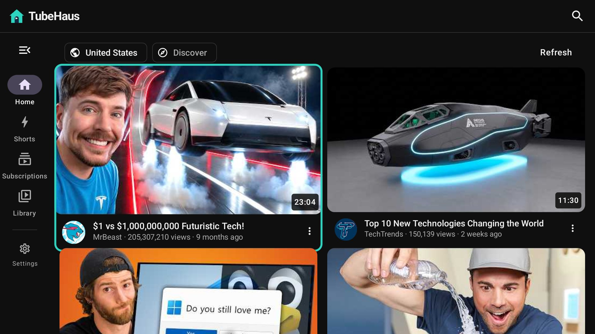

<div align="center">

# TubeHaus for Android, Windows, macOS, Linux and iPad

**YouTube on your own terms — and everything runs on your device.**

No server, no account, no Google sign-in, no tracking. The app talks to YouTube directly,
keeps your subscriptions, history and playlists on the device, and works out recommendations
there too.

Have a TubeHaus server at home? Connect it in Settings and your library is shared with your other
devices and the web version (optional).

**[⬇ Android APK](https://github.com/biolend83/tubehaus/releases/download/app-v0.5.9/TubeHaus-0.5.9.apk)** · **[⬇ Windows](https://github.com/biolend83/tubehaus/releases/download/app-v0.5.9/TubeHaus-0.5.9.msi)** · **[⬇ macOS](https://github.com/biolend83/tubehaus/releases/download/app-v0.5.9/TubeHaus-0.5.9-mac-arm64.dmg)** · **[⬇ Linux .deb](https://github.com/biolend83/tubehaus/releases/download/app-v0.5.9/TubeHaus-0.5.9-linux-amd64.deb)** · **[⬇ iPad / iPhone](https://github.com/biolend83/tubehaus/releases/download/app-v0.5.9/TubeHaus-0.5.9-ipad.ipa)** (0.5.9, beta)

[](https://apps.obtainium.imranr.dev/redirect?r=obtainium://app/%7B%22id%22%3A%20%22io.github.biolend83.tubehaus%22%2C%20%22url%22%3A%20%22https%3A%2F%2Fgithub.com%2Fbiolend83%2Ftubehaus%22%2C%20%22author%22%3A%20%22biolend83%22%2C%20%22name%22%3A%20%22TubeHaus%22%2C%20%22additionalSettings%22%3A%20%22%7B%5C%22filterReleaseTitlesByRegEx%5C%22%3A%20%5C%22%5ETubeHaus%20%5C%22%2C%20%5C%22fallbackToOlderReleases%5C%22%3A%20true%2C%20%5C%22includePrereleases%5C%22%3A%20false%2C%20%5C%22apkFilterRegEx%5C%22%3A%20%5C%22TubeHaus-%5C%5C%5C%5Cd%5C%22%7D%22%7D)

**Android** · [Windows](https://github.com/biolend83/tubehaus/tree/windows-app) · [macOS](https://github.com/biolend83/tubehaus/tree/mac-app) · [Linux](https://github.com/biolend83/tubehaus/tree/linux-app) · [iPad / iPhone](https://github.com/biolend83/tubehaus/tree/ios-app) · [Web app (self-hosted)](https://github.com/biolend83/tubehaus) · [All releases](https://github.com/biolend83/tubehaus/releases)

</div>

## Disclaimer

> [!CAUTION]
> **TubeHaus is independent, free, open-source software. It is not affiliated with, endorsed by or sponsored by YouTube or Google.** "YouTube" is a trademark of Google LLC.
>
> - TubeHaus does not host, store or distribute any videos. They come straight from YouTube to your own device (the app) or to a server you run yourself (the server version).
> - **Downloaded videos are for your own personal viewing.** Their copyright belongs to their owners. If you share, upload, sell or otherwise distribute them, that is entirely your own responsibility, and the authors are not liable for it.
> - It is provided "as is", without warranty of any kind, as the license says. The authors and contributors are not responsible for how it is used or for anything that results from using it.
> - You are responsible for using it in line with the laws where you live and the terms of the services you connect to.
> - The app talks only to YouTube (for videos), GitHub (to check for updates) and, if you connect one, your own TubeHaus server. The maintainer runs no server for it.
> - **Rights holders:** if you believe something in this repository infringes your rights, [open an issue](https://github.com/biolend83/tubehaus/issues/new) with the details (or ask there for a private contact). It will be looked at and, where justified, removed promptly.

## What it does

- **Offline downloads** — save a video in the quality you pick and watch it without internet
  (Library → Downloads). Nothing is converted: the app keeps YouTube's own files.
- **Android TV / Google TV** — the Android APK runs on TVs too: it shows on the TV's home
  screen, the remote moves a highlighted selection from card to card, and videos fill the screen
  (OK pauses, left and right jump 10 seconds, hold OK on a card for its menu).

  
- **Home that learns on your device** — built from videos related to what you watched, new uploads
  from your subscriptions and the topics you like, with room for something new so it doesn't
  collapse into one subject. Settings → *What TubeHaus learned about you* shows every score and
  lets you change or wipe it.
- **Shorts with their own engine** — learns from skipping, finishing, looping and likes.
- **Subscriptions without an account** — from each channel's public feed, sorted into groups if
  you like (a tab each, like PocketTube's). Import from YouTube (Google Takeout), NewPipe, FreeTube,
  Invidious, PocketTube (with its groups), TubeHaus or OPML.
- **A real player** — adaptive quality up to 4K/8K (AV1, VP9, H.264 picked by what your hardware
  decodes), captions with auto-translate, speed, resume where you stopped.
  - Android: background play with notification controls, picture-in-picture, opens YouTube links,
    swipe on the left/right in full screen for brightness/volume, and a wide layout on tablets.
  - iPad / iPhone: Apple's own player (AVPlayer, up to 4K), background play, picture-in-picture,
    offline downloads, and a YouTube engine that updates itself without reinstalling the app.
  - Windows, macOS, Linux: mpv with GPU decoding, the same controls as on the phone plus a volume bar,
    keyboard shortcuts (space/K, arrows, J/L, F, M) and the mouse wheel for Shorts.
- **Comments beside the video** — on tablets and desktops in a side panel, on phones under the
  video, which keeps playing.
- **Calm mode** — no view counts, no Shorts, nothing starts by itself.
- **Focus switches** — hide thumbnails, comments, Shorts or related videos, and turn off the home
  feed or the subscription feed, each on its own (Settings → Focus).
- **Sync with your own TubeHaus server (optional)** — Settings → *TubeHaus server*: subscriptions,
  history and resume points, watch later, likes and playlists stay the same on your phone, TV,
  computer and the web version. Changes wait while you're offline. Without a server the app works
  on its own, as before.
- **Your data moves freely** — export a TubeHaus backup (also readable by the TubeHaus web app),
  Invidious, CSV or OPML.

## How it works

The app has its own small YouTube engine (`common/src/app/tubehaus/engine`). It calls InnerTube,
the JSON API YouTube's own apps use: the web client for search, channels, playlists, related
videos and comments; for streams, clients whose answers carry ready-to-play URLs. Videos never go
through a TubeHaus server. If you connect your own (Settings → *TubeHaus server*), only your library
(subscriptions, history, playlists) is synced with it.

One set of Kotlin sources (`common/src`) is compiled twice: by the Android app with Jetpack
Compose and by the desktop app with Compose for Desktop, and a third time by Kotlin/Native with
Compose Multiplatform for iPad and iPhone. Only the player differs — ExoPlayer (Media3) on Android,
libmpv on Windows, macOS and Linux, AVPlayer on iOS. Details for iOS are on the
[`ios-app`](https://github.com/biolend83/tubehaus/tree/ios-app) branch.

## Install

- **Android 8.0+** — [the APK](https://github.com/biolend83/tubehaus/releases/download/app-v0.5.9/TubeHaus-0.5.9.apk)
  (beta). Open it on the phone and allow installing from your browser when asked.
  Updates: the app tells you itself, or use Obtainium: [one tap to add it](https://apps.obtainium.imranr.dev/redirect?r=obtainium://app/%7B%22id%22%3A%20%22io.github.biolend83.tubehaus%22%2C%20%22url%22%3A%20%22https%3A%2F%2Fgithub.com%2Fbiolend83%2Ftubehaus%22%2C%20%22author%22%3A%20%22biolend83%22%2C%20%22name%22%3A%20%22TubeHaus%22%2C%20%22additionalSettings%22%3A%20%22%7B%5C%22filterReleaseTitlesByRegEx%5C%22%3A%20%5C%22%5ETubeHaus%20%5C%22%2C%20%5C%22fallbackToOlderReleases%5C%22%3A%20true%2C%20%5C%22includePrereleases%5C%22%3A%20false%2C%20%5C%22apkFilterRegEx%5C%22%3A%20%5C%22TubeHaus-%5C%5C%5C%5Cd%5C%22%7D%22%7D) (already set up), or by hand:
  *Add app* → source URL `https://github.com/biolend83/tubehaus` → under *Filter release titles by
  regular expression* enter `^TubeHaus `, turn on *Fallback to older releases*, and under
  *Filter APKs by regular expression* enter `TubeHaus-\d`. The filter
  matters: the same repository also has server releases ("Server 0.7.x") with no APK in them.
- **Android TV / Google TV** — the same APK. In the *Downloader* app, enter the code **3155410**
  (or the address `aftv.news/3155410`): it always gives the newest version. Or use *Send Files to TV*; TubeHaus then shows on the TV's home screen. Settings → *TV mode* turns the
  TV layout on for boxes that don't say they are a TV.
- **Windows 10/11** — [the installer](https://github.com/biolend83/tubehaus/releases/download/app-v0.5.9/TubeHaus-0.5.9.msi) or [setup .exe](https://github.com/biolend83/tubehaus/releases/download/app-v0.5.9/TubeHaus-0.5.9-win-x64-setup.exe), or a
  [portable .zip](https://github.com/biolend83/tubehaus/releases/download/app-v0.5.9/TubeHaus-0.5.9-win-x64-portable.zip) that needs no install; on Windows on ARM, the
  [ARM .zip](https://github.com/biolend83/tubehaus/releases/download/app-v0.5.9/TubeHaus-0.5.9-win-arm64-portable.zip) (beta, mpv built in). Windows may warn that the publisher is unknown, because the installer
  isn't code-signed: choose *More info* → *Run anyway*.
- **macOS** — [Apple Silicon .dmg](https://github.com/biolend83/tubehaus/releases/download/app-v0.5.9/TubeHaus-0.5.9-mac-arm64.dmg) or [Intel .dmg](https://github.com/biolend83/tubehaus/releases/download/app-v0.5.9/TubeHaus-0.5.9-mac-x64.dmg) (beta;
  .zip versions are on the release page).
  It uses Homebrew's mpv: `brew install mpv`. The app isn't signed by Apple yet, so the first time
  right-click it → *Open* → *Open*.
- **iPad / iPhone (iOS 16+)** — [the .ipa](https://github.com/biolend83/tubehaus/releases/download/app-v0.5.9/TubeHaus-0.5.9-ipad.ipa) (beta). Apple installs only apps it signed, so
  you sign it yourself with **[Sideloadly](https://sideloadly.io/)** (free, Windows or Mac) and your Apple ID: connect the
  iPad with a cable, drop the .ipa into Sideloadly, enter your Apple ID, press *Start*. Then on the
  iPad: Settings → General → *VPN & Device Management* → trust your Apple ID, and turn on
  Settings → Privacy & Security → *Developer Mode* if it asks. With a free Apple ID the app has to be
  re-signed every 7 days (Sideloadly can do that by itself over Wi-Fi). It's the same app, built for
  iOS: Apple's player with picture-in-picture, background play and offline downloads. More on the
  [`ios-app`](https://github.com/biolend83/tubehaus/tree/ios-app) branch.
- **Linux (x86-64 and ARM64)** — [.deb](https://github.com/biolend83/tubehaus/releases/download/app-v0.5.9/TubeHaus-0.5.9-linux-amd64.deb) for Debian/Ubuntu, [.rpm](https://github.com/biolend83/tubehaus/releases/download/app-v0.5.9/TubeHaus-0.5.9-linux-x86_64.rpm)
  for Fedora/openSUSE, or [a tar.gz](https://github.com/biolend83/tubehaus/releases/download/app-v0.5.9/TubeHaus-0.5.9-linux-x64.tar.gz) to unpack anywhere and run `TubeHaus/bin/TubeHaus`.
  ARM64 (Raspberry Pi 4/5 and others): [.deb](https://github.com/biolend83/tubehaus/releases/download/app-v0.5.9/TubeHaus-0.5.9-linux-arm64.deb), [.rpm](https://github.com/biolend83/tubehaus/releases/download/app-v0.5.9/TubeHaus-0.5.9-linux-aarch64.rpm),
  [tar.gz](https://github.com/biolend83/tubehaus/releases/download/app-v0.5.9/TubeHaus-0.5.9-linux-arm64.tar.gz).
  It uses your system's mpv: `sudo apt install libmpv2` (Fedora: `sudo dnf install mpv-libs`, Arch: `mpv`). New and not yet tested much: reports welcome.

Don't want to re-sign every week? On iPhone and iPad the TubeHaus web app (the server version) needs no
installing at all: add it to the home screen.

## Build

JDK 21+ and the Android SDK.

```sh
./gradlew :android:assembleRelease     # android/build/outputs/apk/release
./gradlew :desktop:run                 # needs libmpv-2.dll in desktop/resources/windows
./gradlew :desktop:packageMsi          # needs a JDK with jpackage
```

The iPad / iPhone app needs a Mac with Xcode; see the
[`ios-app`](https://github.com/biolend83/tubehaus/tree/ios-app) branch (CI builds it on GitHub's macOS runners).

libmpv for Windows comes from [shinchiro's mpv builds](https://github.com/shinchiro/mpv-winbuild-cmake/releases)
(`mpv-dev-x86_64-*.7z`, the file `libmpv-2.dll`). The release workflow downloads it.

## License

GPL-3.0.
