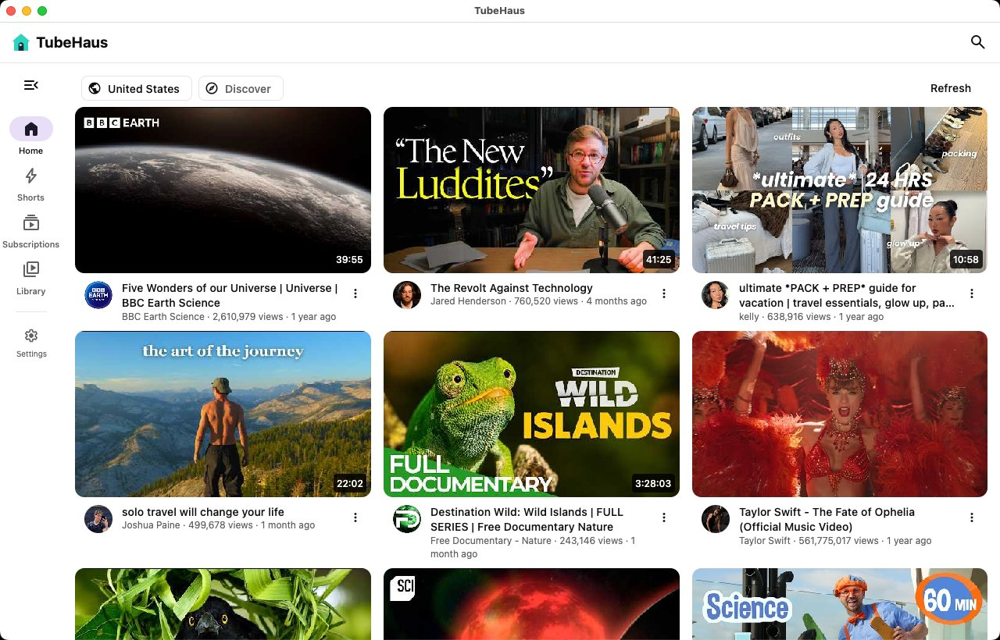

<div align="center">

# TubeHaus for macOS

**YouTube on your own terms — and everything runs on your computer.**

No server, no account, no Google sign-in, no tracking. The app talks to YouTube directly,
keeps your subscriptions, history and playlists on the device, and works out recommendations
there too.

Have a TubeHaus server at home? Connect it in Settings and your library is shared with your other
devices and the web version (optional).

For Apple Silicon (M1 and later) and Intel Macs.

**[⬇ Apple Silicon](https://github.com/biolend83/tubehaus/releases/download/app-v0.5.8/TubeHaus-0.5.8-mac-arm64.dmg)** · **[⬇ Intel](https://github.com/biolend83/tubehaus/releases/download/app-v0.5.8/TubeHaus-0.5.8-mac-x64.dmg)** (0.5.4, beta; .zip versions on the release page)

[Android](https://github.com/biolend83/tubehaus/tree/android-app) · [Windows](https://github.com/biolend83/tubehaus/tree/windows-app) · **macOS** · [Linux](https://github.com/biolend83/tubehaus/tree/linux-app) · [iPad / iPhone](https://github.com/biolend83/tubehaus/tree/ios-app) · [Web app (self-hosted)](https://github.com/biolend83/tubehaus) · [All releases](https://github.com/biolend83/tubehaus/releases)



</div>

## Disclaimer

> [!CAUTION]
> **TubeHaus is independent, free, open-source software. It is not affiliated with, endorsed by or sponsored by YouTube or Google.** "YouTube" is a trademark of Google LLC.
>
> - TubeHaus does not host, store or distribute any videos. They come straight from YouTube to your own device (the app) or to a server you run yourself (the server version).
> - **Downloaded videos are for your own personal viewing.** Their copyright belongs to their owners. If you share, upload, sell or otherwise distribute them, that is entirely your own responsibility, and the authors are not liable for it.
> - It is provided "as is", without warranty of any kind, as the license says. The authors and contributors are not responsible for how it is used or for anything that results from using it.
> - You are responsible for using it in line with the laws where you live and the terms of the services you connect to.
> - The app talks only to YouTube (for videos), GitHub (to check for updates) and, if you connect one, your own TubeHaus server. The maintainer runs no server for it.
> - **Rights holders:** if you believe something in this repository infringes your rights, [open an issue](https://github.com/biolend83/tubehaus/issues/new) with the details (or ask there for a private contact). It will be looked at and, where justified, removed promptly.

## What it does

- **Offline downloads** — save a video in the quality you pick and watch it without internet
  (Library → Downloads). Nothing is converted: the app keeps YouTube's own files.
- **Android TV / Google TV** — the Android APK runs on TVs too: it shows on the TV's home
  screen, the remote moves a highlighted selection from card to card, and videos fill the screen
  (OK pauses, left and right jump 10 seconds, hold OK on a card for its menu).
- **Home that learns on your device** — built from videos related to what you watched, new uploads
  from your subscriptions and the topics you like, with room for something new so it doesn't
  collapse into one subject. Settings → *What TubeHaus learned about you* shows every score and
  lets you change or wipe it.
- **Shorts with their own engine** — learns from skipping, finishing, looping and likes.
- **Subscriptions without an account** — from each channel's public feed, sorted into groups if
  you like (a tab each, like PocketTube's). Import from YouTube (Google Takeout), NewPipe, FreeTube,
  Invidious, PocketTube (with its groups), TubeHaus or OPML.
- **A real player** — adaptive quality up to 4K/8K (AV1, VP9, H.264 picked by what your hardware
  decodes), captions with auto-translate, speed, resume where you stopped.
  - Android: background play with notification controls, picture-in-picture, opens YouTube links.
  - Windows, macOS and Linux: mpv with GPU decoding, the same controls as on the phone plus a
    volume bar, keyboard shortcuts (space/K, arrows, J/L, F, M) and the mouse wheel for Shorts.
- **Comments beside the video** — in a side panel next to the video, which keeps playing.
- **Calm mode** — no view counts, no Shorts, nothing starts by itself.
- **Focus switches** — hide thumbnails, comments, Shorts or related videos, and turn off the home
  feed or the subscription feed, each on its own (Settings → Focus).
- **Sync with your own TubeHaus server (optional)** — Settings → *TubeHaus server*: subscriptions,
  history and resume points, watch later, likes and playlists stay the same on your phone, TV,
  computer and the web version. Changes wait while you're offline. Without a server the app works
  on its own, as before.
- **Your data moves freely** — export a TubeHaus backup (also readable by the TubeHaus web app),
  Invidious, CSV or OPML.

## How it works

The app has its own small YouTube engine (`common/src/app/tubehaus/engine`). It calls InnerTube,
the JSON API YouTube's own apps use: the web client for search, channels, playlists, related
videos and comments; for streams, clients whose answers carry ready-to-play URLs. Videos never go
through a TubeHaus server. If you connect your own (Settings → *TubeHaus server*), only your library
(subscriptions, history, playlists) is synced with it.

One set of Kotlin sources (`common/src`) is compiled twice: by the Android app with Jetpack
Compose and by the desktop app with Compose for Desktop. Only the player differs —
ExoPlayer (Media3) on Android, libmpv on Windows, macOS and Linux.

## Install

1. Install mpv with [Homebrew](https://brew.sh), the player TubeHaus uses:
   ```sh
   brew install mpv
   ```
   If mpv is missing, the app tells you when you first play a video.
2. Download the .dmg for your Mac, [Apple Silicon](https://github.com/biolend83/tubehaus/releases/download/app-v0.5.8/TubeHaus-0.5.8-mac-arm64.dmg) or [Intel](https://github.com/biolend83/tubehaus/releases/download/app-v0.5.8/TubeHaus-0.5.8-mac-x64.dmg),, open it and drag TubeHaus into *Applications*.
3. The app isn't signed by Apple yet, so macOS blocks a plain double-click the first time:
   right-click TubeHaus → *Open* → *Open*. After that it opens normally.

The app checks for a newer version each time it opens and offers the .dmg for your Mac's chip (Settings → *Check for updates*).
Your library is kept in `~/Library/Application Support/TubeHaus`.

## Build

JDK 21+ and `brew install mpv`.

```sh
./gradlew :desktop:run               # run from source
./gradlew :desktop:packageDmg        # needs a JDK with jpackage
```

The app finds Homebrew's libmpv in `/opt/homebrew/lib` (Apple Silicon) or `/usr/local/lib` (Intel).

## License

GPL-3.0.
