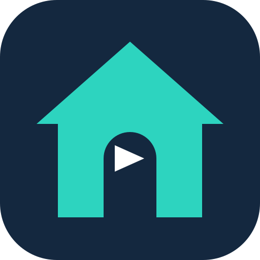
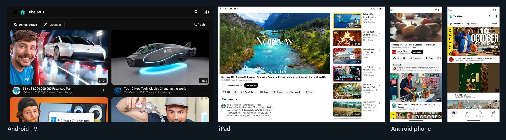
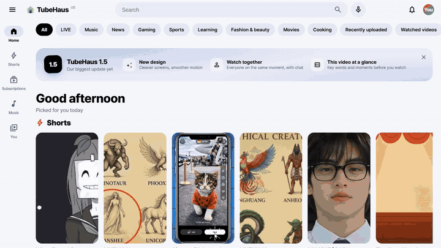

<div align="center">



# TubeHaus

### YouTube as you know it, without Google looking over your shoulder.

On the TV, the phone, the PC and the iPad. Run it on your own server, or just install the app.

[](https://github.com/biolend83/tubehaus/releases)
[](LICENSE)
[](https://github.com/biolend83/tubehaus/actions/workflows/check.yml)

[](https://selfh.st/weekly/2026-10-23/)

**[⬇ Get the app](#get-the-app)** &nbsp;·&nbsp; **[🖥️ Run the server](#quick-start-docker)** &nbsp;·&nbsp; **[📖 How it works](#how-it-works)** &nbsp;·&nbsp; **[❓ FAQ](#faq)** &nbsp;·&nbsp; **English** · [한국어](README.ko.md)



<a href="https://www.producthunt.com/products/tubehaus?embed=true&amp;utm_source=badge-featured&amp;utm_medium=badge&amp;utm_campaign=badge-tubehaus" target="_blank" rel="noopener noreferrer"></a>
<a href="https://fazier.com" target="_blank"></a>

<sub>Independent open-source software, not affiliated with YouTube or Google. Please read the [disclaimer](#disclaimer).</sub>

</div>

## At a glance

<table>
<tr>
<td width="33%" valign="top">

### 🎬 It *is* the YouTube layout
Same home grid, same player, same keyboard shortcuts. Nobody in the house has to learn anything new, and the TV gets a remote-friendly version of it.

</td>
<td width="33%" valign="top">

### 🔒 Nothing for Google
No Google account, no ads, no tracking scripts. Subscriptions, history and playlists are yours, on your device or your server, and they export to any format.

</td>
<td width="33%" valign="top">

### 🏠 One library for the house
Pause on the TV, carry on on the phone. Every device and every browser in the house shares one library, or each person gets their own.

</td>
</tr>
<tr>
<td colspan="3" valign="top">

### 🛡️ Keeps playing when YouTube pushes back
When a side door closes, TubeHaus falls back to **SABR**, the protocol youtube.com itself streams with, with its own BotGuard token and no account. On the server a flagged address is swapped for a new one by itself. [How it works](#how-it-works)

</td>
</tr>
</table>

## Pick your TubeHaus

There are two ways to run it. Same name, same look; they differ in *where* the work happens.

| | 📱 **The app** | 🖥️ **The server** (this branch) |
|---|---|---|
| **Best for** | One phone, TV or PC, today, with nothing to set up | A whole household, iPhone/iPad without sideloading, or keeping YouTube away from your devices |
| **Runs on** | Android, Android TV / Google TV, Windows, macOS, Linux, iPad/iPhone | Any Docker host: a VPS, a home PC, a Raspberry Pi. You watch in any browser |
| **Talks to YouTube** | The device itself, with the app's own engine | Your server, with its own engine, through Cloudflare WARP. Devices only talk to your server |
| **YouTube sees** | Your device's address, like any YouTube app | A Cloudflare WARP address, not your home |
| **Library** | On the device, or shared through your TubeHaus server | On the server, for every device and person |
| **Only here** | Offline downloads, background play and picture-in-picture, the mpv player on desktop, on-device recommendations | Live captions (whisper.cpp), send to TV, full-quality downloads, TV mode in any TV browser |
| **Get it** | **[Download](#get-the-app)** | **[docker compose up](#quick-start-docker)** |

**Both?** The app can connect to your server (Settings → *TubeHaus server*): one library everywhere, while each app still plays the video itself.

### Get the app

| Platform | Download | Notes |
|---|---|---|
| 🤖 **Android & TV** | [APK](https://github.com/biolend83/tubehaus/releases/download/app-v1.7.2/TubeHaus-1.7.2.apk) | Android 8+. On Android TV, Downloader code **3155410**. Updates with [Obtainium](https://apps.obtainium.imranr.dev/redirect?r=obtainium://app/%7B%22id%22%3A%20%22io.github.biolend83.tubehaus%22%2C%20%22url%22%3A%20%22https%3A%2F%2Fgithub.com%2Fbiolend83%2Ftubehaus%22%2C%20%22author%22%3A%20%22biolend83%22%2C%20%22name%22%3A%20%22TubeHaus%22%2C%20%22additionalSettings%22%3A%20%22%7B%5C%22filterReleaseTitlesByRegEx%5C%22%3A%20%5C%22%5ETubeHaus%20%5C%22%2C%20%5C%22fallbackToOlderReleases%5C%22%3A%20true%2C%20%5C%22includePrereleases%5C%22%3A%20false%2C%20%5C%22apkFilterRegEx%5C%22%3A%20%5C%22TubeHaus-%5C%5C%5C%5Cd%5C%22%7D%22%7D) |
| 🪟 **Windows** | [MSI](https://github.com/biolend83/tubehaus/releases/download/app-v1.7.2/TubeHaus-1.7.2.msi) | Or `scoop bucket add tubehaus https://github.com/biolend83/tubehaus` then `scoop install tubehaus` |
| 🍏 **macOS** | [Apple Silicon](https://github.com/biolend83/tubehaus/releases/download/app-v1.7.2/TubeHaus-1.7.2-mac-arm64.dmg) · [Intel](https://github.com/biolend83/tubehaus/releases/download/app-v1.7.2/TubeHaus-1.7.2-mac-x64.dmg) | Or `brew tap biolend83/tubehaus https://github.com/biolend83/tubehaus && brew trust biolend83/tubehaus && brew install --cask tubehaus` (mpv is inside the app) |
| 🐧 **Linux** | [.deb](https://github.com/biolend83/tubehaus/releases/download/app-v1.7.2/TubeHaus-1.7.2-linux-amd64.deb) · [.rpm](https://github.com/biolend83/tubehaus/releases/download/app-v1.7.2/TubeHaus-1.7.2-linux-x86_64.rpm) | ARM64 and tar.gz in [all files](https://github.com/biolend83/tubehaus/releases/latest); Arch: [`packaging/aur`](packaging/aur) |
| 📱 **iPad / iPhone** | [.ipa](https://github.com/biolend83/tubehaus/releases/download/app-v1.7.2/TubeHaus-1.7.2-ipad.ipa) (beta) | iOS 16+, installed with [Sideloadly](https://sideloadly.io/) and your Apple ID (re-signed every 7 days with a free one). Apple's player up to 4K, background play, picture-in-picture, offline downloads. Rather not sideload? Use the server in Safari |

All files, Windows portable and ARM builds: **[latest release](https://github.com/biolend83/tubehaus/releases/latest)**. Install notes and source per platform: [`android-app`](https://github.com/biolend83/tubehaus/tree/android-app) · [`windows-app`](https://github.com/biolend83/tubehaus/tree/windows-app) · [`mac-app`](https://github.com/biolend83/tubehaus/tree/mac-app) · [`linux-app`](https://github.com/biolend83/tubehaus/tree/linux-app) · [`ios-app`](https://github.com/biolend83/tubehaus/tree/ios-app). The rest of this README is about the server.
## Fast, with its own YouTube engine

Since 1.6 the server no longer sits on Invidious. It talks to YouTube itself, so the stack is **three containers lighter** (no Invidious, no companion, no PostgreSQL). It's also quick: a video starts on the streams alone and the title, description and related videos fill in a moment later, answers are kept and refreshed in the background, the stream connections to YouTube stay open, and a video's comments are fetched as it opens.

| | TubeHaus 1.6.3 | Invidious |
|---|---|---|
| **A video starts playing** | **0.16 s** `▇▇` | 1.29 s `▇▇▇▇▇▇▇▇▇▇▇▇▇` |
| The whole video page (title, description, related) | **0.59 s** `▇▇▇▇▇▇` | 1.29 s `▇▇▇▇▇▇▇▇▇▇▇▇▇` |
| A channel | **0.38 s** `▇▇▇▇` | 0.66 s `▇▇▇▇▇▇▇` |
| A channel's videos | **0.28 s** `▇▇▇` | 0.61 s `▇▇▇▇▇▇` |
| A search | **0.56 s** `▇▇▇▇▇▇` | 0.56 s `▇▇▇▇▇▇` |
| Comments, once the video is open | **0.002 s** `▏` | 0.16 s `▇▇` |
| **Anything opened again** | **0.002 s** `▏` | – |
| Each piece of the stream | **0.07 s** `▇` | – |

Medians of 10–12 first visits each, on one server through the same WARP address (TubeHaus measured 2026-11-17; Invidious in the 1.6.0 comparison, before it left the server). A search or channel is mostly YouTube's own time, so it can't go much lower; what TubeHaus adds is that the video plays before the page is complete, the next clicks are fetched while you look, and nothing is fetched twice. Stream pieces reuse open connections (a new one takes 0.17 s).

Hovering a video or showing search results already fetches the first few, so a click usually lands on a page that is ready. It still answers in [Invidious](https://invidious.io)' API format, so the web app, the apps' server mode and other tools that speak that API keep working. Up to 1.5 TubeHaus was built on Invidious and [invidious-companion](https://github.com/iv-org/invidious-companion), and much of what it knows about YouTube was learned from them: thank you, Invidious team. Updating from 1.5? See [below](#quick-start-docker).

<div align="center">

</div>

## Why TubeHaus

<table>
<tr>
<td width="50%" valign="top">

**⚡ Instant, and always the best picture**<br>
A video starts in about a sixth of a second, pages you've seen open from a cache that refreshes in the background, and the videos you're likely to open next are looked up before you click. Quality never drops on its own: 60 fps first, the codec your device decodes in hardware, a buffer sized for 8K.

</td>
<td width="50%" valign="top">

**🔒 Your devices never talk to Google**<br>
Video, thumbnails and pages all come through your server: no Google cookies or YouTube scripts in your browser. YouTube sees a Cloudflare WARP address, never your home.

</td>
</tr>
<tr>
<td valign="top">

**🎙️ Captions for live streams**<br>
YouTube has none. TubeHaus writes them on the fly with [whisper.cpp](https://github.com/ggml-org/whisper.cpp), a few seconds ahead of playback, on one CPU core. Live streams themselves don't stall: segments are fetched ahead with exact timing.

</td>
<td valign="top">

**📺 Made for the TV, too**<br>
A TV mode driven by the remote's arrows, OK and Back, and **Send to TV**: pick a video on the phone and it starts on the TV, no Chromecast needed. **Watch together** keeps everyone in a room on the same second.

</td>
</tr>
<tr>
<td valign="top">

**🌿 Calm mode**<br>
One switch turns YouTube back into a tool: Home shows only new videos from your subscriptions, Shorts, trending and recommendations disappear, nothing autoplays, comments stay folded. Search still works.

</td>
<td valign="top">

**🧠 Shorts that learn, on your server**<br>
How long you watched, looped, liked or swiped away becomes a score per channel and topic in a small file on your server. Every fourth Short is something new. Nothing leaves the server; reset it any time.

</td>
</tr>
<tr>
<td valign="top">

**🚫 No clickbait, no sponsor reads**<br>
[DeArrow](https://dearrow.ajay.app) titles and thumbnails chosen by people instead of the uploader, [SponsorBlock](https://sponsor.ajay.app) skips with "Jump to the highlight", and dislike counts from Return YouTube Dislike.

</td>
<td valign="top">

**💾 Keep it, in full quality**<br>
1080p and 4K come as separate video and audio; the server fetches both and merges them with ffmpeg. Subtitles are translated for videos without your language.

</td>
</tr>
<tr>
<td valign="top">

**☁️ Happy on a cheap cloud VM**<br>
Cloud addresses often get "Sign in to confirm you're not a bot". TubeHaus goes out through **Cloudflare WARP in proxy mode**, takes a fresh visitor identity, then a new WARP address when YouTube walls it off.

</td>
<td valign="top">

**🌍 15 languages**<br>
한국어 · English · 日本語 · 简体中文 · Español · Português · Français · Deutsch · Русский · हिन्दी · Bahasa Indonesia · Türkçe · বাংলা · Tiếng Việt · Polski. View counts and dates follow each language's own style.

</td>
</tr>
</table>

<details>
<summary><b>Everything else it does</b></summary>

- YouTube's layout throughout: home, search, channels, playlists, subscriptions, history, library, trending, and YouTube's own topic pages (Music, Live, News, Gaming, Sports, Learning, Fashion & beauty) shelf by shelf
- A player on [Shaka Player](https://github.com/shaka-project/shaka-player) (DASH/HLS): chapters, storyboard seek previews, the **"Most replayed"** wave over the progress bar, speed, sleep timer, stats, mini player, theater and ambient modes, Media Session (lock screen and Bluetooth keys)
- One library for every device: subscriptions with an RSS-based feed, watch history, resume positions, Watch Later, likes, playlists
- Comments, transcripts, the exact upload time on hover
- Import from Google Takeout, Invidious, NewPipe, FreeTube, OPML or a TubeHaus backup; export to all of them

Optional lookups the browser makes itself: SponsorBlock and DeArrow (both by a hash prefix, not the video ID) and Return YouTube Dislike. DeArrow's thumbnails come through the server, so DeArrow sees the server rather than each viewer.

*(Formerly HomeTube, renamed to avoid a clash with an unrelated project of the same name.)*

</details>

## How it compares

FreeTube and NewPipe are great, mature projects, and TubeHaus owes a lot to them. The difference is mostly where it runs and how it looks:

| | **TubeHaus** | **FreeTube** | **NewPipe** |
|---|---|---|---|
| **Runs on** | Android phones and Android TV / Google TV, Windows, macOS, Linux, iPad/iPhone (sideloaded), and any browser through the server | Windows, macOS, Linux | Android phones and tablets |
| **Looks like** | YouTube itself: same layout, same keyboard shortcuts | Its own design | Its own design |
| **Google account** | Not needed | Not needed | Not needed |
| **Home screen** | Recommendations learned on the device from what you watch, like, skip and hide; nothing leaves it | Subscriptions, trending and popular | Subscriptions feed and trending |
| **One library on several devices** | Optional: connect the apps to your own TubeHaus server | Export and import a file | Export and import a file |
| **SponsorBlock and DeArrow** | Both built in | Both built in | Not in the official app (the Tubular fork has SponsorBlock) |
| **On a TV** | Made for the remote: a TV layout with arrow-key navigation | No TV version | Works, but made for phones |
| **Track record** | Young (2026), beta, one maintainer | Since 2018, large community | Since 2015, large community, on F-Droid |

**When to pick something else:** for a desktop app with the longest track record, FreeTube is excellent. For an Android phone only, with a long history and F-Droid, NewPipe is excellent. TubeHaus is for one YouTube-like app on the TV, the phone, the PC and the iPad, optionally sharing one library.

## Quick start (Docker)

| You need | |
|---|---|
| **A server** | Linux with Docker and docker compose, x86-64 or ARM64 (a free Oracle Cloud ARM VM is plenty) |
| **CPU / RAM** | 2+ cores, about 4 GB RAM; live captions use one more core while someone watches live with captions on |
| **Disk** | about 10-20 GB, mostly images. Videos are streamed, not stored |
| **An address** | a domain or a free wildcard name such as sslip.io for HTTPS, or plain HTTP on a LAN |

```sh
git clone https://github.com/biolend83/tubehaus && cd tubehaus
cp .env.example .env        # set your domain
docker compose pull         # prebuilt images, amd64 and arm64
docker compose up -d
```

That's it: Caddy, the TubeHaus server with its YouTube engine and Cloudflare WARP, the PO-token provider for live streams and whisper.cpp for live captions come up together. Open your domain. WARP registers itself on first start and keeps its registration in a volume.

> [!NOTE]
> **On TrueNAS?** TubeHaus is in the TrueNAS app catalog: **Apps → Discover Apps**, search for **TubeHaus** (community train). Nothing to clone.

> [!IMPORTANT]
> **Going on a public domain? Set a login in `.env` first:** `TUBEHAUS_AUTH=basic`, `TUBEHAUS_USER` and `TUBEHAUS_PASSWORD_HASH` (the hash comes from `docker compose run --rm caddy caddy hash-password`; write every `$` as `$$`). Without it, everyone who opens the address shares the same library. More ways: [Add a login before you expose it](#add-a-login-before-you-expose-it).

> [!TIP]
> **Updating from 1.5 or older?** Invidious, its companion and PostgreSQL are no longer needed. After `git pull`, run `docker compose pull && docker compose up -d --remove-orphans` to stop them; their secrets in `.env` can go. Your library is in the `tubehaus-data` volume and stays as it is. Details: [Updating and backups](#updating-and-backups).

<details>
<summary><b>No domain, or behind your own reverse proxy</b></summary>

Caddy can serve plain HTTP on any port. In `.env`:

```sh
# plain HTTP on a LAN, at http://192.168.1.10:8080
TUBEHAUS_SITE=:80
TUBEHAUS_HTTP_BIND=8080
TUBEHAUS_URL=http://192.168.1.10:8080

# behind your own nginx, Traefik or Caddy, which handles HTTPS for tube.example.com
TUBEHAUS_SITE=:80
TUBEHAUS_HTTP_BIND=127.0.0.1:8080       # only your proxy reaches it
TUBEHAUS_HTTPS_BIND=127.0.0.1:8443      # unused, kept off the public 443
TUBEHAUS_URL=https://tube.example.com
```

Then point your proxy at `http://127.0.0.1:8080` for everything, unbuffered (video and live streams), e.g. in nginx:
`proxy_pass http://127.0.0.1:8080; proxy_buffering off; proxy_read_timeout 1h; proxy_set_header Host $host;`
Complete nginx and Traefik examples are in [Running behind your own reverse proxy](#running-tubehaus-behind-your-own-reverse-proxy).

</details>

<details>
<summary><b>With Flisk instead of docker compose</b></summary>

The same three containers are also described for [Flisk](https://flisk.sh) and read the same `.env`. Optional; docker compose stays the main way.

```sh
npm install -g @flisk-sh/flisk   # Flisk 1.4.26 or later
git clone https://github.com/biolend83/tubehaus && cd tubehaus
cp .env.example .env
flisk up                          # flisk status / flisk logs --service tubehaus / flisk down
```

Pick one of the two for a server, not both. Ports, volumes, updates and moving an existing install are in [Running with Flisk](#running-tubehaus-with-flisk-optional). Thanks to @odykyi for the Flisk setup (#40, #42).

</details>

<details>
<summary><b>Building the image yourself</b></summary>

`docker compose up -d --build` builds the TubeHaus image from your clone (for example after changing the code). The first build takes a few minutes because of whisper.cpp.

</details>

### Add a login before you expose it

TubeHaus has no accounts by default: without a login, everyone who opens the address shares the same library.

- **Built-in password:** `TUBEHAUS_AUTH=basic`, `TUBEHAUS_USER` and `TUBEHAUS_PASSWORD_HASH` in `.env` (hash from `docker compose run --rm caddy caddy hash-password`; every `$` as `$$`)
- **An account for each person:** `TUBEHAUS_AUTH=accounts` gives a sign-in page and a library per person
- **Single sign-on:** with accounts on, `TUBEHAUS_OIDC_ISSUER`, `TUBEHAUS_OIDC_CLIENT_ID` and `TUBEHAUS_OIDC_CLIENT_SECRET` add a "Continue with …" button for your OpenID Connect provider (Authentik, Authelia, Keycloak, Pocket ID, …; redirect URI `<TUBEHAUS_URL>/api/p/auth/oidc/callback`). `TUBEHAUS_OIDC_ONLY=1` turns passwords off
- **Your own gate:** Authelia, Authentik or a passkey gate in front with `forward_auth`
- **Not exposed at all:** keep it on your home network, or reach it from anywhere over Tailscale or WireGuard

All of them, step by step: [Opening TubeHaus to your household](#opening-tubehaus-to-your-household).

### Check that everything works

```sh
docker compose exec tubehaus python3 /app/server/tubehaus_server.py --doctor
```

One line each for WARP, YouTube, a search, a real video lookup with a few bytes of its stream, and the optional tools. If something fails, see [Troubleshooting](#troubleshooting).

### The two images: tubehaus and tubehaus-web

They aren't two editions to choose from: one is the server, the other the web app, and a working setup always has the server plus one way of serving the web app.

| Image | What it is | Ports |
|---|---|---|
| `ghcr.io/biolend83/tubehaus` | **The server.** Talks to YouTube, keeps the library, live captions, offline saves, watch-together rooms. No pages of its own | 3010 (inside) |
| `ghcr.io/biolend83/tubehaus-web` | **The web app and its front door.** The pages, plus Caddy sending every other request to the server. The only port you open | 8080 |

- **`docker compose up` from this repository** uses only `tubehaus`: the web app comes from your clone's `web/` folder, served by the plain `caddy` image
- **App stores** (Umbrel, CasaOS, TrueNAS) use both: you install one app, only port 8796 opens
- **Unraid** shows two templates, **TubeHaus** and **TubeHaus-Web**; or the whole set with the Docker Compose Manager plugin and [`deploy/docker-compose.home.yml`](deploy/docker-compose.home.yml)
- **A home server without a clone:** [`deploy/docker-compose.home.yml`](deploy/docker-compose.home.yml) is the store set (one port, no WARP, no extra permissions)

Both are published together on each server release with the same version number; keep them on the same version.

## How it fits together

```
browser ──► Caddy ─┬─ /y/*, page navigations ──► web/ (the app)
                   └─ everything else ─────────► TubeHaus server
                                                   │  library, live streams, captions, downloads,
                                                   │  and its own YouTube engine (/api/v1/*,
                                                   │  video streams, captions, pictures)
                                                   ▼
                                       Cloudflare WARP (proxy mode)
                                                   │
                                                YouTube
```

The engine asks YouTube the way YouTube's own apps do: lists (search, channels, playlists, comments) from the web client, the video streams from the visionOS client (plain addresses, no PO token) or over SABR when that one is refused, and the exact upload time and category from the web player, over kept-open, compressed connections. It answers in Invidious' API shapes (`/api/v1/videos`, `/api/v1/search`, ...; `?local=true` included), so tools that speak that API can use it too. Streams, captions and pictures come through the server, so the viewer's browser only ever talks to it. More in [How TubeHaus is put together](#how-tubehaus-is-put-together).

## Manual setup

<details>
<summary><b>Without Docker: Python, Caddy or nginx, and the WARP client</b></summary>

You need a Linux server with Python 3.10+ and [Caddy](https://caddyserver.com) (or nginx).

**1. Cloudflare WARP in proxy mode.** Install the official client ([pkg.cloudflareclient.com](https://pkg.cloudflareclient.com)), then **set proxy mode before connecting**, or the whole server's routing moves into WARP:

```sh
warp-cli --accept-tos registration new
warp-cli --accept-tos mode proxy        # listens on 127.0.0.1:40000
warp-cli --accept-tos connect
curl -x http://127.0.0.1:40000 https://www.cloudflare.com/cdn-cgi/trace   # warp=on
```

(Unofficial WARP clients such as `wgcf` get rate-limited by Cloudflare; use the official one.)

**2. The TubeHaus server.**

```sh
git clone https://github.com/biolend83/tubehaus /opt/tubehaus
cd /opt/tubehaus && cp .env.example .env    # edit it
sudo cp deploy/tubehaus.service /etc/systemd/system/ && sudo systemctl enable --now tubehaus
```

Optional extras:
- **Live streams:** [yt-dlp](https://github.com/yt-dlp/yt-dlp) with the [bgutil-ytdlp-pot-provider](https://github.com/Brainicism/bgutil-ytdlp-pot-provider) plugin (PO tokens keep live URLs alive)
- **Live captions:** build whisper.cpp and download `ggml-base-q5_1.bin`; set `HT_WHISPER_BIN` / `HT_WHISPER_MODEL`
- **Offline save:** `ffmpeg`

**3. Caddy or nginx.** Copy `web/` to `/srv/tubehaus/web` and adapt [`deploy/Caddyfile.example`](deploy/Caddyfile.example). For nginx, start from [`deploy/nginx.conf.example`](deploy/nginx.conf.example) and replace the hostname, certificate paths and upstream addresses; it keeps video streams, long polls and downloads unbuffered with extended timeouts.

Without `HT_ACCOUNTS=1`, anyone who can open it shares the same library: put your own login in front (Caddy `basic_auth`, or `forward_auth` to Authelia / Authentik / a passkey gate) before exposing it. Set `window.TUBEHAUS_LOGIN_URL` in `index.html` if expired sessions should be sent to your login page.

</details>

## Opening TubeHaus to your household

A personal TubeHaus has one shared library and doesn't ask who you are, so the real question when
you set it up is **who can reach the address**. Pick one of these three; the first two need no
password at all, because nobody outside can get to the server.

| | Who can open it | Needs |
|---|---|---|
| [Home network only](#1-home-network-only) | devices on your Wi-Fi | nothing extra |
| [Over a VPN](#2-over-a-vpn-tailscale-or-wireguard) | your own phones and laptops, anywhere | Tailscale or WireGuard on each device |
| [On the internet with a login](#3-on-the-internet-with-a-login) | anyone with the password | a domain (or sslip.io) and a login |

Install TubeHaus first with the [Quick start](#quick-start-docker), then come back here.

### 1. Home network only

For a server at home (a mini PC, a Raspberry Pi 4/5, a NAS that runs Docker). In `.env`:

```sh
TUBEHAUS_SITE=:80
TUBEHAUS_HTTP_BIND=8080
TUBEHAUS_URL=http://192.168.1.10:8080      # the server's address on your network
```

`docker compose up -d`, then open `http://192.168.1.10:8080` on any device at home. Don't forward
that port on your router: then it stays inside your home.

Give the server a fixed address in your router (often called "DHCP reservation"), so the address
doesn't change after a power cut.

### 2. Over a VPN (Tailscale or WireGuard)

The server stays closed to the internet, and your own devices reach it as if they were at home,
from anywhere. This is the safest way to use a cloud server.

#### Tailscale (easiest)

1. Install Tailscale on the server (`curl -fsSL https://tailscale.com/install.sh | sh`, then
   `sudo tailscale up`) and on every phone and laptop that should open TubeHaus, signed in to the
   same account.
2. Let Tailscale give TubeHaus an HTTPS address inside your tailnet. In `.env`:

   ```sh
   TUBEHAUS_SITE=:80
   TUBEHAUS_HTTP_BIND=127.0.0.1:8080
   TUBEHAUS_HTTPS_BIND=127.0.0.1:8443
   TUBEHAUS_URL=https://myserver.your-tailnet.ts.net   # shown by "tailscale serve status"
   ```

   ```sh
   docker compose up -d
   sudo tailscale serve --bg 8080
   ```

3. Open the `https://….ts.net` address on your devices. Nothing is open to the internet: in the
   cloud provider's firewall you can close everything except SSH.

To share it with family members, invite them to your tailnet or
[share the machine](https://tailscale.com/kb/1084/sharing) with their Tailscale account.

#### WireGuard

If you'd rather not depend on Tailscale's coordination server, run WireGuard yourself:

1. On the server: `sudo apt install wireguard`, create `/etc/wireguard/wg0.conf` with an address
   such as `10.8.0.1/24` and one `[Peer]` per device, and `sudo systemctl enable --now wg-quick@wg0`.
2. Open **UDP 51820** in the cloud firewall (Oracle Cloud: the subnet's security list *and*
   the instance's `iptables`). That is the only port that needs to be open.
3. Set TubeHaus to listen only on the WireGuard address: `TUBEHAUS_HTTP_BIND=10.8.0.1:8080`,
   `TUBEHAUS_URL=http://10.8.0.1:8080`, and the other lines as in *Home network only*.
4. Import each device's config into the WireGuard app (a QR code with `qrencode -t ansiutf8 < phone.conf`).

### 3. On the internet with a login

Use this when someone can't install a VPN app (a smart TV's browser, a work laptop). You need a
hostname: your own domain, or a free one from [sslip.io](https://sslip.io) such as
`tube.203-0-113-7.sslip.io` for the server at 203.0.113.7. Caddy gets the HTTPS certificate by
itself; ports 80 and 443 must be open.

**Always set a login**, or everyone who finds the address shares your library:

- **Built-in password:** `TUBEHAUS_AUTH=basic`, `TUBEHAUS_USER` and `TUBEHAUS_PASSWORD_HASH` in `.env`
  (the hash comes from `docker compose run --rm caddy caddy hash-password`; write every `$` as `$$`).
- **A sign-in for each person:** `TUBEHAUS_AUTH=accounts`. Everyone signs up with a name and a
  password on TubeHaus' own sign-in page and gets their own subscriptions, history and playlists;
  the first account keeps the library that was there before. Once everyone has an account, set
  `TUBEHAUS_MAX_ACCOUNTS` to that number so nobody else can sign up. Passwords can be changed in
  Settings.
- **Your own sign-in service:** Authelia, Authentik or a passkey gate, with Caddy's `forward_auth`.

Already running nginx, Traefik or another Caddy? See [Running behind your own reverse proxy](#running-tubehaus-behind-your-own-reverse-proxy).

### Phones, tablets and TVs

- **Phones and tablets:** open the address in the browser and choose *Add to Home Screen*; it
  opens full screen like an app.
- **TVs:** the TV's browser works with a remote. Videos can also be sent from a phone to a TV that
  has TubeHaus open (*Cast* in the player).
- **The TubeHaus apps** (Android, Windows, macOS, Linux, iPad) don't need this server at all: they
  talk to YouTube directly and keep everything on the device.

### After it's running

- `docker compose exec tubehaus python3 /app/server/tubehaus_server.py --doctor` checks every part.
- [Updating and backups](#updating-and-backups): what to copy so a new server has the same library.
- [Troubleshooting](#troubleshooting) when videos stop playing.
- [Security](#security): what the server protects against, and what it doesn't.

## Running TubeHaus behind your own reverse proxy

If nginx, Traefik or another proxy already owns ports 80 and 443 on your server, let it handle HTTPS
and pass everything to TubeHaus's Caddy on a local port. This page is for the Docker setup from the
[Quick start](#quick-start-docker). For a setup without Docker, see
[`deploy/nginx.conf.example`](deploy/nginx.conf.example) instead.

### 1. Move TubeHaus's Caddy to a local port

In `.env` (replace `tube.example.com` with your hostname):

```sh
TUBEHAUS_SITE=:80
TUBEHAUS_HTTP_BIND=127.0.0.1:8080       # only your proxy reaches it
TUBEHAUS_HTTPS_BIND=127.0.0.1:8443      # unused, kept off the public 443
TUBEHAUS_URL=https://tube.example.com
```

Then `docker compose up -d`. `curl -I http://127.0.0.1:8080/` on the server should answer.

**Add a login before the proxy makes it public:** `TUBEHAUS_AUTH=basic`, `TUBEHAUS_USER` and
`TUBEHAUS_PASSWORD_HASH` in `.env` (see [Add a login](#add-a-login-before-you-expose-it)).
Or use your proxy's own login (nginx `auth_request`, a Traefik `forwardAuth` middleware with
Authelia or Authentik) for the whole site.

### What your proxy has to do

Whatever proxy you use, four things matter:

| | Why |
|---|---|
| **Everything** goes to `http://127.0.0.1:8080` | Caddy inside the stack decides what goes to the app and what to the server. Don't split paths yourself. |
| **Buffering off** | Video, live streams and downloads are long responses; a buffering proxy holds them back or fills its disk. |
| **A long read timeout** (1 hour) | Live streams and large downloads stay open for a long time. |
| **The `Host` header passed through**, plus `X-Forwarded-Proto` | So links and redirects use your hostname and `https`. |

Library imports are uploads of up to about 25 MB, so allow request bodies at least that big.

### nginx

A complete server block, for example `/etc/nginx/sites-available/tubehaus` (then link it into
`sites-enabled` and `nginx -t && systemctl reload nginx`). The certificate paths are certbot's:

```nginx
server {
    listen 80;
    listen [::]:80;
    server_name tube.example.com;
    return 301 https://$host$request_uri;
}

server {
    listen 443 ssl;
    listen [::]:443 ssl;
    http2 on;                      # nginx 1.25.1 or later; on older versions write "listen 443 ssl http2;"
    server_name tube.example.com;

    ssl_certificate     /etc/letsencrypt/live/tube.example.com/fullchain.pem;
    ssl_certificate_key /etc/letsencrypt/live/tube.example.com/privkey.pem;

    client_max_body_size 25m;      # library imports

    location / {
        proxy_pass http://127.0.0.1:8080;
        proxy_http_version 1.1;
        proxy_set_header Host $host;
        proxy_set_header X-Real-IP $remote_addr;
        proxy_set_header X-Forwarded-For $proxy_add_x_forwarded_for;
        proxy_set_header X-Forwarded-Proto $scheme;
        proxy_set_header Connection "";

        proxy_buffering off;           # video and live streams
        proxy_request_buffering off;
        proxy_read_timeout 1h;
        proxy_send_timeout 1h;
    }
}
```

### Traefik (Docker labels)

If Traefik runs in Docker, it can reach TubeHaus's Caddy over a shared Docker network, and no host port
is needed at all. This assumes a Traefik v2 or v3 that already has:

- an external Docker network, here called `traefik` (`docker network create traefik`),
- an HTTPS entry point called `websecure` and a certificate resolver called `letsencrypt`,
- `exposedByDefault=false` (so only containers with `traefik.enable=true` are published).

Change those three names in the labels below if yours are different. Put this next to
`docker-compose.yml` as `docker-compose.override.yml`; docker compose reads it automatically:

```yaml
services:
  caddy:
    ports: !reset []                  # nothing on the host; Traefik comes in over the network (compose 2.24+)
    networks: [default, traefik]
    labels:
      - traefik.enable=true
      - traefik.docker.network=traefik
      - traefik.http.routers.tubehaus.rule=Host(`tube.example.com`)
      - traefik.http.routers.tubehaus.entrypoints=websecure
      - traefik.http.routers.tubehaus.tls.certresolver=letsencrypt
      - traefik.http.services.tubehaus.loadbalancer.server.port=80
      - traefik.http.services.tubehaus.loadbalancer.passhostheader=true

networks:
  traefik:
    external: true
```

Keep the `.env` from step 1 (`TUBEHAUS_SITE=:80` matters: Caddy then serves plain HTTP on port 80
inside its container). If your docker compose is older than 2.24 and doesn't know `!reset`, leave the
`ports:` line out; the host port then stays on `127.0.0.1:8080` and does no harm.

Traefik streams responses without buffering and has no response timeout by default, so video works
as is. Two things to check in your Traefik's own configuration if you changed them:

- don't add a `buffering` middleware to this router,
- `entryPoints.websecure.transport.respondingTimeouts.writeTimeout` must stay `0` (the default),
  or long videos are cut off.

Then `docker compose up -d` and open `https://tube.example.com`.

### Checking it

```sh
docker compose exec tubehaus python3 /app/server/tubehaus_server.py --doctor
```

Then open a video and seek around in it, and open a live stream if you use them. If video stops after
a minute or so, the read timeout or buffering is the usual reason.

These examples are written from the settings above; if one of them doesn't work on your setup, or you
run a different proxy, please open an issue or a pull request.

## Running TubeHaus with Flisk (optional)

**docker compose stays the main way to run TubeHaus** (README, *Quick start*). If you already use
[Flisk](https://flisk.sh), the same three containers (Caddy, TubeHaus, bgutil) are also described as one small `service.json` each under [`services/tubehaus/`](services/tubehaus).
They read the same `.env`. Contributed by @odykyi in #40.

Pick one of the two for a server, not both: they use the same ports and different volume names.

### Start

You need Docker and Flisk 1.4.26 or later (`npm install -g @flisk-sh/flisk`; `flisk doctor` checks the rest).

```sh
git clone https://github.com/biolend83/tubehaus && cd tubehaus
cp .env.example .env        # set your domain, as for docker compose
flisk up
```

| docker compose | Flisk |
|---|---|
| `docker compose ps` | `flisk status` |
| `docker compose logs tubehaus` | `flisk logs --service tubehaus` |
| `docker compose restart tubehaus` | `flisk restart tubehaus` |
| `docker compose exec tubehaus python3 /app/server/tubehaus_server.py --doctor` | `flisk run tubehaus -- python3 /app/server/tubehaus_server.py --doctor` |
| `docker compose down` | `flisk down` |

Everything Flisk generates (`.tiltignore`, a root `package.json`, `shared-platform-engineering/`, `.autogenerated/`) is git-ignored.

### Differences from docker compose

- **Caddy's host ports come from `.env`, the same as docker compose**: `TUBEHAUS_HTTP_BIND` (default 80) and
  `TUBEHAUS_HTTPS_BIND` (default 443), read in `services/tubehaus/caddy/service.json`. They hold a port or `address:port`.
  - Plain HTTP on a LAN: `TUBEHAUS_SITE=:80`, `TUBEHAUS_URL=http://192.168.1.10`.
  - Behind your own nginx/Traefik: set `TUBEHAUS_HTTP_BIND=127.0.0.1:8080` and `TUBEHAUS_HTTPS_BIND=127.0.0.1:8443` in `.env`
    before the first `flisk up`, or Caddy is reachable from the network and anyone could skip your proxy and its login.
    `flisk doctor` warns about any published address that is not `127.x`.
- **Flisk starts its own router and a PostgreSQL** that TubeHaus doesn't use (PostgreSQL on 15432). The router's ports are
  picked at start and printed by `flisk up`: 8080/8443 with the default `.env` (Caddy holds 80 and 443), but 80/443 when Caddy
  is moved off them, as in the proxy setup above. If your own proxy needs 80 and 443, pin the router elsewhere:
  `FLISK_HTTP_PORT=8180 FLISK_HTTPS_PORT=8543 flisk up` (set them in the shell: Flisk does not read these two from `.env`).
- **The volumes get a prefix**: `tubehaus-tubehaus-autogenerated_tubehaus-data` and so on (`docker volume ls`).
  A docker compose install's data isn't picked up by itself; see below.
- To build the TubeHaus image yourself, replace `"image": "ghcr.io/biolend83/tubehaus:latest"` in
  `services/tubehaus/tubehaus/service.json` with `"buildContext": "../../.."` and `"dockerfile": "Dockerfile"`.
- `deploy/docker-compose.public.yml` (a public instance with log limits and the Anubis check) has no Flisk version.

### Update

```sh
git pull
flisk down
for image in ghcr.io/biolend83/tubehaus:latest brainicism/bgutil-ytdlp-pot-provider caddy:2; do
  docker pull "$image"
done
flisk up
```

Backups: the same volumes as in [Updating and backups](#updating-and-backups), with the prefix above, e.g.
`docker cp tubehaus-tubehaus-autogenerated-tubehaus-1:/data/ytlib.json ./ytlib-backup.json`.
Settings → Library → Export in the web page works the same either way.

### Moving a docker compose install to Flisk

```sh
cd tubehaus
docker compose down              # never add -v: that deletes the volumes
```

If you ran behind your own proxy, change Caddy's ports first (above). Then copy each volume to its new name. The old names start
with your Compose project name (the folder name, `tubehaus` if you cloned it that way; `docker volume ls` shows them):

```sh
(
old_prefix=tubehaus_
new_prefix=tubehaus-tubehaus-autogenerated_
for v in tubehaus-data warp-data caddy-data; do
  # a wrong prefix would make docker create an empty volume instead of failing, so check the source first
  docker volume inspect "${old_prefix}${v}" > /dev/null || exit 1
  docker volume create "${new_prefix}${v}" > /dev/null || exit 1
  docker run --rm --mount "type=volume,src=${old_prefix}${v},dst=/from,readonly"     --mount "type=volume,src=${new_prefix}${v},dst=/to" alpine cp -a /from/. /to/ || exit 1
done
) && flisk up
```

The old volumes stay as they are, so going back is `flisk down` then `docker compose up -d`.
Remove them with `docker volume rm tubehaus_<name>` once the Flisk setup works.

## Updating and backups

### Update

```sh
cd tubehaus
git pull
docker compose pull            # newer TubeHaus and Caddy images
docker compose up -d --remove-orphans   # add --build if you build the TubeHaus image yourself
```

Your library and the WARP registration live in Docker volumes, so they survive updates.

**From 1.5 or older to 1.6:** the server now asks YouTube itself, so Invidious, invidious-companion and
PostgreSQL are gone from `docker-compose.yml`. `--remove-orphans` above stops their old containers. Then, if you
like, delete what they left: `docker volume rm tubehaus_postgres-data tubehaus_companion-cache` (the names start
with your folder's name; `docker volume ls` shows them), and the `COMPANION_KEY`, `INVIDIOUS_HMAC_KEY`,
`POSTGRES_PASSWORD`, `TUBEHAUS_DOMAIN`, `TUBEHAUS_HTTPS` and `TUBEHAUS_EXTERNAL_PORT` lines in `.env`.

YouTube changes things often. If videos suddenly stop playing, `docker compose pull && docker compose up -d`
(after a `git pull`) is the first thing to try. Watch this repository's releases
(Watch → Custom → Releases) to hear about TubeHaus updates.

### What to back up

| Volume | Contents | Needed? |
|---|---|---|
| `tubehaus-data` | your library: subscriptions, history, resume points, playlists (`ytlib.json`), subtitle cache | **yes** |
| `warp-data` | the WARP registration; a new one is created if it's missing | no |
| `caddy-data` | HTTPS certificates; Caddy gets new ones if it's missing | no |

The easiest backup is in the app: **Settings → My data → Export → TubeHaus backup**. It's one JSON file with
everything (subscriptions, history, resume points, playlists, likes, Shorts preferences), and **Import from file**
restores it on any TubeHaus.

From the command line instead:

```sh
docker compose cp tubehaus:/data/ytlib.json ./ytlib-backup.json
```

Restore it:

```sh
docker compose cp ./ytlib-backup.json tubehaus:/data/ytlib.json
docker compose restart tubehaus
```

### Moving to another server

1. Back up `ytlib.json` as above
2. Install TubeHaus on the new server with the same `.env`
3. Restore `ytlib.json`, then point your DNS at the new server

## Troubleshooting

Start with the self-check. It tests every piece TubeHaus depends on and prints one line each:

```sh
docker compose exec tubehaus python3 /app/server/tubehaus_server.py --doctor
```

```
[ok  ] WARP proxy             127.0.0.1:40000 -> warp=on ip=2a09:...
[ok  ] YouTube reachable      via WARP
[ok  ] Search                 20 results
[ok  ] Video lookup           'Me at the zoo' -> 14 streams via VISIONOS
[ok  ] Stream download        10000 of 10000 bytes
[ok  ] yt-dlp (live streams)  /opt/venv/bin/yt-dlp
[ok  ] ffmpeg (HD downloads)  /usr/bin/ffmpeg
[ok  ] whisper (live captions) /opt/whisper/whisper-cli + ggml-base-q5_1.bin
[ok  ] State directory        /data
```

For a manual install, run `python3 server/tubehaus_server.py --doctor` with the same environment as the service.
When you open an issue, please paste this output together with `docker compose logs tubehaus --tail 100`.

### Videos don't play / "Sign in to confirm you're not a bot"

- **WARP proxy fails:** the container could not register or connect WARP. Check
  `docker compose logs tubehaus | grep -i warp`. Restarting the container usually fixes a first-start race:
  `docker compose restart tubehaus`.
- **WARP is on but videos still fail:** YouTube sometimes flags WARP addresses too. TubeHaus reconnects WARP for
  a fresh address automatically (at most every 45 s and 6 times per 30 min). Look for `[warp] rotated` in the logs.
  If it keeps rotating without success, wait a while; the limit protects you from hammering YouTube.
- **Search works but the video lookup fails:** YouTube may have changed the client the engine plays videos
  with. Look for `[engine]` lines in `docker compose logs tubehaus --tail 100`, update to the latest release
  (`git pull && docker compose pull && docker compose up -d`), and if that doesn't help, open an issue with
  the doctor's output.

### The page loads but nothing plays (black player, spinner forever)

- Open the browser's developer console and look for failed `/companion/videoplayback` or `/api/p/dash/` requests.
- If you put a login in front of TubeHaus, make sure it covers the whole site, not just `/`. The player loads
  video through `/companion/*` on the same address and needs the same session.
- `TUBEHAUS_URL` in `.env` must be exactly the address you open in the browser, including `https://`.

### Live streams don't start

Live streams need yt-dlp and PO tokens from the `bgutil` container:

```sh
docker compose ps bgutil                 # must be running
docker compose logs tubehaus | grep live
```

A brand-new install can take a minute before the first PO token is ready.

### Live captions say "off"

The image was built without whisper.cpp (`WITH_WHISPER=0`), or the model download failed during the build.
Pull the prebuilt image (`docker compose pull tubehaus && docker compose up -d`), or rebuild with `docker compose build --no-cache tubehaus`.

### HTTPS certificate errors

Caddy gets a certificate automatically only if `TUBEHAUS_SITE` is a real hostname that points at your server and
ports 80 and 443 are reachable from the internet. On a LAN without a domain, or behind your own reverse proxy,
use `TUBEHAUS_SITE=:80` with `TUBEHAUS_HTTP_BIND` for the host port: see "No domain, or your own reverse proxy?"
in the README.

### Health status

`docker compose ps` shows whether each container is healthy. TubeHaus also answers `GET /api/p/health` with a
small JSON status (WARP proxy on/off, rotations in the last 30 minutes, live captions available).

## FAQ

<details>
<summary><b>What happens when YouTube blocks it?</b></summary>

There are three layers. A refused video moves on to the next way in (visionOS client → YouTube Kids → SABR → TV client), so one closed door doesn't stop playback. An address YouTube has flagged ("Sign in to confirm you're not a bot", Google's "sorry" page) is swapped for a new WARP address by the server itself, and the request is replayed. And every day a [check](.github/workflows/engine-check.yml) runs each engine call against live YouTube and opens an issue the moment one breaks, so a fix usually ships before most people notice.

</details>

<details>
<summary><b>What is SABR, and do I have to turn it on?</b></summary>

It's how youtube.com itself streams: one address, and the player tells YouTube where it is and what it wants in small requests ([details](#how-it-works)). It's on by default as the fallback; nothing to set up. `HT_SABR=only` makes it the main way in on the server, at about 3 s per new video instead of under 1 s.

</details>

<details>
<summary><b>Do I still need Invidious?</b></summary>

No, not since 1.6: the server asks YouTube itself. It answers in Invidious' API format, so apps that can use an Invidious instance's API (Yattee, FreeTube's API mode, ...) may work with it too; the parts that need an Invidious account (its own subscriptions and login) aren't there. A running Invidious instance doesn't get in the way; TubeHaus just no longer uses it.

</details>

<details>
<summary><b>Where does the content come from? Does it store videos?</b></summary>

Everything comes from YouTube. Nothing is stored except your library (subscriptions, history, playlists) and short-lived files for offline downloads.

</details>

<details>
<summary><b>Is there a recommendation algorithm?</b></summary>

For Shorts, yes, and it runs entirely on your server (see *Shorts that learn* above). For regular videos you get your subscriptions feed, trending and topic pages, and YouTube's related list for each video. Nothing is learned by Google, since no Google account is involved.

</details>

<details>
<summary><b>Age-restricted videos?</b></summary>

They usually don't play, since there's no signed-in account to pass the age check.

</details>

<details>
<summary><b>Can I bring my subscriptions in, and take my data out?</b></summary>

Yes. Under Settings → My data (or the subscriptions page), **Import from file** takes Google Takeout (the subscriptions CSV and `watch-history.json`), Invidious, NewPipe and FreeTube exports, OPML, and TubeHaus backups. **Export** gives you a full TubeHaus backup (subscriptions, history, resume points, playlists, likes), an Invidious-format file, a Takeout-style CSV, or OPML for any feed reader. Your data is never stuck here.

</details>

<details>
<summary><b>Does anything phone home?</b></summary>

No. There is no telemetry. The only outside requests are YouTube (from the server, through WARP), DeArrow's thumbnail server (from the server, for the optional DeArrow thumbnails) and, from the browser, the optional SponsorBlock, DeArrow and Return YouTube Dislike lookups.

</details>

<details>
<summary><b>How do phones and TVs connect?</b></summary>

It's a web app: open your address in the browser, or use "Add to Home Screen" to install it like an app. TV browsers get a TV mode with remote-control navigation. Or use the [TubeHaus apps](#get-the-app), on their own or connected to your server.

</details>

<details>
<summary><b>Does the server transcode? My NAS can't decode AV1.</b></summary>

It never transcodes. The server fetches the video from YouTube and passes it through, so even a small NAS or a Raspberry Pi barely notices. Decoding happens on the device you watch on, and the player picks a format that device decodes in hardware (AV1, VP9 or H.264, which YouTube all offers), so an older phone without AV1 simply gets VP9 or H.264. The one exception is a download in 1080p or 4K, where ffmpeg joins picture and sound without re-encoding.

</details>

<details>
<summary><b>How do I watch away from home?</b></summary>

The easy way is a private network: [Tailscale](https://tailscale.com) or WireGuard, then the same address as at home, in the browser or the apps. To open it on the internet instead, give it a domain (Caddy gets the HTTPS certificate by itself) and [add a login](#add-a-login-before-you-expose-it) first.

</details>

<details>
<summary><b>A video won't play. What can I try?</b></summary>

Wait a few seconds first: when the usual way is refused, the next one is tried by itself (SABR takes 2-3 s). In the apps, the player's settings → **Playback method** pins one way; *SABR* or *TV* plays most videos the others can't, *YouTube Kids* most videos made for kids. On a server, `--doctor` (above) shows whether YouTube is answering at all. If it still won't play, [open an issue](https://github.com/biolend83/tubehaus/issues) with the video link.

</details>

## Running a public instance

<details>
<summary><b>Let people try it without installing: <code>TUBEHAUS_PUBLIC=1</code></b></summary>

Set `TUBEHAUS_PUBLIC=1` in `.env` (or `HT_PUBLIC_MODE=1` for a manual install). Then:

- **Every visitor's library lives in their own browser.** The server stores nothing about its visitors, and visitors never see each other's data. A note in Settings tells them to export a backup now and then
- **The server only does stateless work:** fetching feeds for the channels a browser sends, parsing imports and converting exports, and playing video
- **Switched off:** send to TV and server-side downloads (they would be shared between strangers), and Shorts recommendations don't learn

**Handling a crowd.** TubeHaus protects itself, and your YouTube access, when many people show up at once:

| Setting (`.env`) | Default | What it does |
|---|---|---|
| `TUBEHAUS_MAX_VIEWERS` | `0` (off) | people watching at once; newcomers beyond it get "busy, try again in a few minutes", people already watching are never cut off |
| `TUBEHAUS_MAX_HEIGHT` | `0` (off) | highest quality offered, e.g. `1080`, to keep bandwidth in check |
| `TUBEHAUS_RATE_PER_MIN` | `120` on public instances | API requests per visitor per minute; more get "slow down" (429) |
| `HT_MAX_CONNECTIONS` | `256` | requests handled at the same time; beyond it the server answers "busy" at once instead of falling over |

Always on: when many people open the same video (or the same channel feeds) at once, YouTube is asked once and the answer is shared; live streams are fetched once per stream however many people watch; idle connections are dropped after 30 seconds; and public instances don't pre-load recommended videos.

**The ready-made public setup.** `deploy/docker-compose.public.yml` puts all of this together:

- **Anubis** in front: every visitor's browser solves a short proof-of-work check before anything else loads, which keeps scrapers and bulk bots out
- **Sign-up required** (`HT_ACCOUNTS=1`): a user name and a password, no e-mail or other personal details. Passwords are stored as PBKDF2 hashes (600,000 rounds); sessions are signed HttpOnly cookies; sign-ups and log-ins are rate-limited per network
- Load limits, memory/CPU caps, no access log

```sh
docker compose --env-file .env -f deploy/docker-compose.public.yml up -d
```

Also firewall the box so the containers can reach the internet only: no private networks, no cloud metadata service, none of your other servers. Before you open one:

- **Bandwidth:** video is streamed through your server. Watch your provider's traffic limits
- **YouTube blocks:** many viewers on one address get it flagged sooner; WARP rotation helps but has limits
- **Trust:** visitors' requests pass through your server. Be clear about what you log (TubeHaus logs no viewing history), and don't put the built-in password on it
- Leave `TUBEHAUS_AUTH=none`, and consider rate limiting in Caddy

**Public instances**

| Address | Region | Limits | Run by |
|---|---|---|---|
| *none listed yet* | | | |

Running one? [Add it here](https://github.com/biolend83/tubehaus/issues/new?template=public_instance.yml) (or in the [discussion](https://github.com/biolend83/tubehaus/discussions/18)) so others can find it.

</details>

## Configuration

<details>
<summary><b>All settings</b> (environment variables, see <a href=".env.example"><code>.env.example</code></a>)</summary>

| Variable | Default | |
|---|---|---|
| `HT_BIND`, `HT_PORT` | `127.0.0.1`, `3010` | where the API listens |
| `HT_STATE` | `./state` | library and subtitle cache |
| `HT_PUBLIC_URL` | `http://localhost:8080` | the address browsers use |
| `HT_YT_PROXY` | `127.0.0.1:40000` | WARP proxy (empty = direct) |
| `HT_WARP_ROTATE` | `1` | new WARP address when YouTube blocks (a reconnect, or a new registration when that keeps the address) |
| `HT_SABR` | `1` | SABR (what YouTube's own web player gets) when no other way plays a video; `first` to use it before them, `only` for every video but live and age-restricted ones, `0` off. Needs deno. See [How it keeps playing](#how-it-works) |
| `HT_SABR_LIVE` | – | `first`: live streams over SABR before the usual HLS playlist (otherwise SABR only when that playlist can't be had) |
| `HT_REGION` | `US` | default region of searches and trending |
| `HT_HL` | (the viewer's language) | YouTube's language for its texts |
| `HT_YTDLP` | `yt-dlp` | for live streams |
| `HT_WHISPER_BIN`, `HT_WHISPER_MODEL`, `HT_WHISPER_LANG` | empty, empty, `auto` | live captions |
| `HT_SUB_LANG`, `HT_LIBRETRANSLATE` | `en`, empty | default subtitle translation target (the app asks for its own language), optional fallback |
| `HT_DOWNLOAD_DIR` | `/var/tmp/tubehaus-dl` | offline save workspace |
| `HT_PUBLIC_MODE` | `0` | public instance: libraries stay in visitors' browsers (see above) |
| `HT_ACCOUNTS`, `HT_MAX_ACCOUNTS` | `0`, `1000` | require sign-up (user name + password) before anything else |
| `HT_MAX_VIEWERS`, `HT_MAX_HEIGHT`, `HT_RATE_PER_MIN`, `HT_MAX_CONNECTIONS` | `0`, `0`, `120` public / `0`, `256` | load limits (see *Handling a crowd*) |
| `HT_VID_PREFETCH` (`TUBEHAUS_PREFETCH`) | `4` | videos you're likely to click next, looked up ahead so they start at once (0 = only what you ask for) |
| `TUBEHAUS_AUTH=accounts` | | Docker: a sign-in page and a library for each person (`HT_ACCOUNTS=1` in a manual setup); `TUBEHAUS_MAX_ACCOUNTS` closes sign-ups |
| `HT_OIDC_ISSUER`, `HT_OIDC_CLIENT_ID`, `HT_OIDC_CLIENT_SECRET` (`TUBEHAUS_OIDC_*`) | empty | with accounts: sign in through your OpenID Connect provider; redirect URI `<HT_PUBLIC_URL>/api/p/auth/oidc/callback`. A first sign-in makes the account, named after the `preferred_username` claim (`HT_OIDC_USER_CLAIM`) |
| `HT_OIDC_NAME`, `HT_OIDC_ONLY`, `HT_OIDC_SCOPES` | `SSO`, `0`, `openid profile email` | the button's name ("Continue with …"), `1` = no passwords at all, the scopes asked for |
| `HT_PUBLIC_PROXIES` | `0` | proxies with public addresses in front of your own (they can't be told from visitors); see [Security](#security) |
| `HT_MAX_BODY_MB` | `64` | largest request body (YouTube history imports) |
| `HT_NAME`, `HT_LINKS` (`TUBEHAUS_NAME`, `TUBEHAUS_LINKS`) | empty | your instance's own name, and extra side-menu links as JSON `[{"name": "…", "url": "https://…"}]` (or `/path`; a `.apk` link downloads). Any name can be one per language, `{"ko": "홈튜브", "en": "HomeTube"}`: visitors see theirs, else English |

</details>

## How TubeHaus is put together


A map for finding your way around the code. TubeHaus is two small pieces with no build step and no
dependencies of their own: a web app (plain ES modules) and a server (Python standard library only).

```
browser ──► Caddy ─┬─ /y/*, page navigations ──► web/            (the app, static files)
                   └─ everything else ─────────► TubeHaus server (server/tubehaus_server.py)
                                                          │
                                          Cloudflare WARP (proxy mode) ──► YouTube
```

- **The TubeHaus server** talks to YouTube with its own engine (the section "the built-in YouTube engine"
  in `tubehaus_server.py`) and answers YouTube data in Invidious' API shapes: `/api/v1/videos`, `search`,
  `channels`, `playlists`, `comments`, ... It also passes the video streams (`/companion/videoplayback`,
  the path Invidious' companion used, so older apps find it), captions and pictures (`/vi/`, `/ggpht/`,
  `/sb/`), and adds the rest: live streams, captions, the shared library, ...
  - Lists come from YouTube's web client, the video streams from its visionOS client (plain addresses,
    no PO token) with Android VR as a fallback, and the exact upload time and category from the web player.
  - Every request carries a visitor identity (kept a week in `STATE/visitor.json`). When every client is
    walled ("Sign in to confirm you're not a bot") it gets a new identity once, then a new WARP address.
  - The same engine exists in the apps (`common/src/app/tubehaus/engine` on the `android-app` branch);
    when YouTube changes a client, the versions in `ENG_PLAYERS` are the first thing to update.
- **The web app** calls `/api/v1/...` for YouTube data and the TubeHaus API (`/api/p/...`) for everything else.

### The web app: `web/`

`web/index.html` loads `y/main.js`. Every file starts with a comment saying what it is for.

| File | What lives there |
|---|---|
| `y/main.js` | Entry point: header (search, notifications, account menu), side menu, the routes, global shortcuts |
| `y/core.js` | App skeleton: router, shared state, video cards, popup menus, dialogs, the video-info cache and prefetch |
| `y/pages.js` | List pages: home, search, channel, playlist, subscriptions, history, library, trending, **settings** |
| `y/watch.js` | Watch page, Shorts, mini player |
| `y/player.js` | The player on top of Shaka: controls, captions, storyboards, chapters, SponsorBlock, quality and codec choice, keyboard shortcuts |
| `y/util.js` | Shared helpers: DOM, number/time formatting, `api()`, settings, icons |
| `y/i18n.js` | Interface language: `$t()` lookups, language picker, number and date styles |
| `y/lang/<code>.js` | Translations, keyed by the original Korean text |
| `y/locallib.js` | The library kept in the browser (used on public instances, where the server stores nothing) |
| `y/cast.js` | "Send to TV" |
| `y/tv.js` | TV mode: spatial navigation with a remote |
| `y/app.css` | All styles |
| `y/lib/` | Shaka Player, vendored. Don't edit |

Good to know:

- **Text in the code is Korean** (the original language) and wrapped in `$t("...")`. To add a string,
  write it in Korean inside `$t()` and add the same key to every `y/lang/*.js` file
  (`node scripts/i18n-check.mjs` tells you what is missing). If you don't speak Korean, write it in
  English inside `$t()`, add it to `en.js`, and say so in the pull request. The maintainer adds the Korean key
- **Pages are functions that render HTML strings.** Routes are listed in `main.js` as `[regex, handler, options]`;
  the handler gets the `#page` element and the regex match and fills it
- **Settings** are plain properties: `settings.theme`, `settings.theme = "dark"` (`util.js` saves them and fires a
  `settings` event). Defaults are in `DEFAULTS` in `util.js`; the settings page is in `pages.js`

### The server: `server/tubehaus_server.py`

One file, split into sections that each start with a `# ---------- ... ----------` comment.
Search for the comment to jump there:

| Section | What it does |
|---|---|
| `/api/v1/videos cache` | Answers video info instantly from a cache; refreshes it in the background; warms the next likely videos |
| `machine-translated subtitles` | Subtitles in your language for videos that have none |
| `live pull-ahead` | Live streams as HLS: fetches segments before the player asks, rebuilds a longer playlist |
| `self-healing egress` | Reconnects WARP for a fresh address when YouTube starts refusing |
| `library` | Subscriptions, history, resume points, playlists (JSON files in `HT_STATE`) |
| `import / export` | Getting your data in and out |
| `Shorts recommendations` | Shorts ranked from what you watched, learned on this server only |
| `high-quality offline save` | Downloads 720p+ video and audio separately and merges them with ffmpeg |
| `"send to TV"` | Screens long-poll for commands, a phone posts them |
| `live captions` | whisper.cpp transcription of live streams |
| `self-check` | `--doctor` and `GET /api/p/health` |
| `accounts` | Sign-up and sign-in, used only on public instances |

Requests are handled at the bottom of the file in `class H` (`do_GET`, `do_POST`): plain `if` checks on the
path, one after another. Settings come from environment variables at the top (`HT_*`, see `.env.example`).

### Tests and checks

- `tests/test_server.py`: unit tests for the server (`python3 -m unittest discover -s tests`)
- `scripts/i18n-check.mjs`: translations complete and placeholders matching
- CI (`.github/workflows/check.yml`) runs both, plus a syntax check of every JS file

### The container

`Dockerfile` builds one image with the server, the official Cloudflare WARP client, yt-dlp (+ the PO token
plugin) and whisper.cpp. `deploy/entrypoint.sh` starts WARP in proxy mode, then starts the server.
`docker-compose.yml` adds Caddy and the PO token provider for live streams.

## How it works

This is the long version: what YouTube does to players that aren't its own, and what TubeHaus does about it, from the first request to the last byte on screen. It's written for the curious. You don't need any of it to use TubeHaus, but if you've ever wondered why third-party YouTube apps break every few months, and why this one keeps going, this is the answer.

**The short version:** TubeHaus asks YouTube the way YouTube's own apps do. When one way is refused it moves down a chain of others, and at the end of the chain it speaks **SABR**, the protocol youtube.com itself streams with, using a BotGuard token it makes itself, without an account. On the server, an address YouTube has flagged is swapped for a new one automatically, and every day an automatic check runs the whole engine against live YouTube.

<details open>
<summary><b>Contents</b></summary>

1. [YouTube is an app API, not a website](#1-youtube-is-an-app-api-not-a-website)
2. [InnerTube, and why the client matters](#2-innertube-and-why-the-client-matters)
3. [Visitor identities and walls](#3-visitor-identities-and-walls)
4. [The fallback chain](#4-the-fallback-chain)
5. [Videos made for kids](#5-videos-made-for-kids)
6. [Locked links: signatures and the n parameter](#6-locked-links-signatures-and-the-n-parameter)
7. [The ad that holds the links back](#7-the-ad-that-holds-the-links-back)
8. [SABR: youtube.com's own streaming protocol](#8-sabr-youtubecoms-own-streaming-protocol)
9. [UMP: reading the answer](#9-ump-reading-the-answer)
10. [PO tokens and BotGuard, without an account](#10-po-tokens-and-botguard-without-an-account)
11. [Turning SABR back into a file](#11-turning-sabr-back-into-a-file)
12. [SABR in the apps: a hidden browser page](#12-sabr-in-the-apps-a-hidden-browser-page)
13. [WARP: an address YouTube will talk to](#13-warp-an-address-youtube-will-talk-to)
14. [Making it fast](#14-making-it-fast)
15. [Captions: translated in seconds, written live](#15-captions-translated-in-seconds-written-live)
16. [Live streams](#16-live-streams)
17. [The players, and why nothing is transcoded](#17-the-players-and-why-nothing-is-transcoded)
18. [One file from two streams, without ffmpeg](#18-one-file-from-two-streams-without-ffmpeg)
19. [Casting without Google's SDK](#19-casting-without-googles-sdk)
20. [Recommendations that never leave the device](#20-recommendations-that-never-leave-the-device)
21. [Knowing when it breaks](#21-knowing-when-it-breaks)
22. [What doesn't work, honestly](#22-what-doesnt-work-honestly)

</details>

### 1. YouTube is an app API, not a website

Open a video on youtube.com and look at what arrives. The page itself has no video in it. It has a large JavaScript player (`base.js`, a few megabytes, renamed with every release), and that player asks a private API for a **player response**: one JSON document that describes the video.

A player response has a handful of parts that matter:

| Part | What's in it |
|---|---|
| `playabilityStatus` | `OK`, or why not: `UNPLAYABLE`, `LOGIN_REQUIRED` ("sign in to confirm you're not a bot", or an age check), `ERROR` ("this video is not available") |
| `streamingData.adaptiveFormats` | every format of the video: picture in each resolution and codec (H.264, VP9, AV1) and sound in each bitrate and language (AAC, Opus), each with its size, bitrate, and either a `url` or a locked `signatureCipher` |
| `streamingData.hlsManifestUrl` | for live streams (and for Apple clients), an HLS playlist instead |
| `streamingData.serverAbrStreamingUrl` | the SABR address (section 8) |
| `captions` | the caption tracks and the languages YouTube can machine-translate into |
| `videoDetails`, `microformat` | title, channel, length, keywords, upload date |
| `storyboards` | the sprite sheets for seek previews |
| `adPlacements` | where ads go, which matters more than you'd think (section 7) |

Every official YouTube app (the Android app, the iOS app, the smart-TV app, YouTube Kids, the VR apps) asks the **same** API for the same document, and each says who it is. YouTube answers each one differently: different formats, different restrictions, different protections. That's the whole game. A third-party player is only as good as the answers it can get, and YouTube changes which clients get which answers, without notice, every few weeks.

TubeHaus never scrapes video addresses out of HTML, never uses a Google account and never runs YouTube's player. It asks the API the way the official apps do, and it has several ways to ask.

### 2. InnerTube, and why the client matters

The private API is called **InnerTube**. A request is a plain HTTPS POST to `https://www.youtube.com/youtubei/v1/<endpoint>` (`player`, `next`, `browse`, `search`, …) with a JSON body. The part that matters is `context.client`:

```json
{
  "context": {
    "client": {
      "clientName": "VISIONOS",
      "clientVersion": "0.1",
      "deviceMake": "Apple",
      "deviceModel": "RealityDevice14,1",
      "osName": "visionOS",
      "osVersion": "26.0",
      "hl": "en",
      "gl": "US",
      "visitorData": "Cgt..."
    }
  },
  "videoId": "dQw4w9WgXcQ",
  "contentCheckOk": true,
  "racyCheckOk": true
}
```

Headers back it up: `X-YouTube-Client-Name` (a number per client), `X-YouTube-Client-Version`, a matching `User-Agent`, `Origin: https://www.youtube.com`. YouTube checks that they agree with each other, so a client that claims to be a TV with a phone's user agent gets a worse answer.

Here's what each client gets as of November 2026. I tried every client name and version I could find (from the official apps, yt-dlp and YouTube.js) against live YouTube, from a cloud address and from a home address. Most were dead or half-working:

| Client | Lists (search, channels, comments) | Streams | Catch |
|---|---|---|---|
| `WEB` | ✅ the best | only through SABR | needs a PO token (section 10) |
| `VISIONOS` (Apple Vision Pro) | – | ✅ **plain addresses** | refuses videos made for kids and some label videos |
| `ANDROID_VR` (Meta Quest) | – | ✅ plain addresses | same refusals as visionOS |
| `ANDROID_KIDS` | – | ✅ videos *made for kids* | only those |
| `TVHTML5` (a Samsung smart TV) | – | ✅ almost everything | locked addresses (section 6) and an ad wait (section 7) |
| `ANDROID`, `IOS`, `MWEB`, … | – | ❌ or ⚠️ | want a PO token, or stop after a minute |

So TubeHaus uses `WEB` for everything that isn't a stream (search, channels, playlists, comments, the home feed's shelves, trending), and **VISIONOS** as its first choice for streams. VISIONOS is the fastest way from a video ID to a playable address: one request, about 0.2 s, no tokens, no puzzles.

The exact versions, device names and user agents live in one table (`clients.json` in the apps, `ENG_*` constants in the server), because when YouTube moves, it's usually a version number that has to move with it.

### 3. Visitor identities and walls

Every request carries a **visitor ID** (`visitorData`), the API's version of an anonymous browser cookie. YouTube hands one out on the first request and expects to see it again. It's how YouTube tells a returning viewer from a bot hammering it with fresh requests.

When YouTube doesn't like what it sees, the answer is `LOGIN_REQUIRED` with *"Sign in to confirm you're not a bot"*. That's a **wall**, and it can be on one of two things:

- **the visitor ID.** It got too many requests, or it was born in a suspicious place. A fresh one usually gets through. TubeHaus takes a new visitor ID (`eng_reroll` on the server, `InnerTube.reroll()` in the apps) and asks again.
- **the address.** Every visitor ID from that IP gets the wall. Only a new address helps. On the server that's WARP's job (section 13). On a phone it's usually not a problem, because home and mobile addresses are rarely walled.

TubeHaus tells the two apart by trying the cheap fix first: if a new visitor ID still gets the wall, the address is walled.

### 4. The fallback chain

No single client plays everything, so a video goes down a chain until one way works:

```
 VISIONOS ──► ANDROID_VR ──► (all walled? new visitor ID, again) ──► ANDROID_KIDS ──► SABR ──► TVHTML5
  ~0.2 s        ~0.2 s                                                 ~1 s          2-3 s     3-8 s
```

Each step reads the refusal before moving on:

| Refusal | What it means | What happens |
|---|---|---|
| `ERROR`, "This video is not available" | this client isn't allowed this video (kids, some labels) | next client, at once |
| `LOGIN_REQUIRED`, "not a bot" | a wall | new visitor ID; on the server, a new address if that fails |
| `LOGIN_REQUIRED`, age check | needs a signed-in adult | stop: no client here can pass it |
| `UNPLAYABLE`, private / removed / members only | the video itself | stop and show YouTube's reason |
| network error | the device is offline | stop, nothing to retry |

Live streams take a separate path: they normally come as an HLS playlist, and when that's refused the server plays them over SABR too (section 16).

The order is a trade-off between speed and reach. VISIONOS is instant but refuses more. SABR plays almost anything but costs a page load and a token, about 2-3 s. The TV client plays nearly everything but waits behind an ad. So the cheap ways go first.

**You can change the order.** On the server, `HT_SABR`:

| `HT_SABR` | What plays a video | Opens in |
|---|---|---|
| `1` (default) | visionOS client; Kids, then SABR, then the TV client when it's refused | ~0.7 s, SABR ~3 s |
| `first` | SABR, then the others | ~3 s |
| `only` | SABR for everything except live streams and age-restricted videos | ~3 s |
| `0` | never SABR | – |

**In the apps**, the player's settings have **Playback method**. Leave it on *Auto* for the chain above, or pin one way (visionOS, Android VR, YouTube Kids, SABR, TV). A pinned way is asked directly with nothing else tried, so a video it can't play says so instead of quietly falling back. The pick sticks for the next videos, which helps on a network where one way is always blocked.

### 5. Videos made for kids

Since 2020, videos marked *made for kids* (nursery rhymes, BabyBus, CoComelon, a lot of toy channels) are treated differently. Comments are off, personalised ads are off, and for many clients the video is simply *"not available"*. YouTube wants them watched in YouTube Kids.

So TubeHaus asks as YouTube Kids: `ANDROID_KIDS`, with the Kids app's version and user agent. For most kids' videos that's all it takes, about a second after the first refusal.

Some still come back refused, often music-label kids' content. For those the chain goes on to SABR and then the TV client, which plays nearly everything. The desktop app even starts its SABR browser (section 12) *while* YouTube Kids is being asked, so it's warm if Kids says no. That cut a kids' video from 12.8 s to 5.8 s on the first try and 1.6 s on the next.

### 6. Locked links: signatures and the n parameter

The TV client's formats don't come with a `url`. They come with a `signatureCipher`:

```
s=AOq0QJ8wRgIhAP...&sp=sig&url=https://rr3---sn-....googlevideo.com/videoplayback?...
```

The `s` value is a **scrambled signature**. YouTube's player unscrambles it with a function hidden in `base.js` (a few reverses, swaps and slices, different in every player version) and appends the result as `sig=`. Separately, every googlevideo address carries an `n` parameter, which must be put through *another* hidden function, a much bigger one. If you skip `n`, YouTube doesn't refuse you outright. It throttles the download to a crawl, so a 1080p video can't keep up with playback.

For years, third-party players found these functions with regular expressions over `base.js`. That no longer works: current players build the functions in ways no regex can follow. TubeHaus uses the **EJS solver from yt-dlp** (Unlicense) instead. It parses the player script into a syntax tree, finds both functions by structure rather than by name, and runs them in a JavaScript engine:

| Where | How the solver runs |
|---|---|
| Server | `server/ejs/solve.js` under deno (or node). The preprocessed player is cached on disk by version, so a new `base.js` is parsed once, not per video |
| Android | the same solver in a hidden WebView (`WebSolver.kt`), fed the player script once per version |
| iPad / iPhone | embedded in the engine script and run in JavaScriptCore |
| Desktop | through the SABR browser page when needed |

One more detail: the TV request must say which player version it'll unscramble with. That's the player's **signature timestamp** (`sts`, a number inside `base.js`), sent as `playbackContext.contentPlaybackContext.signatureTimestamp`. YouTube then scrambles the links for that version. Get it wrong and every signature comes out as garbage.

### 7. The ad that holds the links back

Unscrambled TV links still don't play at first. The TV client's player response includes `adPlacements`, usually a start ad with a `skipOffsetMilliseconds`. Until roughly **80% of that offset** has passed since the answer, googlevideo returns **403 Forbidden** for the video's links. A real TV would be showing the ad meanwhile. YouTube simply doesn't serve the video until the ad would have been watched.

TubeHaus doesn't play the ad, and the first version simply waited out the offset, up to 8 s, before handing the links to the player. Then I noticed the links often open well before that. So now:

```
answer arrives (t = 0)
every 0.5 s: GET <video link>&range=0-0   and   GET <audio link>&range=0-0
  both 200/206? → hand the links to the player now
  deadline (0.8 × skip offset, max 8 s) reached? → hand them over anyway
```

That's about **3.9 s on average** instead of up to 8. Picture and sound are both probed, because one opening doesn't always mean the other has.

And if the player still gets a 403 later, say a phone that moved from Wi-Fi to mobile data and whose links were tied to the old address, the Android app asks for fresh links **once per video every few minutes**, then shows the error. In 1.7.0 it asked every time, which looked like a video stuck flicking between play and stop ([#101](https://github.com/biolend83/tubehaus/issues/101)).

### 8. SABR: youtube.com's own streaming protocol

Everything above is a **side door**: an app YouTube allows for some purpose (VR headsets, kids, TVs), which a third-party player borrows. YouTube closes side doors one at a time, and every closure breaks some apps for a few weeks. But there's a front door it can't close without breaking its own website: **SABR**, *Server-side Adaptive Bit Rate*, the protocol youtube.com now uses to stream almost every video.

Classic streaming (DASH, HLS, and YouTube's own older way) gives the player one address per format, and the player fetches byte ranges or segments and decides the quality itself. SABR turns that around. The player gets **one** address, `serverAbrStreamingUrl`, and holds a conversation with it. Each request is a POST with a protobuf body, `VideoPlaybackAbrRequest`. Simplified, it says:

```
client_abr_state {
  player_time_ms: 83400                  # "I'm at 1:23.4"
  bandwidth_estimate: 25000000           # "my link does about 25 Mbit/s"
  enabled_track_types: VIDEO_AND_AUDIO
  sticky_resolution: 1080
}
selected_format_ids: [ itag 299 (1080p60 H.264), itag 251 (Opus) ]
buffered_ranges: [ itag 299: 0-42 s, itag 251: 0-45 s ]
playback_cookie: <what the server sent last time>
streamer_context {
  client { WEB, 2.2026xxxx }
  po_token: <proof of origin>            # section 10
}
```

The server answers with whatever it decides the player needs next: media pieces in the chosen formats, possibly a different server to continue on, possibly an instruction to wait. In other words, **the quality decision moves to YouTube's side**, and YouTube sees exactly where the player is, which is what makes SABR hard to fake: a "player" that downloads a whole video in three seconds without ever advancing its clock looks nothing like a person watching.

TubeHaus implements the player half of that conversation. It keeps the state a real player would (player time advancing as it plays, buffered ranges per format, the selected formats, the `playbackCookie` YouTube sends back each time), follows redirects, honours back-off requests, and asks for more only when the buffer runs low. The protobuf messages and the UMP reader come from [googlevideo](https://github.com/LuanRT/googlevideo) (MIT), which reverse-engineered them; the parts that turn the conversation into a seekable file (section 11) are TubeHaus' own.

The player response for SABR comes from the **watch page** (`ytInitialPlayerResponse` in `https://www.youtube.com/watch?v=…`), not from an InnerTube `player` call, because the WEB client's answer only works when it matches the current web player version exactly. A stale version gives "the page needs to be reloaded" a minute in. The `serverAbrStreamingUrl` also has an `n` parameter, unscrambled with the same EJS solver as the TV links.

### 9. UMP: reading the answer

The answer to each SABR request isn't JSON or protobuf. It's **UMP**, *Universal Media Protocol*, a framing format: a stream of parts, each a **type** number, a varint **size**, and that many bytes of payload, back to back:

```
[MEDIA_HEADER][size][protobuf: header_id=3, itag=299, start_ms=42000, duration_ms=5000,
                              start_range=8_400_000, content_length=1_250_000, ...]
[MEDIA][size][header_id=3][1 250 000 bytes of H.264]
[MEDIA_END][size][header_id=3]
[NEXT_REQUEST_POLICY][size][protobuf: backoff_time_ms=2000, playback_cookie=...]
[SABR_REDIRECT][size][protobuf: url=https://rr5---...]
[STREAM_PROTECTION_STATUS][size][protobuf: status=1]
```

The varints are UMP's own (the first byte's high bits say how many bytes follow), not protobuf's. The parts that matter:

| Part | What TubeHaus does with it |
|---|---|
| `FORMAT_INITIALIZATION_METADATA` | the format's total length and duration, and where its index is: sizes the file (section 11) |
| `MEDIA_HEADER` | where this piece goes in the file (byte range) and in time (ms) |
| `MEDIA`, `MEDIA_END` | the bytes; pieces can be split across many MEDIA parts |
| `NEXT_REQUEST_POLICY` | wait this long before asking again; the new playback cookie |
| `SABR_REDIRECT` | continue on another server |
| `STREAM_PROTECTION_STATUS` | YouTube's verdict on the PO token (section 10) |
| `SABR_ERROR`, `RELOAD_PLAYER_RESPONSE` | start over with a fresh player response |

### 10. PO tokens and BotGuard, without an account

SABR only keeps streaming to a player that proves it's a real browser on youtube.com. The proof is a **PO token** (*proof of origin*). A player without one gets about a minute, roughly 1.7 MB for native clients, and then nothing.

PO tokens come from **BotGuard**, Google's anti-bot system: an obfuscated virtual machine shipped as JavaScript, which inspects the environment it runs in (the DOM, the canvas, timing, dozens of browser APIs) and produces an opaque blob that Google's servers can check. Making a token goes like this:

1. **Get the challenge.** The youtube.com home page bootstraps BotGuard itself: inside it is a call to `ytAtN({...})` carrying a `bgChallenge` with the interpreter script's URL and the program to run. TubeHaus reads it from there, from the same page a browser would.
2. **Run it.** Load the interpreter, run the program, and take a **snapshot**. BotGuard looks around and returns its blob (`webPoSignalOutput` goes with it, a set of functions for later).
3. **Get an integrity token.** Send the blob to Google's **GenerateIT** endpoint, the same way youtube.com does, through `www.youtube.com/api/jnn/v1/GenerateIT`. Back comes an *integrity token*, valid for a few hours.
4. **Mint.** With the integrity token and the functions from step 2, mint a PO token **bound to an identifier**. Minting is local and takes milliseconds.

Step 4's identifier is where a week went. Tokens bound to the visitor ID, or the session's data-sync ID, are accepted at first and then turned down after about a minute: YouTube streams happily, then reports status 3 (*attestation failed*) and stops. Tokens bound to the **video ID**, the way YouTube's own player does it for this kind of session, stream to the end. So TubeHaus mints a fresh token per video.

YouTube reports its verdict in the stream itself, as `STREAM_PROTECTION_STATUS`, and TubeHaus listens:

| Where | Environment | How a bad token is spotted |
|---|---|---|
| Server | BotGuard in **deno + jsdom** (a DOM in JavaScript, with a stub canvas), no browser | about half the minters jsdom makes turn out bad: a first status of **1** keeps the minter, **2** replaces it at once |
| Apps | BotGuard in a real browser engine (section 12) | the first status is 2 even for good tokens, so only **three 3s in a row** count as bad |

Three dead ends worth writing down, so nobody repeats them: the *WAA Create* challenge with `jnn-pa.googleapis.com` gives tokens that die after a minute even in a real headless Edge; native clients (Android, iOS, VR) over SABR without a token stop at about 1.7 MB; and an old web client version gives "the page needs to be reloaded".

No cookies, no Google account, and on the server no browser at all: the libraries are bundled into one file (`server/sabr/vendor.mjs`), so deno downloads nothing at run time.

### 11. Turning SABR back into a file

Players (ExoPlayer, mpv, AVPlayer, the browser's Media Source Extensions) want something they can read by **byte range**: "give me bytes 8,400,000 to 9,650,000 of the 1080p file". SABR hands out **pieces in time order, when it decides**. Bridging the two is the heart of TubeHaus' SABR support:

```
 SABR pieces ──► written at their byte offset ──► sparse file per format ──► 127.0.0.1 server ──► player
                 (MEDIA_HEADER.start_range)       + list of ranges held       answers Range: requests
                                                  + (byte, ms) points seen    from the file
```

- Each `MEDIA_HEADER` says exactly where its bytes sit in YouTube's original file. They're written **at that offset** into a **sparse file**: the operating system only allocates the parts actually written, so a 2-hour 4K format "exists" at full size from the start but costs nothing until it's watched.
- Per format, TubeHaus keeps a sorted, merged list of the byte ranges on disk, and every `(byte offset, time in ms)` pair the headers have revealed.
- A small HTTP server on `127.0.0.1` answers the player's `Range:` requests. If the range is on disk, it's served at once. If not, the server **waits** for it, holding the player's connection open, and makes sure SABR is fetching it.
- **Seeking.** When the player asks for a byte that isn't there and SABR isn't about to reach it, TubeHaus estimates *the time* of that byte from the nearest known points, and starts a **new SABR conversation at that time**. A jump to 70% fetches from 70% instead of downloading everything before it: 0.77 s in tests. If the first piece lands later than the byte wanted, it restarts a little earlier.
- **Not too far ahead.** It reads at most 24 MB past what the player has asked for, then pauses the conversation. Bandwidth isn't wasted on a video you close after a minute.
- **Cleaning up.** A format untouched for 20 minutes is closed and its file deleted. All formats together are capped at 2 GB.

To the player it's an ordinary file on a fast server. Seeking, quality changes, audio-track changes and captions (also served from `127.0.0.1`, with their own token) all work without the player knowing anything about SABR.

On the server, the same files are served to the web app as `/companion/sabr?v=&itag=`, behind the same DASH manifest every other video uses. The web player doesn't know either.

### 12. SABR in the apps: a hidden browser page

The apps can't run deno and jsdom. But every platform has a real browser engine, which BotGuard trusts more anyway. So each app runs SABR in a **hidden browser page whose origin is `https://www.youtube.com`**. To BotGuard and to YouTube's servers it looks like what it is: a browser on youtube.com.

| | The hidden page | The file server (section 11) |
|---|---|---|
| **Android** | a WebView, `loadDataWithBaseURL("https://www.youtube.com/tubehaus-sabr", page)`, with a desktop Chrome user agent | Kotlin, `common/jvm/Sabr.kt` |
| **Windows, macOS, Linux** | Edge or Chrome, headless with its own profile, driven over the **DevTools protocol**; the page is answered at a youtube.com address with `Fetch.fulfillRequest` | the same Kotlin |
| **iPad, iPhone** | a 1×1-point WKWebView in the window, `loadHTMLString(page, baseURL: youtube.com)` | Kotlin/Native over POSIX sockets, serving **HLS** (AVPlayer only plays HLS), built from each format's `sidx` index |

The page is `sabr-page.js`, about 180 KB, bundled with esbuild from googlevideo, BgUtils and TubeHaus' own glue. It does the BotGuard and SABR work and posts each piece (format, offset, bytes) to the native side through a message bridge, and the native side keeps the sparse file and serves the player.

Things that each cost a day to find:

- The EJS solver must run in a **Web Worker**. Inside the page, YouTube's player script, once loaded, tries to navigate the page to a watch URL.
- BotGuard's interpreter has to load through a `<script src>` tag. `fetch` is refused by CORS.
- `window.yt.config_` must hold the **home page's `ytcfg`** (client version, API key, visitor data). With anything less, every token is turned down.
- SABR request bodies go as `text/plain`, so the browser sends no preflight and no forbidden headers are needed.
- `--remote-debugging-port=0` (a random DevTools port) makes **YouTube turn every token down**. The app picks a free port itself.
- On Android, `InetAddress.getLoopbackAddress()` is `::1`, and ExoPlayer asks `127.0.0.1`. The server binds `127.0.0.1` explicitly.
- Newer Edge versions hand off to another process at start, which looked like a crash. The app now waits for the DevTools port to answer instead of watching the process, and clears a browser left over from a crash that was holding the profile.
- The desktop keeps the hidden browser alive between videos (1.6 s for a second video) and closes it with the app.

### 13. WARP: an address YouTube will talk to

A server in a data centre has an address YouTube knows is a data centre. Those are the first to get "sign in to confirm you're not a bot", and some are walled permanently. A home connection rarely is, but a server at home exposes your home address to YouTube for everything the household watches.

The server sends YouTube traffic through **Cloudflare WARP in proxy mode**. The official `warp-cli` runs a local proxy on `127.0.0.1:40000`; the server's YouTube requests (InnerTube, watch pages, googlevideo streams, captions, pictures) go through it, and nothing else does. The rest of the server's routing is untouched, which matters: WARP in its default mode would move the whole machine's traffic, SSH included.

WARP addresses are shared with millions of Cloudflare users, so YouTube can't wall them wholesale, but it does flag individual ones. The server watches for two signs:

- an InnerTube answer with the **"not a bot" wall**, even after a new visitor ID;
- Google's **"sorry" page** (`google.com/sorry/...`, the unusual-traffic check) instead of a watch page, which is what SABR gets when an address reads too many watch pages.

Either one triggers a **rotation**:

```
1. warp-cli disconnect, warp-cli connect          → wait until traffic flows (up to 40 s, usually 1-2)
2. same exit address as before? (often, yes)
     warp-cli registration delete
     warp-cli registration new                    → a new device, a new address
     warp-cli mode proxy, warp-cli proxy port 40000
     warp-cli connect                             → wait again
3. replay the request that hit the wall
```

The reconnect alone usually keeps the same address, so the **re-registration** is what actually gets a new one. A rotation takes about 2 s.

Requests that arrive during a rotation **wait** on the rotation's lock and then go through on the new address, rather than failing or each starting a rotation of their own. In a test, four requests sent mid-rotation all succeeded. Rotations are also rate-limited, with a minimum gap and a cap per 30 minutes, so a YouTube-wide outage doesn't turn into the server registering hundreds of WARP devices.

### 14. Making it fast

When TubeHaus ran on Invidious, a video page took 1.3 s. Now the video starts in **0.16 s**. No single trick did it; it's a stack of small ones:

- **The streams first.** A player response has the streams; the title, description, chapters and related videos come from a separate `next` call. TubeHaus answers the player with streams alone, and the rest fills in a moment later. The video is already playing.
- **One request to YouTube, however many ask.** If ten people (or one person's prefetch and their click) ask for the same thing at once, one call goes to YouTube and the rest wait on it (`api_busy`). The same goes for translated captions.
- **Stale while refreshing.** Answers are kept for a time that suits each kind: search 15 min, channels 10 min, playlists 15 min, trending 30 min, search suggestions 1 h. After that they're still served instantly, for up to 6 hours, while a background refresh fetches the new version. A page you've seen opens in 2 ms.
- **Prefetch.** Hovering a video for a moment, or search results appearing, fetches the player answers for the first few. Most clicks land on something already fetched. With `HT_SABR=only` it prefetches just the next video, since each SABR prefetch costs a watch page.
- **Kept-open connections.** A new TLS connection to googlevideo costs 0.17 s. Stream pieces go over a pool of open connections, about 0.07 s each. InnerTube calls ask for compressed answers.
- **Comments early.** A video's comments are fetched as it opens, so they're ready when you scroll down: 2 ms instead of 160.

Measured on one server through the same WARP address, medians of 10-12 first visits:

| | TubeHaus | Invidious |
|---|---|---|
| A video starts playing | **0.16 s** | 1.29 s |
| The whole video page | **0.59 s** | 1.29 s |
| A channel | **0.38 s** | 0.66 s |
| A search | 0.56 s | 0.56 s |
| Anything opened again | **0.002 s** | – |

A search is mostly YouTube's own time, so it can't get much faster. What TubeHaus adds is that the video plays before the page is complete, the next click is fetched while you look, and nothing is fetched twice.

### 15. Captions: translated in seconds, written live

**Translated captions.** YouTube can machine-translate captions (`&tlang=ko` on a caption URL), but for long videos the answer is often empty, or a 429 (*too many requests*). The server does it differently:

1. Fetch the original track once.
2. Split it into chunks of lines and translate **six chunks at a time**.
3. Hand the player whatever is done, as it's done. The player asks with `?part=1` and gets a complete WebVTT file: translated lines where they're ready, original lines where they're not, and an `X-Sub-Done: 0` header. It asks again every 1.5 s until `X-Sub-Done: 1`.
4. Several viewers asking for the same translation share one job.

A 1-hour video went from **93 s to about 10 s**, and the first lines show up in **0.3 s**, in the original language first, then swapped for the translation.

**Live captions.** Most live streams have no captions at all. The server writes them itself: it pulls the stream's audio a few seconds ahead of what the viewer sees, runs **whisper.cpp** (`ggml-base-q5_1`, quantised, one CPU core) on it, and serves the text as a WebVTT track with timestamps that line up with the picture. It only runs while someone is watching that stream with captions on.

### 16. Live streams

Live streams come as an HLS playlist that changes every few seconds, with segment addresses that expire. Two things make them hard:

- **Addresses that die.** Live segment URLs stop working after a while, and need a PO token to last. The server keeps a fresh playlist per stream (refreshed in the background while anyone is watching), and the PO-token provider container keeps live URLs alive.
- **Stalls.** Players fetch a segment when they need it, and a slow fetch is a stall. The server pulls segments **ahead** of the viewers, keeps about a minute per quality (~40 MB at 1080p), and serves them from memory with exact timing, so every viewer of a stream shares one download.
- **When the HLS playlist is refused**, the server plays the stream over **live SABR**. There's no file to fill this time: one SABR conversation per quality carries picture and sound together near the live edge (a picture-only live conversation makes YouTube resend the same sound segment forever), and the server keeps the newest minute of segments in memory and writes its own **live HLS playlist** from them. The init part goes once as `EXT-X-MAP` and then the numbered media parts, with durations taken from each next segment's start time (live headers don't carry one). Every HLS player plays it unchanged. At the live edge the library would ask again immediately, so requests are spaced to one a second, and a quality nobody has asked for in a minute is stopped. `HT_SABR_LIVE=first` tries it before the usual HLS.

### 17. The players, and why nothing is transcoded

| Where | Player | How it plays |
|---|---|---|
| Web app | [Shaka Player](https://github.com/shaka-project/shaka-player) | a DASH manifest the server writes from the player response: every format, with its index ranges, so Shaka can switch quality mid-video |
| Android, Android TV | ExoPlayer (Media3) | the same DASH description; picks the codec the device decodes **in hardware** (AV1 → VP9 → H.264, by what the device's decoders say), 60 fps first, a buffer sized for 8K |
| Windows, macOS, Linux | **mpv** (libmpv), GPU decoding | the same DASH manifest, so quality switches are seamless; mpv ships inside the app |
| iPad, iPhone, Apple TV | AVPlayer | HLS: master and media playlists built from each format's `sidx` index, up to 4K |

**Nothing is ever transcoded**, not on the server and not on the device. YouTube already offers every video in several codecs: H.264 for everything, VP9 for most, AV1 for many. The player looks at what the device can decode in hardware and asks for that. An older phone without AV1 gets VP9 or H.264, and a NAS without AV1 support isn't involved at all, since the server only passes bytes through. That's why a Raspberry Pi can serve a household.

### 18. One file from two streams, without ffmpeg

Above 720p, YouTube sends picture and sound as separate files. A download is two files, which most video apps won't play together. The usual fix is ffmpeg, a large native dependency. The desktop app's **Save as one file** does it in Kotlin instead (`Mux.kt`):

- **MP4 (H.264/AAC, AV1):** read both files' boxes (`ftyp`, `moov`, the fragment boxes `moof` + `mdat`), write one `moov` that describes both tracks, and copy the fragments of each, renumbered, into one fragmented MP4.
- **WebM (VP9/Opus):** read both files' EBML elements, write one `Segment` with both `Tracks`, and interleave the `Cluster`s by time.

The samples themselves are copied byte for byte. Nothing is decoded or re-encoded, so a 1-hour 1080p video joins in a few seconds, at full quality.

### 19. Casting without Google's SDK

Casting usually means Google's Cast SDK (Android-only, closed-source, tied to Play Services) and Apple's AirPlay frameworks (Apple-only). TubeHaus speaks the protocols itself, from shared Kotlin code, so it works the same from a Windows PC, a Linux laptop or a de-Googled phone:

- **Google Cast:** find devices with **mDNS** (`_googlecast._tcp`), open a TLS connection to port 8009, and speak **Cast v2**: length-prefixed protobuf `CastMessage` frames on named channels (connection, heartbeat, receiver, media). Launch the Default Media Receiver, load the stream, and follow its status for the progress bar.
- **AirPlay:** find Apple TVs over mDNS (`_airplay._tcp`) and drive playback over AirPlay's HTTP API.

The casting code became its own library, [Castwire](https://github.com/biolend83/castwire), tested on real Google TVs.

### 20. Recommendations that never leave the device

The apps' Home feed and the server's Shorts are **learned locally**. There's no model in the cloud, and nothing is sent anywhere:

- Each video you watch adds to a score for its **channel** and for each meaningful **word** of its title and keywords (split per language, so Korean, Japanese and English titles all work).
- The weight depends on what you did: how much of it you watched, whether you looped it, liked or disliked it, hid it, or swiped away in two seconds. Time of day counts too, so what you watch in the evening shapes the evening's feed.
- The feed mixes YouTube's related videos and your subscriptions' new uploads, ranked by those scores. Every fourth Short is deliberately something new, so the feed doesn't close in on itself.
- The scores are a small file on the device (or your server, for Shorts). You can turn learning off and keep your history, or reset it.

### 21. Knowing when it breaks

YouTube changes things without notice, and a broken engine is usually noticed by users first. TubeHaus tries to notice first:

- **Every day**, a [GitHub Actions check](.github/workflows/engine-check.yml) runs each engine call (search, channel, playlist, comments, a normal video, a kids' video, captions, a few bytes of a real stream) against live YouTube through a fresh WARP address. If YouTube walls the runner, it retries on a new address before calling it a failure.
- When something breaks, it opens an issue, and runs a **repair tool** that probes the known clients and versions (gathered from the apps, yt-dlp and YouTube.js), finds a combination that works, and proposes an updated `clients.json` on a branch.
- On your own server, `docker compose exec tubehaus python3 /app/server/tubehaus_server.py --doctor` runs the same checks, one line each: WARP, YouTube, a search, a real video and a few bytes of its stream, and the optional tools.

### 22. What doesn't work, honestly

- **Age-restricted videos** need a signed-in adult account, and TubeHaus never uses one. They don't play.
- **Members-only and paid videos**, for the same reason.
- **SABR costs a watch page per new video.** That's fine for a household, but an instance serving many strangers will meet Google's "sorry" page more often (WARP rotation handles it, within its limits).
- **The Apple TV app has no SABR**: tvOS has no web engine to run BotGuard in. It plays what the other clients give, or goes through your server.
- **YouTube will change again.** Everything above is how it works in November 2026. The daily check is there because something in this list will be out of date by next year.

TubeHaus stands on others' work: [yt-dlp](https://github.com/yt-dlp/yt-dlp) (the EJS solver, and years of public knowledge about YouTube), [googlevideo](https://github.com/LuanRT/googlevideo), [BgUtils](https://github.com/LuanRT/BgUtils) and [YouTube.js](https://github.com/LuanRT/YouTube.js) (SABR, UMP and BotGuard), [Invidious](https://invidious.io) and invidious-companion (TubeHaus' foundation up to 1.5), [whisper.cpp](https://github.com/ggml-org/whisper.cpp), Shaka Player, ExoPlayer and mpv. Thank you.

## Roadmap

What's planned and where help is welcome. Plans, not promises: priorities change with what people ask for in
[issues](https://github.com/biolend83/tubehaus/issues) and [discussions](https://github.com/biolend83/tubehaus/discussions).

### Next

- **Better search**
- **Translation review by native speakers** for the machine-assisted languages ([#5](https://github.com/biolend83/tubehaus/issues/5))
- **Smoother public instances**: lighter on the server under a crowd, clearer messages when it's full

### Help wanted

Small, self-contained tasks are labelled
[`good first issue`](https://github.com/biolend83/tubehaus/issues?q=is%3Aissue+is%3Aopen+label%3A%22good+first+issue%22).
Bigger ones are labelled [`help wanted`](https://github.com/biolend83/tubehaus/issues?q=is%3Aissue+is%3Aopen+label%3A%22help+wanted%22).
[How TubeHaus is put together](#how-tubehaus-is-put-together) shows where things live in the code.

Also always welcome:

- Reverse proxy examples besides Caddy (nginx, Traefik)
- Reports of setups that work: server, devices, TV browsers ([#7](https://github.com/biolend83/tubehaus/issues/7))
- Tests for the server (`tests/test_server.py`)

### Not planned

- **A personal recommendation algorithm.** Nothing learns from what you watch, on purpose. (Shorts ranking is
  the one exception, and it stays on your server)
- **Playing age-restricted videos.** That needs a Google account, which TubeHaus never uses
- **An Invidious account system.** Since 1.6 the server asks YouTube itself and answers in Invidious' API format, but
  Invidious' own accounts, login and its classic pages are not part of it

## Contributing

Thanks for helping out! Bug reports, translations and pull requests are all welcome.

### Where to start

- Issues labelled [`good first issue`](https://github.com/biolend83/tubehaus/issues?q=is%3Aissue+is%3Aopen+label%3A%22good+first+issue%22)
  are small and self-contained. Comment that you are taking one so nobody does it twice
- [Roadmap](#roadmap) lists what's planned and where help is wanted
- [How TubeHaus is put together](#how-tubehaus-is-put-together) is a map of the code: which file does what

First pull requests get a reply within a day or two, usually sooner.

### Reporting a bug

Open an [issue](https://github.com/biolend83/tubehaus/issues/new/choose) and include your setup
(docker compose or manual), device and browser, and the logs (`docker compose logs tubehaus --tail 100`).
If videos stop playing everywhere at once, YouTube has probably changed something: the doctor's output
(`--doctor`) helps most there.

### Pull requests

1. Fork the repo and create a branch
2. Make your change. For anything big, open an issue first so we can agree on the approach
3. Open a pull request describing what changed and how you tested it

#### Using AI tools

Welcome, and TubeHaus itself is built with their help. Two things, so reviews stay quick:

- **Say so in the pull request**, in a line (e.g. "drafted with an AI assistant, reviewed and tested by me")
- **Run it yourself before you send it.** Open the app and try the change, and run the checks below.
  Pull requests that were clearly never run may be closed without a detailed review

The code is deliberately dependency-free:

- `web/` is plain ES modules, no build step. Edit and reload
- `server/tubehaus_server.py` uses only the Python standard library
- Shaka Player in `web/y/lib/` is vendored; don't edit it

Before you push, the same checks CI runs:

```sh
for f in web/y/*.js web/y/lang/*.js; do cp "$f" /tmp/c.mjs && node --check /tmp/c.mjs || echo "FAIL $f"; done
python3 -m py_compile server/tubehaus_server.py
python3 -m unittest discover -s tests
node scripts/i18n-check.mjs
```

### The apps (Android, Windows, macOS, Linux, iPad)

The apps live on their own branches, not on `main` (which is the server):

- `android-app` is the one to work on and to send pull requests to. `windows-app`, `mac-app` and `linux-app`
  have the same code with a different README; changes are copied there on release
- `ios-app` adds the iPad/iPhone build on top of the same shared code

Inside the app branch:

- `common/src/app/tubehaus/` is shared by every platform: `engine/` talks to YouTube, `data/` keeps the library,
  `ui/` is the Compose interface
- `android/` and `desktop/` are the platform parts (Media3 player on Android, libmpv on the desktop)
- `common/jvm/` is the engine for Android and the desktop; the iPad uses `ios/engine/engine.js` instead

Build and check (JDK 21, e.g. the one inside Android Studio):

```sh
git clone -b android-app https://github.com/biolend83/tubehaus
cd tubehaus
./gradlew :desktop:run              # run the desktop app (needs mpv / libmpv installed)
./gradlew :android:assembleDebug    # build the Android APK
./gradlew :desktop:engineCheck      # live check of every YouTube call
```

App text is in `common/src/app/tubehaus/ui/Strings.kt`, keyed by the English text. It has English and Korean so
far; another language is a new map next to `KO` and an entry in `LANGS`. The web app's translations in
`web/y/lang/` on `main` are a good starting point.

### Translations

Interface text lives in `web/y/lang/<code>.js`, keyed by the original Korean text. TubeHaus has 15 languages, so
every language can be kept complete with each release. Fixes to the existing
translations are very welcome; several were machine-assisted. Edit the values only and keep the keys and the
`{0}` placeholders as they are.

`node scripts/i18n-check.mjs` lists missing keys and `{0}` placeholders that don't match English.
CI runs it in strict mode.

### License

By contributing you agree that your work is released under the [AGPL-3.0](LICENSE), like the rest of the project.

## Security

### Reporting a problem

Please report security problems privately through
[GitHub's private vulnerability reporting](https://github.com/biolend83/tubehaus/security/advisories/new)
instead of a public issue.

### Who can see what

A **personal server** (the default) has one shared library: subscriptions, history, playlists and
saved positions. TubeHaus doesn't ask who you are, so **whoever can open the address sees and
changes that library**. That's fine on your home network or behind a VPN, but before it can be
reached from the internet, put a login in front of it:

- the built-in password (`TUBEHAUS_AUTH=basic` in `.env`, see the README),
- a sign-in for each person (`TUBEHAUS_AUTH=accounts`): everyone gets a library of their own, and
  the server itself refuses library calls from anyone not signed in,
- Authelia, Authentik or a passkey gate through `forward_auth`,
- or don't expose it at all and reach it over WireGuard or Tailscale: [Opening TubeHaus to your household](#opening-tubehaus-to-your-household).

A **public instance** (`HT_PUBLIC_MODE=1`) keeps every visitor's library in their own browser, and
the server refuses the library, download and casting calls entirely. With `HT_ACCOUNTS=1`, people
sign up with a user name and password before they can use it at all.

### What the server does to protect you

- **Other web sites can't use it.** A page on another site open in the same browser can't read your
  library or change it (add a playlist, start a download, send a video to your TV). The server
  refuses any request for the personal parts that the browser marks as coming from another site
  (`Sec-Fetch-Site`, `Origin`), and it doesn't give other sites CORS permission for them. Only the
  playback parts (streams, captions, thumbnails, health) are open to every origin, like Invidious' API.
- **Passwords** (with `HT_ACCOUNTS=1`) are stored as PBKDF2-SHA256 hashes with 600,000 rounds and a
  random salt. Sessions are HMAC-signed cookies (`HttpOnly`, `Secure`, `SameSite=Lax`) with a key
  that never leaves the server; removing an account ends its sessions.
- **Guessing is slowed down:** 10 sign-in attempts per address and per user name every 10 minutes,
  3 new accounts per address an hour, 10 wrong admin keys per address every 10 minutes.
- **The visitor's address can't be made up.** `X-Forwarded-For` is only believed from a reverse
  proxy on the same machine or a private network, and it's read from the end, so a visitor can't
  get around the limits by writing a different address in it. In a manual setup with a proxy that has
  a public address in front of yours and passes the header on, set `HT_PUBLIC_PROXIES` to how many.
- **Requests have limits:** request bodies over `HT_MAX_BODY_MB` (64 MB) are refused before they're
  read, connections that send nothing for 30 seconds are closed, and `HT_RATE_PER_MIN` /
  `HT_MAX_VIEWERS` / `HT_MAX_CONNECTIONS` cap what one visitor or a crowd can take.
- **Input is checked before it's used:** video, channel and playlist IDs, languages and itags must
  match their exact format; picture and stream addresses are only fetched from YouTube's and
  Google's own hosts, so the server can't be used to reach other machines on your network.
- **Nothing about visitors is kept** on a public instance: only hourly counts, told apart by a hash
  whose key exists only in memory.

### What it doesn't protect against

- Anyone who can already open your personal server: they share the library. Use a login or a VPN.
- Someone on your own home network writing a made-up `X-Forwarded-For`: addresses from private
  networks are trusted as proxies.
- YouTube itself: videos are fetched from YouTube through Cloudflare WARP, so YouTube sees a WARP
  address, not yours, but it does see which videos are fetched.

### The apps

The Android, Windows, macOS, Linux and iPad apps don't use a server at all. Everything they keep
(subscriptions, history, downloads) stays on the device, and they talk to YouTube directly.

## Code of conduct

TubeHaus follows the [Contributor Covenant, version 2.1](https://www.contributor-covenant.org/version/2/1/code_of_conduct/).

In short: be kind, assume good faith, keep it about the work. No harassment, insults or personal
attacks, in issues, pull requests, discussions or anywhere else in this project.

To report a problem, use [GitHub's private reporting](https://github.com/biolend83/tubehaus/security/advisories/new)
or write to the maintainer through GitHub. Reports are kept confidential, and the maintainer may edit,
hide or remove comments and block people who don't follow these rules.

## Community

- **Questions and setup help:** [Discussions](https://github.com/biolend83/tubehaus/discussions) (please include the `--doctor` output)
- **Bugs and feature requests:** [Issues](https://github.com/biolend83/tubehaus/issues/new/choose)
- **Contributing:** see [Contributing](#contributing). Start with a [`good first issue`](https://github.com/biolend83/tubehaus/issues?q=is%3Aissue+is%3Aopen+label%3A%22good+first+issue%22); [Roadmap](#roadmap) shows what's planned and [How TubeHaus is put together](#how-tubehaus-is-put-together) maps the code
- **Translations:** interface text lives in `web/y/lang/<code>.js` (the key is the original Korean text). The 15 languages are complete; corrections are very welcome
- **Security problems:** report them privately, see [Security](#security)
- **What changed:** [CHANGELOG.md](CHANGELOG.md) and [Releases](https://github.com/biolend83/tubehaus/releases)

## Thanks

People who made TubeHaus better, with code, translations, testing or ideas:

**Code and design**
-  [@onedge](https://github.com/onedge): a Translate link on comments, translated on the device itself (iPhone, iPad, Mac); what plays in Control Center and on the lock screen with the media keys (iPad, macOS); "Back to music" in the music player (#49 to #52, #68, #69, #73 to #75)
-  [@Aaqibhafeezkhan](https://github.com/Aaqibhafeezkhan): the house-and-play icon, remembering the playback speed, an nginx example, Spanish polish (#28, #29, #30, #31)
-  [@bh-official](https://github.com/bh-official): the exact upload date on hover, and tests for exact upload times (#26, #27)
-  [@eran3d](https://github.com/eran3d): iPhone and iPad start in the original audio track instead of a dub (#80)
-  [@Neatly9509](https://github.com/Neatly9509): iPhone playback with Safari's own player and the top safe area, server captions with no lost lines after a pause, and caption settings (#41, #53, #54)
-  [@odykyi](https://github.com/odykyi): running the whole stack with Flisk (#40, #42), and recommending TubeHaus in a YouTube Community thread (#43)
-  [@adebayomoses](https://github.com/adebayomoses): unit tests for the sidx parser (#48)
-  [@onyks-os](https://github.com/onyks-os): the first contribution, fixing the install instructions (#1)

**Translations**
-  [@SakarPaisen](https://github.com/SakarPaisen): Turkish (#8)
-  [@rahul05ranjan](https://github.com/rahul05ranjan): Bengali, and a Hindi review by a native speaker (#16, #17)

**Ideas and bug reports**
-  [@JamesMowery](https://github.com/JamesMowery): import from file and data export (which became v0.4.0), the wrong posted time on new videos, and a bigger volume slider (#14, #15, #20, #32)
-  [@DEDSECex0dus](https://github.com/DEDSECex0dus): fifteen reports and ideas from daily use, from Linux resets, crashes and RAM use to picture-in-picture, a drag-and-drop queue and custom themes (#63 to #67, #70 to #72, #77 to #79, #82, #84, #85, #87)
-  [@DarekRobert](https://github.com/DarekRobert): old videos showing as "just now" with 0 views in the subscription feed (#33)
-  [@attiamohammed](https://github.com/attiamohammed): the APK for self-hosted servers (#34)
-  [@JonnyWalker115](https://github.com/JonnyWalker115): search history (#35)
-  [@krrishroy](https://github.com/krrishroy): an app crash and freeze (#44)
-  [@dachronos](https://github.com/dachronos): mpv not being recognized, and choosing the audio device (#45, #46)
-  [@iamprabhuantony](https://github.com/iamprabhuantony): "mpv is missing" (#61)
-  [@teruis](https://github.com/teruis): an AppImage package and translated subtitles (#62)
-  [@MrCableYolo](https://github.com/MrCableYolo): "This video is not available" (#76)
-  [@hilloIsTheBest](https://github.com/hilloIsTheBest): OIDC sign-in (#81)
-  [@karimabousleiman](https://github.com/karimabousleiman): ended live stream recordings failing in the web player (#86)
-  [@arcastro](https://github.com/arcastro): opening YouTube links in TubeHaus (#88)

**Testing and feedback on Reddit** (mostly [r/DigitalEscapeTools](https://www.reddit.com/r/DigitalEscapeTools/))
- [u/Proper_Witness9173](https://www.reddit.com/user/Proper_Witness9173/): brightness and volume swipes, the tablet layout, comments beside the video, picture-in-picture and most of 0.3.8
- [u/DryYam2258](https://www.reddit.com/user/DryYam2258/): the first Mac tester; asked for text size, removing subscriptions and channel pictures, and suggested subscription groups
- [u/Gloomy_Acadia_445](https://www.reddit.com/user/Gloomy_Acadia_445/): asked for Linux, which led to the .deb, .rpm and tar.gz builds
- [u/Victor_Orbis35](https://www.reddit.com/user/Victor_Orbis35/): reported "mpv is missing" on Windows, which turned out to be a missing Vulkan runtime (fixed in 0.3.5)
- [u/ValerieAnne84](https://www.reddit.com/user/ValerieAnne84/): crashes and D-pad trouble on Android TV (onn 4K Pro)
- [u/Low-Term5893](https://www.reddit.com/user/Low-Term5893/): testing on an Android smart TV
- [u/Training_Constant_84](https://www.reddit.com/user/Training_Constant_84/): ran the Docker server and on Kubernetes behind Authentik, and reported downloads in the wrong audio language
- [u/human-rights-4-all](https://www.reddit.com/user/human-rights-4-all/): asked for Invidious to be credited up front, which it now is

Opened a useful issue, sent a pull request or tested an app? You belong here too.

## Credits

- [Invidious](https://github.com/iv-org/invidious) and [invidious-companion](https://github.com/iv-org/invidious-companion) (AGPL-3.0): the backend this sat on until 1.5, and the API format it still answers in
- [Shaka Player](https://github.com/shaka-project/shaka-player) (Apache-2.0): bundled in `web/y/lib/`
- Layout after [varun-jasti/Youtube-UI-UX](https://github.com/varun-jasti/Youtube-UI-UX) (MIT); progress bar and volume after [pncsoares/youtube-video-player-clone](https://github.com/pncsoares/youtube-video-player-clone) (MIT)
- Icons: Material Symbols (Apache-2.0)
- [whisper.cpp](https://github.com/ggml-org/whisper.cpp) (MIT), [SponsorBlock](https://sponsor.ajay.app), [DeArrow](https://dearrow.ajay.app), [Return YouTube Dislike](https://returnyoutubedislike.com)
- Cloudflare WARP

## Disclaimer

> [!CAUTION]
> **TubeHaus is independent, free, open-source software. It is not affiliated with, endorsed by or sponsored by YouTube or Google.** "YouTube" is a trademark of Google LLC.
>
> - TubeHaus does not host, store or distribute any videos. They come straight from YouTube to your own device (the app) or to a server you run yourself (the server version).
> - **Downloaded videos are for your own personal viewing.** Their copyright belongs to their owners. If you share, upload, sell or otherwise distribute them, that is entirely your own responsibility, and the authors are not liable for it.
> - It is provided "as is", without warranty of any kind, as the license says. The authors and contributors are not responsible for how it is used or for anything that results from using it.
> - You are responsible for using it in line with the laws where you live and the terms of the services you connect to.
> - The maintainer does not run a public instance or any other service for it.
> - **Rights holders:** if you believe something in this repository infringes your rights, [open an issue](https://github.com/biolend83/tubehaus/issues/new) with the details (or ask there for a private contact). It will be looked at and, where justified, removed promptly.

## License

AGPL-3.0, like Invidious. See the [disclaimer](#disclaimer) above.
