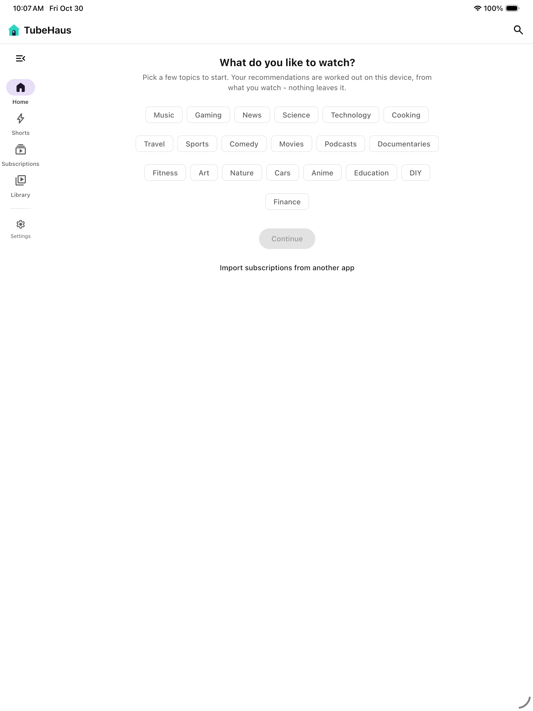

<div align="center">

# TubeHaus for iPad and iPhone

**YouTube on your own terms, on the iPad: no account, no tracking, and no server needed.**

The same TubeHaus app as on Android and the desktop, built for iOS. It talks to YouTube directly,
keeps your subscriptions, history and playlists on the iPad, and works out recommendations there too.

**[⬇ TubeHaus-0.5.7-ipad.ipa](https://github.com/biolend83/tubehaus/releases/download/app-v0.5.7/TubeHaus-0.5.7-ipad.ipa)** (iOS 16+, beta) · install it with **[Sideloadly](https://sideloadly.io/)**

[Android](https://github.com/biolend83/tubehaus/tree/android-app) · [Windows](https://github.com/biolend83/tubehaus/tree/windows-app) · [macOS](https://github.com/biolend83/tubehaus/tree/mac-app) · [Linux](https://github.com/biolend83/tubehaus/tree/linux-app) · **iPad / iPhone** · [Web app (self-hosted)](https://github.com/biolend83/tubehaus) · [All releases](https://github.com/biolend83/tubehaus/releases)



</div>

## Disclaimer

> [!CAUTION]
> **TubeHaus is independent, free, open-source software. It is not affiliated with, endorsed by or sponsored by YouTube or Google.** "YouTube" is a trademark of Google LLC.
>
> - TubeHaus does not host, store or distribute any videos. They come straight from YouTube to your own device (the app) or to a server you run yourself (the server version).
> - **Downloaded videos are for your own personal viewing.** Their copyright belongs to their owners. If you share, upload, sell or otherwise distribute them, that is entirely your own responsibility, and the authors are not liable for it.
> - It is provided "as is", without warranty of any kind, as the license says. The authors and contributors are not responsible for how it is used or for anything that results from using it.
> - You are responsible for using it in line with the laws where you live and the terms of the services you connect to.
> - The app talks only to YouTube (for videos), GitHub (to check for updates) and, if you connect one, your own TubeHaus server. The maintainer runs no server for it.
> - **Rights holders:** if you believe something in this repository infringes your rights, [open an issue](https://github.com/biolend83/tubehaus/issues/new) with the details (or ask there for a private contact). It will be looked at and, where justified, removed promptly.

## Why Sideloadly?

TubeHaus isn't in the App Store, and an iPad only installs apps Apple signed. With
[Sideloadly](https://sideloadly.io/) (free, Windows or Mac) you sign the app yourself with your own Apple ID.
There is no jailbreak and no paid developer account, and your Apple ID only goes to Apple.

## Install

1. Download **[TubeHaus-0.5.7-ipad.ipa](https://github.com/biolend83/tubehaus/releases/download/app-v0.5.7/TubeHaus-0.5.7-ipad.ipa)** and install **[Sideloadly](https://sideloadly.io/)** on your PC or Mac.
2. Connect the iPad with a cable (tap *Trust This Computer* on the iPad if it asks).
3. Drop the .ipa into Sideloadly, enter your Apple ID and press **Start**.
4. On the iPad: Settings → General → **VPN & Device Management** → tap your Apple ID → *Trust*.
5. If it asks, turn on Settings → Privacy & Security → **Developer Mode** and restart.

**Every 7 days:** with a free Apple ID the signature lasts 7 days. Sideloadly can re-sign the app by
itself over Wi-Fi (turn on its auto-refresh), or just repeat step 3. Your library stays.

**Updates:** install a newer .ipa over the old one the same way; your library stays. The YouTube
engine (see below) updates itself in between, so most fixes for YouTube changes arrive without
reinstalling.

## What it does

Everything the Android app does, with Apple's own player:

- **Player:** AVPlayer, adaptive quality up to 4K, captions, speed, resume where you stopped
- **Background play and picture-in-picture**, also starting by itself when you leave the app
- **Offline downloads:** save a video and watch it without internet (Library → Downloads)
- **Subscriptions without an account,** sorted into groups if you like. Import from YouTube (Google Takeout),
  NewPipe, FreeTube, Invidious, PocketTube (with its groups), TubeHaus or OPML. Pick the files in the Files app
- **Home that learns on the iPad,** Shorts, comments beside the video, search history, Calm mode, Focus switches
- **Sync with your own TubeHaus server (optional):** Settings → *TubeHaus server*, one library on the iPad,
  your other devices and the web version
- **Your files in the Files app:** a "TubeHaus" folder on the iPad holds backups you export and the engine files

## How it works

- **One code base:** the same Kotlin sources as the Android and desktop apps (`common/src`), compiled
  by Kotlin/Native into a framework, with Compose Multiplatform for the screens. The iOS-only parts
  (player, picture-in-picture, files, downloads) are in `ios/src` and `common/ios`.
- **A YouTube engine that updates itself:** on iOS the engine runs as JavaScript in Apple's
  JavaScriptCore (`ios/engine/engine.js`). Every 6 hours the app checks for a newer one from this
  branch and uses it, so a fix for a YouTube change doesn't need a new .ipa or re-signing.
- **TubePatch:** a small Kotlin compiler plugin (`ios/patch`) lets a `patch.js` replace marked
  functions and texts without a new build, for the same reason. It is used only in the iOS build;
  Android and the desktop apps don't contain it.

## Build

You need a Mac with Xcode 16+ and JDK 21. Or let GitHub do it: `.github/workflows/ios.yml` builds an
unsigned .ipa on GitHub's macOS runners and tries it in the iPad simulator.

```sh
./gradlew :ios:linkReleaseFrameworkIosArm64     # the Kotlin side: TubeHausKit.framework
brew install xcodegen
cd ios/app && xcodegen generate                 # TubeHaus.xcodeproj
xcodebuild -project TubeHaus.xcodeproj -scheme TubeHaus -sdk iphoneos -configuration Release   CODE_SIGNING_ALLOWED=NO                       # then zip Payload/TubeHaus.app as a .ipa
```

The Android and desktop builds are explained on the
[`android-app`](https://github.com/biolend83/tubehaus/tree/android-app) branch.

Most of the code is written with Claude Code.

## License

GPL-3.0.
